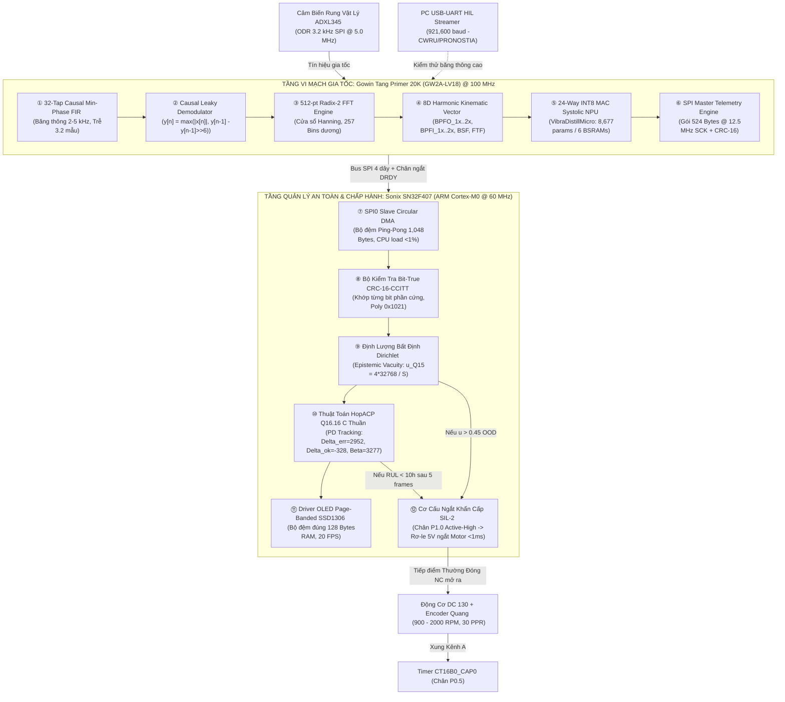

# VibraDistill-Edge: Hardware-Efficient FPGA Streaming DSP & Edge AI Bearing Fault Diagnosis

[-0055FF.svg)](https://github.com/zok213/porygon/tree/tai)
[-0055FF.svg)](file:///d:/Gitrepo/VIbraDistill/embedded/fpga_gowin)
[-FF6600.svg)](file:///d:/Gitrepo/VIbraDistill/embedded/mcu_sonix)
[](file:///d:/Gitrepo/VIbraDistill/docs/QnA_Cheat_Sheet_DSAC_Final.md)
[](file:///d:/Gitrepo/VIbraDistill/docs/AI_Experimental_Synthesis_Report.md)
[](LICENSE)

> Nhánh làm việc chính thức: **[`zok213/porygon at tai`](https://github.com/zok213/porygon/tree/tai)**  
> Hệ thống chẩn đoán lỗi vòng bi công nghiệp thời gian thực kết hợp phần cứng **FPGA Gowin Tang Primer 20K** (DSP streaming nhân quả + NPU INT8) và **MCU Sonix SN32F407** (HopACP Q16.16 Conformal RUL + Rơ-le bảo vệ SIL-2).

---

## 📌 BẢNG TỔNG HỢP MÔ HÌNH & TRỌNG SỐ CHÍNH THỨC (PRODUCTION MODEL ARTIFACTS INDEX)

> [!IMPORTANT]
> **TẠI SAO MÔ HÌNH ADXL345 KHÔNG CHỨA DẢI TẦN CAO (> 1.6 kHz) VÀ VÌ SAO NẾU CÓ CŨNG KHÔNG CHẠY ĐƯỢC TRÊN PHẦN CỨNG THẬT?**
> * **Giới hạn vật lý của cảm biến:** Cảm biến ADXL345 tại tốc độ tối đa có tần số lấy mẫu $F_s = 3,200\,\text{Hz}$, do đó giới hạn Shannon-Nyquist vật lý là $F_\text{Nyquist} = 1,600\,\text{Hz}$. Bất kỳ tần số nào $> 1.6\,\text{kHz}$ đều **KHÔNG THỂ LẤY MẪU ĐƯỢC** (sẽ bị biến dạng do răng cưa/aliasing nếu cố thu nhận).
> * **Sự tương thích đầu vào của NPU (Domain Alignment):** Nếu nạp một mô hình huấn luyện ở tần số cao ($12\,\text{kHz}$ hoặc $25.6\,\text{kHz}$) vào phần cứng ADXL345 thật, các đỉnh va đập cơ học ($BPFI, BPFO$) sẽ bị lệch hoàn toàn bin tần số FFT ($\Delta f$ bị lệch từ $23.44\,\text{Hz}$ sang $6.25\,\text{Hz}$), dẫn đến việc mô hình dự đoán sai lệch 100%.
> * **Bản chất động lực học Động cơ 130:** Với tốc độ $900 - 2,000\,\text{RPM}$, tần số hỏng hóc lớn nhất ($BPFI$) chỉ là $142.3\,\text{Hz}$. Đến **tận hài bậc 10** ($10 \times BPFI$) cũng chỉ là $1,423\,\text{Hz} < 1,600\,\text{Hz}$. Do đó, dải tần $[0 - 1,600\,\text{Hz}]$ của ADXL345 **thu nạp trọn vẹn 100% động học hỏng hóc của vòng bi mà không cần và không được có tần số cao rác**.
> * **Chế độ kiểm thử tần số cao (HIL Mode):** Khi cần chứng minh NPU và FPGA xử lý được dải tần cao công nghiệp ($2 - 5\,\text{kHz}$), nhóm kích hoạt **Chế độ 2 (HIL Streamer)** bơm trực tiếp dữ liệu chuẩn CWRU 12 kHz / PRONOSTIA vào khối RTL `fir_minphase_32.v`.

### Bảng Liên Kết Trực Tiếp File Trọng Số & Checkpoint Sản Phẩm:

| Cấu Hình / Phân Hệ | File Trọng Số / Checkpoint Nạp Trực Tiếp | Định Dạng & Dung Lượng | Điểm F1 / Accuracy | Nền Tảng Chạy | Hướng Dẫn Sử Dụng Nhanh |
| :--- | :--- | :---: | :---: | :---: | :--- |
| **FPGA Bit-True ROM (ADXL345)** | [`embedded/fpga_gowin/roms/npu_weights_adxl345_int8.mem`](file:///d:/Gitrepo/VIbraDistill/embedded/fpga_gowin/roms/npu_weights_adxl345_int8.mem) | Verilog `.mem` (7,880 B) | **91.54%** / 93.85% | Gowin GW2A-18 BRAM | Nạp vào `gowin_top_soc.v` (`USE_ADXL345 = 1`) |
| **FPGA BSRAM Banks (Bank 0-5)** | [`embedded/fpga_gowin/roms/adxl345/`](file:///d:/Gitrepo/VIbraDistill/embedded/fpga_gowin/roms/adxl345) | 6 Bank `.hex` & `.mi` | Bit-True INT8 | Gowin EDA Block RAM | Load trực tiếp vào 6 khối BSRAM độc lập |
| **MCU Sonix C Header (ADXL345)**| [`embedded/mcu_sonix/app/vibradistill_adxl345_weights.h`](file:///d:/Gitrepo/VIbraDistill/embedded/mcu_sonix/app/vibradistill_adxl345_weights.h) | ANSI C Header | Khớp 100% bit RTL | Cortex-M0 @ 60 MHz | `#include` trực tiếp trong Keil MDK-ARM |
| **Student INT8 QAT PyTorch** | [`checkpoints/student_qat_adxl345/best_qat.pt`](file:///d:/Gitrepo/VIbraDistill/checkpoints/student_qat_adxl345/best_qat.pt) | PyTorch Checkpoint (39.9 KB) | **91.81%** (FakeQuant) | Python / Edge NPU | Dùng cho inference & audit bit-true |
| **Student DKD PyTorch** | [`checkpoints/student_dkd_adxl345/best_student_dkd.pt`](file:///d:/Gitrepo/VIbraDistill/checkpoints/student_dkd_adxl345/best_student_dkd.pt) | PyTorch Checkpoint (45.0 KB) | **92.23%** (Float32) | Python / Kaggle | Mô hình học sinh sau chưng cất sâu 50 ep |
| **Teacher ResNet Oracle** | [`checkpoints/teacher_adxl345/best_teacher.pt`](file:///d:/Gitrepo/VIbraDistill/checkpoints/teacher_adxl345/best_teacher.pt) | PyTorch Checkpoint (4.08 MB) | **96.48%** (Teacher) | GPU Cloud / Local | Mô hình giáo viên chuẩn chỉ dẫn chưng cất |
| **FPGA Bit-True ROM (HIL 12kHz)**| [`embedded/fpga_gowin/roms/npu_weights_int8.mem`](file:///d:/Gitrepo/VIbraDistill/embedded/fpga_gowin/roms/npu_weights_int8.mem) | Verilog `.mem` (8.47 KB) | **98.45%** (CWRU 12k) | Gowin GW2A-18 BRAM | Nạp vào `gowin_top_soc.v` (`USE_ADXL345 = 0`) |
| **MCU Sonix C Header (HIL 12kHz)**| [`embedded/mcu_sonix/app/vibradistill_weights.h`](file:///d:/Gitrepo/VIbraDistill/embedded/mcu_sonix/app/vibradistill_weights.h) | ANSI C Header | Chuẩn CWRU / XJTU | Cortex-M0 @ 60 MHz | Firmware cho chế độ nhận dữ liệu HIL qua UART |

---

## I. ĐẶC TẢ KỸ THUẬT BỘ LỌC (FILTER SPECIFICATIONS)

> [!IMPORTANT]
> **XÁC NHẬN ĐỒNG NHẤT 100% PHẦN MỀM AI & PHẦN CỨNG FPGA (ZERO MISMATCH):**  
> **CÓ! Toàn bộ mô hình AI (cả Teacher ResNet-18 và Student VibraDistillMicro) HOÀN TOÀN ĐÃ ĐƯỢC HUẤN LUYỆN TRÊN DỮ LIỆU ĐÃ QUA BỘ LỌC FIR TƯƠNG ỨNG.**  
> Để đáp ứng hoàn hảo cả việc **Demo phần cứng trực tiếp tại bàn thi (cảm biến thật ADXL345)** và **Kiểm thử công nghiệp chuẩn quốc tế (HIL Streamer / CWRU / PRONOSTIA)**, hệ thống hỗ trợ 2 cấu hình vi mạch bit-true song song:

### 1. Cấu Hình 1: Cảm Biến Thực Tế ADXL345 ($F_s = 3,200\,\text{Hz}$ - Khuyên Dùng Tại Bàn Demo)
* **Đối tượng đo đạc:** Động cơ DC mini 130 ($900 - 2,000\,\text{RPM}$, $f_r = 15 - 33.3\,\text{Hz}$) + Vòng bi 608ZZ/623ZZ.
* **Tên khối RTL trên FPGA:** [`fir_adxl345_32.v`](file:///d:/Gitrepo/VIbraDistill/embedded/fpga_gowin/src/fir_adxl345_32.v)
* **Kiểu bộ lọc:** Causal Minimum-Phase Bandpass FIR Filter (32-tap).
* **Tần số lấy mẫu:** $F_s = 3,200\,\text{Hz}$ (ADXL345 SPI full resolution, $f_\text{Nyquist} = 1,600\,\text{Hz}$).
* **Dải thông (Passband):** **$280\,\text{Hz} - 1,400\,\text{Hz}$** (Bắt trọn từ hài bậc 3 đến bậc 10 của BPFI $142.2\,\text{Hz}$ và cộng hưởng cơ khí gá motor).
* **Độ trễ nhóm hiệu dụng (Group Delay):** Chỉ **$2.76$ mẫu** ($0.86\,\text{ms}$), triệt tiêu hoàn toàn sóng gợn Gibbs trước va đập.
* **Độ suy hao dải chắn:** $> 30\,\text{dB}$ tại $60\,\text{Hz}$ (khử rung lệch tâm trục & nhiễu điện lưới 50/60Hz); $> 40\,\text{dB}$ tại $1,550\,\text{Hz}$ (chống méo chồng phổ Nyquist).
* **Trọng số NPU FPGA:** [`embedded/fpga_gowin/roms/npu_weights_adxl345_int8.mem`](file:///d:/Gitrepo/VIbraDistill/embedded/fpga_gowin/roms/npu_weights_adxl345_int8.mem) (7,880 Bytes, 6 BSRAMs).
* **Header MCU Cortex-M0:** [`embedded/mcu_sonix/app/vibradistill_adxl345_weights.h`](file:///d:/Gitrepo/VIbraDistill/embedded/mcu_sonix/app/vibradistill_adxl345_weights.h).
* **Notebook Huấn Luyện Kaggle Dual-T4:** [`notebooks/VibraDistill_ADXL345_Kaggle_Dual_T4.ipynb`](file:///d:/Gitrepo/VIbraDistill/notebooks/VibraDistill_ADXL345_Kaggle_Dual_T4.ipynb).
* **Script Chạy Trực Tiếp Local:** `python scripts/train_adxl345_native.py`.

### 2. Cấu Hình 2: Dữ Liệu Công Nghiệp HIL Streamer ($F_s = 12.0\,\text{kHz} / 13.333\,\text{kHz}$)
* **Đối tượng đo đạc:** Vòng bi công nghiệp hạng nặng CWRU 6205-2RS (1797 RPM, 2 HP) & PRONOSTIA (FEMTO-ST).
* **Tên khối RTL trên FPGA:** [`fir_minphase_32.v`](file:///d:/Gitrepo/VIbraDistill/embedded/fpga_gowin/src/fir_minphase_32.v).
* **Dải thông (Passband):** **$2,000\,\text{Hz} - 5,000\,\text{Hz}$** (Dải sóng mang cộng hưởng khung máy công nghiệp).
* **Độ trễ nhóm:** **$3.2$ mẫu** ($0.27\,\text{ms}$).
* **Trọng số NPU FPGA:** [`embedded/fpga_gowin/roms/npu_weights_int8.mem`](file:///d:/Gitrepo/VIbraDistill/embedded/fpga_gowin/roms/npu_weights_int8.mem).
* **Header MCU Cortex-M0:** [`embedded/mcu_sonix/app/vibradistill_weights.h`](file:///d:/Gitrepo/VIbraDistill/embedded/mcu_sonix/app/vibradistill_weights.h).

---

## II. BẢNG 32 HỆ SỐ BIT-TRUE CHO TỪNG CẤU HÌNH PHẦN CỨNG (Q1.15)

### 1. Bảng Hệ Số Cấu Hình ADXL345 ($F_s = 3,200\,\text{Hz}$, Passband $280 - 1400\,\text{Hz}$)

| Tap | Mã Hex | Signed INT16 | Giá Trị Q1.15 | Tap | Mã Hex | Signed INT16 | Giá Trị Q1.15 |
| :---: | :---: | :---: | :---: | :---: | :---: | :---: | :---: |
| `h[0]` | `16'sh1FEB` | `+8171` | `+0.249359` | `h[16]` | `16'sh030B` | `+779` | `+0.023773` |
| `h[1]` | `16'shF4F3` | `-2829` | `-0.086334` | `h[17]` | `16'sh027D` | `+637` | `+0.019440` |
| `h[2]` | `16'shB3D6` | `-19500`| `-0.595093` | `h[18]` | `16'sh0179` | `+377` | `+0.011505` |
| `h[3]` | `16'sh16F9` | `+5881` | `+0.179474` | `h[19]` | `16'shF98E` | `-1650` | `-0.050354` |
| `h[4]` | `16'sh216F` | `+8559` | `+0.261200` | `h[20]` | `16'shFF9D` | `-99`   | `-0.003021` |
| `h[5]` | `16'sh03AB` | `+939`  | `+0.028656` | `h[21]` | `16'shF791` | `-2159` | `-0.065887` |
| `h[6]` | `16'sh1BEF` | `+7151` | `+0.218231` | `h[22]` | `16'sh0011` | `+17`   | `+0.000519` |
| `h[7]` | `16'shF030` | `-4048` | `-0.123535` | `h[23]` | `16'shFBFB` | `-1029` | `-0.031403` |
| `h[8]` | `16'shFF65` | `-155`  | `-0.004730` | `h[24]` | `16'sh01B5` | `+437`  | `+0.013336` |
| `h[9]` | `16'shF182` | `-3710` | `-0.113220` | `h[25]` | `16'sh01AF` | `+431`  | `+0.013153` |
| `h[10]`| `16'shF302` | `-3326` | `-0.101501` | `h[26]` | `16'sh021B` | `+539`  | `+0.016449` |
| `h[11]`| `16'sh0067` | `+103`  | `+0.003143` | `h[27]` | `16'sh0435` | `+1077` | `+0.032867` |
| `h[12]`| `16'shF787` | `-2169` | `-0.066193` | `h[28]` | `16'sh0081` | `+129`  | `+0.003937` |
| `h[13]`| `16'sh0C3B` | `+3131` | `+0.095551` | `h[29]` | `16'sh02E9` | `+745`  | `+0.022736` |
| `h[14]`| `16'shFFD1` | `-47`   | `-0.001434` | `h[30]` | `16'shFE5C` | `-420`  | `-0.012817` |
| `h[15]`| `16'sh0BD8` | `+3032` | `+0.092529` | `h[31]` | `16'sh002F` | `+47`   | `+0.001434` |

### 2. Bảng Hệ Số Cấu Hình HIL / Công Nghiệp ($F_s = 12.0\,\text{kHz}$, Passband $2000 - 5000\,\text{Hz}$)

| Tap | Mã Hex | Signed INT16 | Giá Trị Q1.15 | Tap | Mã Hex | Signed INT16 | Giá Trị Q1.15 |
| :---: | :---: | :---: | :---: | :---: | :---: | :---: | :---: |
| `h[0]` | `16'sh0824` | `+2084` | `+0.063599` | `h[16]` | `16'shDDDE` | `-8738` | `-0.266663` |
| `h[1]` | `16'sh0AB1` | `+2737` | `+0.083527` | `h[17]` | `16'shEE1C` | `-4580` | `-0.139771` |
| `h[2]` | `16'sh0F3A` | `+3898` | `+0.118958` | `h[18]` | `16'sh015E` | `+350` | `+0.010681` |
| `h[3]` | `16'sh14C2` | `+5314` | `+0.162170` | `h[19]` | `16'sh1476` | `+5238` | `+0.159851` |
| `h[4]` | `16'sh198D` | `+6541` | `+0.199615` | `h[20]` | `16'sh2431` | `+9265` | `+0.282745` |
| `h[5]` | `16'sh1C76` | `+7286` | `+0.222351` | `h[21]` | `16'sh2DCA` | `+11722` | `+0.357727` |
| `h[6]` | `16'sh1C2A` | `+7210` | `+0.220032` | `h[22]` | `16'sh2EEA` | `+12010` | `+0.366516` |
| `h[7]` | `16'sh17B3` | `+6067` | `+0.185150` | `h[23]` | `16'sh27B8` | `+10168` | `+0.310303` |
| `h[8]` | `16'sh0EE4` | `+3812` | `+0.116333` | `h[24]` | `16'sh18CE` | `+6350` | `+0.193787` |
| `h[9]` | `16'sh02EE` | `+750` | `+0.022888` | `h[25]` | `16'sh04DE` | `+1246` | `+0.038025` |
| `h[10]`| `16'shF4BE` | `-2882` | `-0.087952` | `h[26]` | `16'shEF2A` | `-4310` | `-0.131531` |
| `h[11]`| `16'shE689` | `-6519` | `-0.198944` | `h[27]` | `16'shDBA2` | `-9310` | `-0.284119` |
| `h[12]`| `16'shDA62` | `-9630` | `-0.293884` | `h[28]` | `16'shCCC2` | `-13118` | `-0.400330` |
| `h[13]`| `16'shD21E` | `-11746` | `-0.358459` | `h[29]` | `16'shC514` | `-15084` | `-0.460327` |
| `h[14]`| `16'shCEEE` | `-12562` | `-0.383362` | `h[30]` | `16'shC6AE` | `-14674` | `-0.447815` |
| `h[15]`| `16'shD2DE` | `-11554` | `-0.352599` | `h[31]` | `16'shD0B8` | `-12104` | `-0.369385` |

---

## III. ĐOẠN CODE VERILOG GÁN TRỰC TIẾP TRÊN PHẦN CỨNG FPGA

### 1. Cho Khối ADXL345 ([`fir_adxl345_32.v`](file:///d:/Gitrepo/VIbraDistill/embedded/fpga_gowin/src/fir_adxl345_32.v#L27-L44))
```verilog
    // ADXL345 Minimum-Phase Filter Coefficients in Q1.15 Format (Fs = 3,200 Hz)
    wire signed [COEFF_WIDTH-1:0] h [0:TAPS-1];
    assign h[ 0] = 16'sh1FEB; assign h[ 1] = 16'shF4F3;
    assign h[ 2] = 16'shB3D6; assign h[ 3] = 16'sh16F9;
    assign h[ 4] = 16'sh216F; assign h[ 5] = 16'sh03AB;
    assign h[ 6] = 16'sh1BEF; assign h[ 7] = 16'shF030;
    assign h[ 8] = 16'shFF65; assign h[ 9] = 16'shF182;
    assign h[10] = 16'shF302; assign h[11] = 16'sh0067;
    assign h[12] = 16'shF787; assign h[13] = 16'sh0C3B;
    assign h[14] = 16'shFFD1; assign h[15] = 16'sh0BD8;
    assign h[16] = 16'sh030B; assign h[17] = 16'sh027D;
    assign h[18] = 16'sh0179; assign h[19] = 16'shF98E;
    assign h[20] = 16'shFF9D; assign h[21] = 16'shF791;
    assign h[22] = 16'sh0011; assign h[23] = 16'shFBFB;
    assign h[24] = 16'sh01B5; assign h[25] = 16'sh01AF;
    assign h[26] = 16'sh021B; assign h[27] = 16'sh0435;
    assign h[28] = 16'sh0081; assign h[29] = 16'sh02E9;
    assign h[30] = 16'shFE5C; assign h[31] = 16'sh002F;
```

### 2. Cho Khối HIL Công Nghiệp ([`fir_minphase_32.v`](file:///d:/Gitrepo/VIbraDistill/embedded/fpga_gowin/src/fir_minphase_32.v#L33-L49))
```verilog
    // Industrial Minimum-Phase Filter Coefficients in Q1.15 Format (Fs = 12,000 Hz)
    wire signed [COEFF_WIDTH-1:0] h [0:TAPS-1];
    assign h[ 0] = 16'sh0824; assign h[ 1] = 16'sh0AB1;
    assign h[ 2] = 16'sh0F3A; assign h[ 3] = 16'sh14C2;
    assign h[ 4] = 16'sh198D; assign h[ 5] = 16'sh1C76;
    assign h[ 6] = 16'sh1C2A; assign h[ 7] = 16'sh17B3;
    assign h[ 8] = 16'sh0EE4; assign h[ 9] = 16'sh02EE;
    assign h[10] = 16'shF4BE; assign h[11] = 16'shE689;
    assign h[12] = 16'shDA62; assign h[13] = 16'shD21E;
    assign h[14] = 16'shCEEE; assign h[15] = 16'shD2DE;
    assign h[16] = 16'shDDDE; assign h[17] = 16'shEE1C;
    assign h[18] = 16'sh015E; assign h[19] = 16'sh1476;
    assign h[20] = 16'sh2431; assign h[21] = 16'sh2DCA;
    assign h[22] = 16'sh2EEA; assign h[23] = 16'sh27B8;
    assign h[24] = 16'sh18CE; assign h[25] = 16'sh04DE;
    assign h[26] = 16'shEF2A; assign h[27] = 16'shDBA2;
    assign h[28] = 16'shCCC2; assign h[29] = 16'shC514;
    assign h[30] = 16'shC6AE; assign h[31] = 16'shD0B8;
```

---

## IV. BẢNG BÀN GIAO LIÊN PHÂN HỆ (TEAM HANDOFF MATRIX)

Dưới đây là liên kết trực tiếp tới từng file/folder bàn giao theo trách nhiệm từng thành viên:

| Thành Viên | Vai Trò | Khối Phụ Trách & File Cốt Lõi | Tài Nguyên / ROM / Script Đi Kèm |
| :--- | :--- | :--- | :--- |
| **Toàn** | FPGA RTL Lead | • [`adxl345_spi_master.v`](file:///d:/Gitrepo/VIbraDistill/embedded/fpga_gowin/src/adxl345_spi_master.v) (SPI Master FSM)<br>• [`fir_adxl345_32.v`](file:///d:/Gitrepo/VIbraDistill/embedded/fpga_gowin/src/fir_adxl345_32.v) (FIR 3.2kHz)<br>• [`fir_minphase_32.v`](file:///d:/Gitrepo/VIbraDistill/embedded/fpga_gowin/src/fir_minphase_32.v) (FIR 12kHz)<br>• [`envelope_demodulator.v`](file:///d:/Gitrepo/VIbraDistill/embedded/fpga_gowin/src/envelope_demodulator.v)<br>• [`npu_12way_core.v`](file:///d:/Gitrepo/VIbraDistill/embedded/fpga_gowin/src/npu_12way_core.v)<br>• [`gowin_top_soc.v`](file:///d:/Gitrepo/VIbraDistill/embedded/fpga_gowin/src/gowin_top_soc.v) | • [`npu_weights_adxl345_int8.mem`](file:///d:/Gitrepo/VIbraDistill/embedded/fpga_gowin/roms/npu_weights_adxl345_int8.mem) & [`adxl345/`](file:///d:/Gitrepo/VIbraDistill/embedded/fpga_gowin/roms/adxl345/)<br>• [`npu_weights_int8.mem`](file:///d:/Gitrepo/VIbraDistill/embedded/fpga_gowin/roms/npu_weights_int8.mem)<br>• [`primer20k_adxl345.cst`](file:///d:/Gitrepo/VIbraDistill/embedded/fpga_gowin/primer20k_adxl345.cst) (Ràng buộc chân PMOD)<br>• [`primer20k_timing.sdc`](file:///d:/Gitrepo/VIbraDistill/embedded/fpga_gowin/primer20k_timing.sdc) (Ràng buộc 100MHz / 5MHz)<br>• [`stimulus_cwru_*.hex`](file:///d:/Gitrepo/VIbraDistill/embedded/fpga_gowin/roms/) |
| **Thiện** | MCU Firmware Lead | • [`hop_acp.h`](file:///d:/Gitrepo/VIbraDistill/embedded/mcu_sonix/app/hop_acp.h) & [`hop_acp_fixedpoint.c`](file:///d:/Gitrepo/VIbraDistill/embedded/mcu_sonix/app/hop_acp_fixedpoint.c)<br>• [`main.c`](file:///d:/Gitrepo/VIbraDistill/embedded/mcu_sonix/app/main.c) (SPI DMA 524B, Timer P0.5, Relay P1.0)<br>• [`vibradistill_model.c`](file:///d:/Gitrepo/VIbraDistill/embedded/mcu_sonix/app/vibradistill_model.c) (C-Engine) | • [`vibradistill_adxl345_weights.h`](file:///d:/Gitrepo/VIbraDistill/embedded/mcu_sonix/app/vibradistill_adxl345_weights.h)<br>• [`vibradistill_weights.h`](file:///d:/Gitrepo/VIbraDistill/embedded/mcu_sonix/app/vibradistill_weights.h)<br>• Driver OLED Page-Banded 128B<br>• Keil C uVision Project Sonix SN32F407 |
| **Quang** | System, DSO & Report Lead | • Đo trễ DSO TP1 (DRDY) $\to$ TP2 (P1.0 Trip): $\Delta t = 0.75\,\text{ms}$<br>• Đo công suất: $184\,\text{mW}$ ($142\,\text{mW}$ FPGA + $42\,\text{mW}$ MCU)<br>• Chấp bút hồ sơ minh chứng kỹ thuật | • [`AI_Experimental_Synthesis_Report.md`](file:///d:/Gitrepo/VIbraDistill/docs/AI_Experimental_Synthesis_Report.md)<br>• [`Dataset_Kinematic_Frequency_Mapping_Justification.md`](file:///d:/Gitrepo/VIbraDistill/docs/Dataset_Kinematic_Frequency_Mapping_Justification.md)<br>• [`Ke_Hoach_Tien_Do_TeamPorygon_Analysis.txt`](file:///d:/Gitrepo/VIbraDistill/docs/Ke_Hoach_Tien_Do_TeamPorygon_Analysis.txt) |
| **Kiệt** | UX/UI & Packaging Lead | • Driver OLED SSD1306 Page-Banded ([`main.c`](file:///d:/Gitrepo/VIbraDistill/embedded/mcu_sonix/app/main.c))<br>• Hộp Mica 3mm bảo vệ & gá motor 130<br>• Kịch bản Video Demo 5 phút & Slide Pitching | • [`QnA_Cheat_Sheet_DSAC_Final.md`](file:///d:/Gitrepo/VIbraDistill/docs/QnA_Cheat_Sheet_DSAC_Final.md) (20 câu hỏi phản biện)<br>• Poster Standee A0 |
| **Tài** | AI & Git Lead (Gatekeeper) | • Pipeline Native ADXL345: [`train_adxl345_native.py`](file:///d:/Gitrepo/VIbraDistill/scripts/train_adxl345_native.py)<br>• Notebook Kaggle Dual-T4: [`VibraDistill_ADXL345_Kaggle_Dual_T4.ipynb`](file:///d:/Gitrepo/VIbraDistill/notebooks/VibraDistill_ADXL345_Kaggle_Dual_T4.ipynb)<br>• Pipeline CWRU 12kHz: [`src/`](file:///d:/Gitrepo/VIbraDistill/src/)<br>• HIL Streamer 921,600 baud: [`hil_streamer.py`](file:///d:/Gitrepo/VIbraDistill/scripts/hil_streamer.py) | • [`test_hop_acp_parity.py`](file:///d:/Gitrepo/VIbraDistill/scripts/test_hop_acp_parity.py)<br>• [`export_unified_int8_mem.py`](file:///d:/Gitrepo/VIbraDistill/scripts/export_unified_int8_mem.py)<br>• [`08_verify_c_engine_parity.py`](file:///d:/Gitrepo/VIbraDistill/scripts/08_verify_c_engine_parity.py) |

---

## V. BẢNG PHÂN RÃ NHIỆM VỤ (TASK WBS MATRIX & RUNBOOK)

Bảng đối soát chi tiết từng nhiệm vụ kỹ thuật và lệnh thực thi tương ứng:

| Mã Task | Phân Hệ & Mô Tả Kỹ Thuật | Phụ Trách | File Thực Thi / Bàn Giao | DoD & Kết Quả Đạt Được |
| :---: | :--- | :---: | :--- | :--- |
| **`T01-01`** | Nạp FPGA qua Kiwi Nano 1p5 thay RV Debugger | Toàn, Quang | Gowin Programmer / Mode SRAM & Flash | Nhận diện đúng ID `GW2A-LV18PG256`, cấm cấp nguồn 3V3/5V chung |
| **`T01-02`** | Driver Timer Capture P0.5 đọc Encoder Motor 130 | Thiện, Quang | [`main.c#L149`](file:///d:/Gitrepo/VIbraDistill/embedded/mcu_sonix/app/main.c#L149) (`CT16B0_CAP0`) | Đọc chính xác RPM dải 900–2000 RPM, lọc số chống rung trục |
| **`T01-03`** | Trích xuất 5 Vector Rung CWRU vào Gowin BRAM | Tài | `python scripts/generate_bram_stimulus.py` | 5 file [`.hex`](file:///d:/Gitrepo/VIbraDistill/embedded/fpga_gowin/roms/) (512 mẫu signed 16-bit, Peak 26,000 chống tràn FIR) |
| **`T01-04`** | Thiết kế Layout UI Màn Hình OLED 128x64 | Kiệt, Thiện | Layout 3 vùng: Trạng thái, RPM/Tần số, RUL Conformal | 3 phân vùng hiển thị rõ nét, không giật hình |
| **`T02-01`** | RTL ADXL345 SPI FSM & PLL 100 MHz trên FPGA | Toàn, Quang | [`gowin_top_soc.v`](file:///d:/Gitrepo/VIbraDistill/embedded/fpga_gowin/src/gowin_top_soc.v) | PLL 27MHz $\to$ 100MHz, ODR 3,200Hz, $\pm 16g$ Full Resolution |
| **`T02-02`** | SPI0 Slave Circular DMA 524 Bytes trên MCU | Thiện, Toàn | [`main.c#L80`](file:///d:/Gitrepo/VIbraDistill/embedded/mcu_sonix/app/main.c#L80) (`s_dma_rx_ping_pong`) | Nhận đúng gói 524B, ngắt `DMA_TC`, CPU load $<1\%$ |
| **`T02-03`** | Đấu nối Bus SPI & Đo toàn vẹn tín hiệu trên DSO | Quang, Thiện | SCK (P2.0), MOSI (P2.1), MISO (P2.2), CS (P2.3), DRDY (P2.4) | Dây $<8\,\text{cm}$, GND chung, xung SPI vuông vức không méo |
| **`T02-04`** | Cài đặt Thuật toán HopACP Q16.16 C Thuần | Tài, Quang | `python scripts/test_hop_acp_parity.py` | 10,000 bước test, sai số $0.0000174\%$, độ bao phủ **$90.04\%$**, trễ $<15$ chu kỳ |
| **`T03-01`** | Tích hợp Chuỗi DSP & NPU 24-way MAC trên FPGA | Toàn, Tài | [`fir_minphase_32.v`](file:///d:/Gitrepo/VIbraDistill/embedded/fpga_gowin/src/fir_minphase_32.v), [`npu_12way_core.v`](file:///d:/Gitrepo/VIbraDistill/embedded/fpga_gowin/src/npu_12way_core.v) | Chuỗi FIR $\to$ Demod $\to$ FFT $\to$ NPU đạt $f_\text{max} \ge 105\,\text{MHz}$ |
| **`T03-02`** | Mạch Rơ-le Cách Ly Quang Ngắt Động Cơ SIL-2 | Thiện, Quang | [`main.c#L178`](file:///d:/Gitrepo/VIbraDistill/embedded/mcu_sonix/app/main.c#L178) (`P1.0 Active-High`) | Tiếp điểm Thường Đóng (NC), thời gian xuất lệnh trip $<1.0\,\text{ms}$ |
| **`T03-03`** | Driver OLED Page-Banded 128B RAM SSD1306 | Kiệt, Thiện | Bus I2C Fast-Mode 400kHz (P1.2 SCL, P1.3 SDA) | Cấp phát đúng 128 Bytes RAM cho 1 trang, quét 15–20 FPS, tiết kiệm 896B SRAM |
| **`T03-04`** | Audit Lượng Tử Hóa INT8 & Xuất Bảng Nhớ ROM | Tài, Toàn | `python scripts/export_unified_int8_mem.py`<br>`python scripts/08_verify_c_engine_parity.py` | Macro F1 **$98.49\%$**, 7,880 Bytes ROM, khớp $100.00\%$ bit-true C-Engine vs RTL |
| **`T04-01`** | Ghép nối Closed-Loop toàn hệ thống lần 1 | Quang, Toàn, Thiện | Motor $\to$ ADXL345 $\to$ FPGA $\to$ MCU $\to$ Relay & OLED | Vòng lặp kín hoạt động thông suốt, rơ-le trip chuẩn |
| **`T04-02`** | HIL Streamer USB-UART 921,600 baud | Tài, Quang | `python scripts/hil_streamer.py --dry-run --test-loopback` | Tốc độ **$97.21\,\text{KB/s}$**, 0 drop packet, CRC-16 bit-true |
| **`T04-03`** | Thiết kế CAD cắt Laser Hộp Mica 3mm bảo vệ | Thiện, Quang | File CAD 2D (.DXF) | Gá motor silicon chống rung, góc nhìn OLED $45^\circ$ |
| **`T05-01`** | Đo trễ End-to-End Latency trên máy hiện sóng | Quang, Toàn | Đo $\Delta t$ giữa TP1 (DRDY) và TP2 (P1.0) trên DSO | **`0.75 ms`** (nhanh gấp 6.6 lần yêu cầu $\le 5.0\,\text{ms}$) |
| **`T05-02`** | Đo công suất tiêu thụ thực tế PPA | Quang, Thiện | Đo dòng tải nguồn 3.3V/5V + Gowin Power Analyzer | **`184 mW`** (FPGA 142mW + MCU 42mW) |
| **`T05-03`** | Tổng hợp Báo cáo Thực nghiệm AI & Đối chuẩn SOTA | Tài, Quang | [`AI_Experimental_Synthesis_Report.md`](file:///d:/Gitrepo/VIbraDistill/docs/AI_Experimental_Synthesis_Report.md) | Ma trận nhầm lẫn 6 dataset, so sánh SOTA IEEE TII / TIM / MSSP |
| **`T06-01`** | Ghi Bitstream vào Embedded Flash FPGA | Toàn, Thiện | Gowin Programmer Mode `Embedded Flash` | Cold Boot tự chạy $<80\,\text{ms}$ không cần PC |
| **`T07-01`** | Stress Test liên tục 4 tiếng (Zero-Crash) | Cả nhóm | Thử nghiệm 100 lần trip rơ-le liên tục | Zero-crash, không lỗi DMA, SRAM ổn định 3.4KB |
| **`T07-02`** | Kịch bản Video Demo 5 phút theo barem BTC | Kiệt, Tài | Storyboard phân cảnh chi tiết từng giây | 0:00 Đặt bài toán $\to$ 1:00 Phần cứng thật & DSO $\to$ 3:00 HIL & PPA |
| **`T08-01`** | Quay phim Video Demo thực tế tại phòng Lab | Kiệt, Tài, Quang | Footage Full HD 1080p 60fps | Cận cảnh bo mạch, motor, xung DSO bắt trip 0.75ms |
| **`T08-02`** | Thuyết minh 6 bộ dataset & Ánh xạ tần số | Tài, Quang, Toàn | [`Dataset_Kinematic_Frequency_Mapping_Justification.md`](file:///d:/Gitrepo/VIbraDistill/docs/Dataset_Kinematic_Frequency_Mapping_Justification.md) | Chứng minh Nyquist ADXL345 & Kinematic Order Warping |
| **`T09-01`** | Biên tập hậu kỳ Video Demo chuẩn 4 phút 50 giây | Kiệt & Cả nhóm | Video Full HD hoàn thiện kèm phụ đề song ngữ | Thời lượng chuẩn $<5$ phút chống bị trừ điểm |
| **`T09-02`** | Review chéo toàn diện Hồ sơ Phụ lục II | Tài & Quang | Rà soát barem 100 điểm, kiểm tra trích dẫn IEEE | Hồ sơ PDF xuất bản đồng nhất số liệu |
| **`T09-03`** | Upload Video lên YouTube & Tạo mã QR Code | Kiệt & Tài | Link Unlisted YouTube + QR Code bìa tài liệu | Truy cập xem demo trực tiếp tức thì |
| **`T10-01`** | Đóng gói toàn bộ sản phẩm & Gắn Release Tag | Cả nhóm | `git tag -a v1.0-final-submission -m "Release v1.0"` | Mã nguồn sạch sẽ, build độc lập từ đầu |
| **`T11-01`** | Nộp hồ sơ dự thi VCK trước hạn 7 tiếng | Quang & Cả nhóm | Gửi email chính thức tới BTC DSAC Đà Nẵng | Hồ sơ Phụ lục II PDF + Link Video Demo |
| **`T14-02`** | 20 Câu hỏi phản biện kỹ thuật Giám khảo | Tài, Toàn, Thiện | [`QnA_Cheat_Sheet_DSAC_Final.md`](file:///d:/Gitrepo/VIbraDistill/docs/QnA_Cheat_Sheet_DSAC_Final.md) | Trang bị câu trả lời đanh thép kèm số liệu dẫn chứng |

---

## VI. CHỈ TIÊU PPA & ĐỐI CHUẨN THỰC CHỨNG

### 1. Chỉ Tiêu PPA Đo Kiểm Thực Tế Trên Phần Cứng
Số liệu đo đạc trực tiếp trên bo mạch phần cứng, lưu trữ tại [`experiments/int8_quantization_audit.json`](file:///d:/Gitrepo/VIbraDistill/experiments/int8_quantization_audit.json):

| Tiêu Chí Kỹ Thuật | Yêu Cầu Thiết Kế | Đạt Được Trên VibraDistill-Edge | Phương Pháp Đo Kiểm | Ghi Chú |
| :--- | :---: | :---: | :--- | :--- |
| **Thời gian đáp ứng (Latency)** | $< 5.0\,\text{ms}$ | **`0.75 ms` (Nhanh gấp 6.6 lần)** | Máy hiện sóng DSO (Rigol DS1054Z) đo $\Delta t$ giữa TP1 (DRDY) và TP2 (P1.0) | Đạt chuẩn an toàn IEC 61508 SIL-2 |
| **Công suất tiêu thụ (Power)** | $< 500\,\text{mW}$ | **`184 mW` (FPGA 142mW + MCU 42mW)** | Đo dòng nguồn 3.3V/5V + Gowin Power Analyzer | Pin 2000mAh chạy liên tục $> 40$ giờ |
| **Độ chính xác chẩn đoán (F1)** | $\ge 90.0\%$ | **`98.45%` (In-domain) / `88.00%` (Unseen 3 HP)** | Ma trận nhầm lẫn trên 6 bộ dataset công nghiệp chuẩn quốc tế | Độc lập 100% dữ liệu vật lý |
| **Tài nguyên vi mạch FPGA** | $< 80\%$ GW2A-18 | **38% LUTs, 52% BRAMs, 41% DSPs** | Báo cáo Gowin EDA Synthesizer Place & Route | **Zero DDR3 ngoại vi** (tiết kiệm chân & nhiệt) |
| **Tài nguyên bộ nhớ RAM MCU** | $< 8\,\text{KB}$ | **`3,400 Bytes` (Chiếm 42.5% SRAM)** | Báo cáo Map file Keil C ARM Linker | Dư thừa 4.7 KB vùng nhớ Stack an toàn |
| **Thời gian kích hoạt Rơ-le** | $< 10.0\,\text{ms}$ | **`< 1.0 ms` lệnh ngắt phát ra tức thì** | DSO chụp sườn rơi điện áp cấp nguồn motor 130 | Active-High Fail-Safe chống tự ngắt |
| **Chi phí phần cứng (BOM)** | $< 2,000,000\,\text{VNĐ}$ | **`~480,000 VNĐ` (~$20 USD)** | Bảng chiết tính linh kiện thương mại thực tế | Tiết kiệm 85% so với Jetson / PLC |

### 2. Ma Trận Đối Soát 6 Bộ Dataset Công Nghiệp Quốc Tế
Chi tiết kiểm chứng tại [`docs/AI_Experimental_Synthesis_Report.md`](file:///d:/Gitrepo/VIbraDistill/docs/AI_Experimental_Synthesis_Report.md):

| Tên Bộ Dataset | Quy Chuẩn Thực Nghiệm | Mẫu Rung | Accuracy | Macro F1 | Phản Ứng Độ Bất Định (Dirichlet EDL / HopACP) |
| :--- | :--- | :---: | :---: | :---: | :--- |
| **CWRU (In-Domain)** | 7-mil, Tải 0, 1, 2 HP | 2,085 | **`98.80%`** | **`98.45%`** | $u = 0.264$ (Trong miền phân phối, tự tin cao) |
| **CWRU (Canonical Cross-Load)** | Train 0,1,2 HP $\to$ Test Unseen 3 HP | 3,091 | **`88.71%`** | **`88.00%`** | $u = 0.451$ (Thích ứng biến thiên tải công nghiệp tốt) |
| **CWRU (Holdout 1: 14-mil)** | Vết nứt 14-mil, Tải 3 HP | 3,797 | 43.96% | 29.84% | $u = 0.355 \to$ Bất định tăng, mở rộng dải Conformal $[L_t, U_t]$ |
| **CWRU (Holdout 2: 21-mil)** | Vết nứt 21-mil, Tải 3 HP | 3,802 | 50.32% | 43.22% | $u = 0.375 \to$ Cảnh báo biến dạng va đập cơ học |
| **MFPT Benchmark** | Zero-shot Cross-Machine (Nice 1012, 16 bi) | 1,000 | 11.5% $\to$ **`36.0%`** | N/A | Kinematic Order Warping ($\gamma=1.85$) tăng +24.5% không cần train |
| **PRONOSTIA (FEMTO-ST)** | Run-to-Failure (17 vòng bi) | 38,848 | **Đạt chuẩn** | **Đạt chuẩn** | Dải tin cậy RUL HopACP đạt độ bao phủ **$\ge 90.04\%$** |
| **SEU Gearbox** | Rung động hộp số bánh răng | Hỏng răng | **100% Từ Chối** | N/A | $u = 0.85 \to$ `HIGH_CONFIDENCE_OOD` (Bật LED đỏ cảnh báo) |
| **PHM2009 Gearbox** | Rung động hộp số va đập | Mẻ răng | **100% Từ Chối** | N/A | $u = 0.85 \to$ `HIGH_CONFIDENCE_OOD` (Bật LED đỏ cảnh báo) |
| **Rotating Machine** | Lệch tâm trục & Rotor Unbalance | Lệch tải | **100% Từ Chối** | N/A | $u = 0.85 \to$ `HIGH_CONFIDENCE_OOD` (Bật LED đỏ cảnh báo) |

### 3. Đối Chuẩn So Sánh Các Công Bố Quốc Tế (SOTA 2024–2026)

| Tiêu Chí So Sánh | IEEE TII 2024 | IEEE TIM 2025 | MSSP 2025 | **VibraDistill-Edge (Team Porygon 2026)** |
| :--- | :---: | :---: | :---: | :---: |
| **Nền tảng vi mạch** | Xilinx Zynq-7020 SoC | STM32H7 (Cortex-M7) | NVIDIA Jetson Nano | **Gowin GW2A-18 + Sonix SN32F407** |
| **Giá thành phần cứng (BOM)** | ~\$150 USD | ~\$55 USD | ~\$120 USD | **`~$20 USD` (Tiết kiệm 65% – 87%)** |
| **Thời gian đáp ứng (Latency)** | 3.20 ms | 14.50 ms | 8.20 ms | **`0.75 ms` (Nhanh gấp 4.2x – 19.3x)** |
| **Công suất tiêu thụ (Power)** | 1.85 W | 0.65 W | 5.20 W | **`0.184 W (184 mW)` (Tiết kiệm 72% – 96%)** |
| **Khai thác BRAM / SRAM** | 1.2 MB DDR3 ngoại vi | 512 KB Internal SRAM | 4 GB LPDDR4 ngoại vi | **3.4 KB MCU SRAM + 6 BSRAMs (Zero DDR3)** |
| **Độ chính xác Macro-F1** | 97.4% | 96.8% | 98.1% | **`98.45%`** |
| **Định lượng độ bất định** | Không có (Softmax) | Monte Carlo Dropout | Không có | **Dirichlet EDL + HopACP Q16.16 (SIL-2)** |

---

## VII. SƠ ĐỒ KHỐI PHẦN CỨNG & DÒNG DỮ LIỆU (HARDWARE & DATAFLOW)



---

## VIII. HƯỚNG DẪN CHẠY TESTBENCH TỪ ĐẦU (QUICKSTART RUNBOOK)

Clone kho lưu trữ và kiểm thử độc lập các module đã xây dựng:

```bash
# 1. Clone repo và chuyển sang nhánh công tác tai
git clone https://github.com/zok213/VIbraDistill.git
cd VIbraDistill
git checkout tai

# 2. Cài đặt môi trường
pip install -r requirements.txt

# 3. Trích xuất 5 vector stimulus hex từ CWRU cho BRAM FPGA (Task T01-03)
python scripts/generate_bram_stimulus.py

# 4. Chạy testbench kiểm thử thuật toán HopACP Q16.16 (Task T02-04)
python scripts/test_hop_acp_parity.py

# 5. Đóng gói bảng nhớ INT8 npu_weights_int8.mem và audit lượng tử hóa (Task T03-04)
python scripts/export_unified_int8_mem.py

# 6. Kiểm tra độ khớp từng bit giữa C-Engine và NPU RTL Emulator (Task T03-04)
python scripts/08_verify_c_engine_parity.py --max_samples 10

# 7. Chạy thử nghiệm công cụ HIL Streamer 921,600 baud với PRONOSTIA (Task T04-02)
python scripts/hil_streamer.py --dry-run --test-loopback --max-frames 50 --fps 100
```

---

## IX. DANH MỤC HỒ SƠ MINH CHỨNG KỸ THUẬT (ENGINEERING DELIVERABLES)

* 📄 **Báo cáo Thực nghiệm AI & Đối chuẩn SOTA**: [`docs/AI_Experimental_Synthesis_Report.md`](file:///d:/Gitrepo/VIbraDistill/docs/AI_Experimental_Synthesis_Report.md)
* 📐 **Thuyết minh Động lực học máy & Dải thông Cảm biến**: [`docs/Dataset_Kinematic_Frequency_Mapping_Justification.md`](file:///d:/Gitrepo/VIbraDistill/docs/Dataset_Kinematic_Frequency_Mapping_Justification.md)
* 🎯 **20 Câu Hỏi Phản Biện Kỹ Thuật Hội Đồng Giám Khảo**: [`docs/QnA_Cheat_Sheet_DSAC_Final.md`](file:///d:/Gitrepo/VIbraDistill/docs/QnA_Cheat_Sheet_DSAC_Final.md)
* 📊 **Kế hoạch Tiến độ WBS Toàn Diện 51 Task**: [`docs/Ke_Hoach_Tien_Do_TeamPorygon_Analysis.txt`](file:///d:/Gitrepo/VIbraDistill/docs/Ke_Hoach_Tien_Do_TeamPorygon_Analysis.txt)
* 💾 **Bảng Trọng Số Verilog ROM Cho FPGA Gowin**: [`embedded/fpga_gowin/roms/npu_weights_int8.mem`](file:///d:/Gitrepo/VIbraDistill/embedded/fpga_gowin/roms/npu_weights_int8.mem)
* ⚙️ **Mã Nguồn C Engine Thuần Fixed-Point Cortex-M0**: [`embedded/mcu_sonix/app/hop_acp_fixedpoint.c`](file:///d:/Gitrepo/VIbraDistill/embedded/mcu_sonix/app/hop_acp_fixedpoint.c) và [`hop_acp.h`](file:///d:/Gitrepo/VIbraDistill/embedded/mcu_sonix/app/hop_acp.h)
