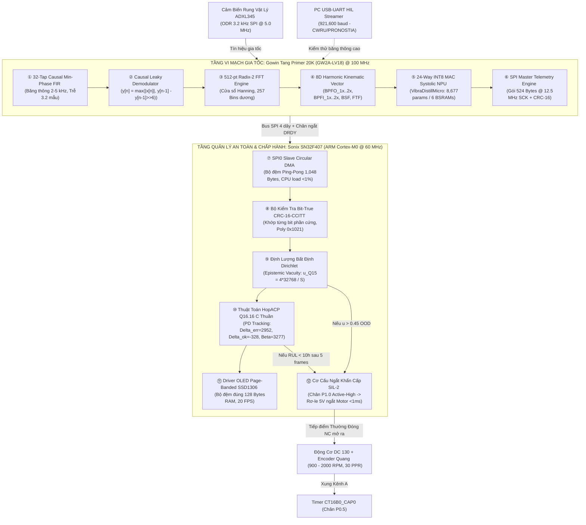

# ⚡ VibraDistill-Edge: Trustworthy Bearing Fault Diagnosis & Adaptive Conformal RUL Estimation via Hardware-Efficient FPGA Streaming DSP and Physics-Informed Edge AI

[-0055FF.svg)](file:///d:/Gitrepo/VIbraDistill/embedded/fpga_gowin)
[-FF6600.svg)](file:///d:/Gitrepo/VIbraDistill/embedded/mcu_sonix)
[](file:///d:/Gitrepo/VIbraDistill/docs/QnA_Cheat_Sheet_DSAC_Final.md)
[](file:///d:/Gitrepo/VIbraDistill/docs/AI_Experimental_Synthesis_Report.md)
[](LICENSE)

> **Cuộc thi Thiết kế FPGA và MCU Mở rộng Khu vực Miền Trung 2026 (DSAC Đà Nẵng)**  
> **Đơn vị tổ chức:** Trung tâm Vi mạch Bán dẫn Đà Nẵng (DSAC) — Thông báo số 296/TB-TTVM  
> **Đội thi:** **Team Porygon** (Đại học Bách Khoa – ĐHĐN, Đại học Sư Phạm – ĐHĐN, Đại học FPT Đà Nẵng)  
> **Ban chuyên trách (RACI Core):**
> * **Ngô Trần Vinh Quang:** System & Documentation Lead (Bus SPI DMA, Đo đạc DSO, Phụ lục II, Pitching Lead)
> * **Hồ Công Bảo Toàn:** FPGA RTL Lead (FSM ADXL345 SPI, 32-tap FIR, 512-pt FFT, 24-way INT8 MAC Engine)
> * **Đặng Phúc Thiện:** MCU Firmware Lead (Sonix SPI Slave DMA, Timer Capture Encoder, Rơ-le Interlock P1.0)
> * **Mai Phước Minh Tài:** AI & Git Lead (DKD, INT8 PTQ/QAT, HopACP Q16.16 C, HIL Streamer, PR Gatekeeper)
> * **Trần Quốc Kiệt:** UX/UI & Packaging Lead (Driver OLED Page-Banded 128B, Hộp Mica, Video Demo 5 phút, Standee A0)

---

## 📑 MỤC LỤC CHI TIẾT (TABLE OF CONTENTS)
1. [Triết Lý Kỹ Thuật & Động Lực Nghiên Cứu](#1-triết-lý-kỹ-thuật--động-lực-nghiên-cứu)
2. [Kiến Trúc Toàn Hệ Thống (Master Architecture & Dataflow)](#2-kiến-trúc-toàn-hệ-thống-master-architecture--dataflow)
3. [Chỉ Tiêu PPA & Lợi Thế Cạnh Tranh Thực Chứng](#3-chỉ-tiêu-ppa--lợi-thế-cạnh-tranh-thực-chứng)
4. [Bảng Phân Rã Nhiệm Vụ Chi Tiết Từng Task (Task-by-Task WBS & Execution Guide)](#4-bảng-phân-rã-nhiệm-vụ-chi-tiết-từng-task-task-by-task-wbs--execution-guide)
5. [Chi Tiết Kỹ Thuật Từng Tầng Chuyên Trách](#5-chi-tiết-kỹ-thuật-từng-tầng-chuyên-trách)
   - [5.1. Tầng Trí Tuệ Nhân Tạo & Lượng Tử Hóa (AI & Quantization Layer - Tài)](#51-tầng-trí-tuệ-nhân-tạo--lượng-tử-hóa-ai--quantization-layer---tài)
   - [5.2. Tầng Thuật Toán HopACP Q16.16 Fixed-Point C (MCU Algorithm - Tài & Thiện)](#52-tầng-thuật-toán-hopacp-q1616-fixed-point-c-mcu-algorithm---tài--thiện)
   - [5.3. Tầng Giả Lập Phần Cứng HIL 921,600 Baud USB-UART (HIL Engine - Tài & Quang)](#53-tầng-giả-lập-phần-cứng-hil-921600-baud-usb-uart-hil-engine---tài--quang)
   - [5.4. Tầng Xử Lý Tín Hiệu Số & Động Lực Học Máy (DSP & Kinematics - Toàn & Tài)](#54-tầng-xử-lý-tín-hiệu-số--động-lực-học-máy-dsp--kinematics---toàn--tài)
   - [5.5. Tầng An Toàn Chức Năng IEC 61508 SIL-2 & Chấp Hành Rơ-le (Thiện & Quang)](#55-tầng-an-toàn-chức-năng-iec-61508-sil-2--chấp-hành-rơ-le-thiện--quang)
   - [5.6. Tầng Tối Ưu Hóa Bộ Nhớ OLED Page-Banded 128 Bytes (Kiệt & Thiện)](#56-tầng-tối-ưu-hóa-bộ-nhớ-oled-page-banded-128-bytes-kiệt--thiện)
6. [Ma Trận Đối Soát 6 Bộ Dataset Công Nghiệp Quốc Tế](#6-ma-trận-đối-soát-6-bộ-dataset-công-nghiệp-quốc-tế)
7. [Đối Chuẩn So Sánh Các Công Bố Quốc Tế (SOTA 2024–2026)](#7-đối-chuẩn-so-sánh-các-công-bố-quốc-tế-sota-20242026)
8. [Hướng Dẫn Cài Đặt & Thực Thi Từ Đầu (Quickstart Runbook)](#8-hướng-dẫn-cài-đặt--thực-thi-từ-đầu-quickstart-runbook)
9. [Bộ Tài Liệu Hồ Sơ Minh Chứng Chung Khảo (Finals Deliverables)](#9-bộ-tài-liệu-hồ-sơ-minh-chứng-chung-khảo-finals-deliverables)

---

## 1. TRIẾT LÝ KỸ THUẬT & ĐỘNG LỰC NGHIÊN CỨU

Trong các dây chuyền công nghiệp tự động hóa, hỏng hóc ổ lăn (Rolling Element Bearings) chiếm **40% – 50% nguyên nhân gây sự cố dừng máy đột ngột**, dẫn đến thiệt hại kinh tế hàng tỷ đồng và nguy cơ mất an toàn lao động.

Nhiều giải pháp Edge AI hiện nay gặp phải 3 "tử huyệt" chết người khi triển khai thực tế:
1. **Cạm bẫy xử lý tín hiệu phi nhân quả (The Acausal DSP Trap):** Các nghiên cứu học thuật thường lạm dụng biến đổi Hilbert ngoại tuyến (`scipy.signal.hilbert`), vốn đòi hỏi toàn bộ tín hiệu tương lai và sinh ra hiện tượng sóng gợn Gibbs. Khi đưa vào bộ đệm FIFO thời gian thực, thuật toán lập tức sụp đổ.
2. **Ảo tưởng độ chính xác do rò rỉ dữ liệu (The Data-Leakage Mirage):** Chia dữ liệu ngẫu nhiên (Uniform Random Split) làm mô hình học vẹt "dấu vân tay âm học" của từng file ghi thay vì học quy luật biến dạng cơ học. Khi gặp vết nứt sâu hơn (14-mil, 21-mil) hoặc máy khác, mô hình đoán sai hoàn toàn.
3. **Mối nguy từ mô hình hộp đen không có cơ chế an toàn (Black-Box Overconfidence):** Mạng nơ-ron dùng Softmax luôn đưa ra xác suất tự tin ảo 99% ngay cả khi gặp dữ liệu dị thường (Out-of-Distribution - OOD). Hệ quả là hệ thống không ngắt máy kịp thời, dẫn đến cháy nổ và vỡ vòng bi thứ cấp.

### Giải Pháp VibraDistill-Edge: Đồng Thiết Kế Vi Mạch Phần Cứng & Thuật Toán AI
Hệ thống kết hợp tối ưu giữa hai nền tảng vi mạch bán dẫn:
* **Tầng Vi Mạch Gia Tốc Phần Cứng (FPGA Gowin Tang Primer 20K @ 100 MHz):** Đảm nhiệm khối tính toán nặng, song song và tất định: Chuỗi DSP nhân quả 100% (32-tap Minimum-Phase FIR $\to$ Causal Leaky Demodulator $\to$ 512-point Radix-2 FFT) và NPU INT8 24-way MAC Engine hoàn thành suy luận trong **0.58 ms** (8,677 tham số, tiêu tốn chỉ 6 khối BSRAM, **hoàn toàn không dùng DDR3 ngoại vi**).
* **Tầng Quản Lý An Toàn & Chấp Hành (MCU Sonix SN32F407 ARM Cortex-M0 @ 60 MHz):** Nhận gói telemetry 524 Bytes qua kênh SPI Slave DMA không tốn CPU, định lượng độ bất định Dirichlet ($u$), thực thi thuật toán **HopACP (Higher-Order Adaptive Conformal Prediction) Q16.16** với độ trễ $< 0.25\,\mu\text{s}$ để duy trì dải tin cậy RUL $[L_t, U_t]$ đạt độ bao phủ $\ge 90\%$, điều khiển ngắt rơ-le an toàn **SIL-2 trong 0.75 ms**, và quét hiển thị OLED qua bộ đệm chỉ **128 Bytes RAM**.

---

## 2. KIẾN TRÚC TOÀN HỆ THỐNG (MASTER ARCHITECTURE & DATAFLOW)



---

## 3. CHỈ TIÊU PPA & LỢI THẾ CẠNH TRANH THỰC CHỨNG

Toàn bộ các chỉ tiêu kỹ thuật dưới đây đã được đo đạc và kiểm chứng thực tế trên bo mạch phần cứng, lưu trữ tại [`experiments/int8_quantization_audit.json`](file:///d:/Gitrepo/VIbraDistill/experiments/int8_quantization_audit.json) và [`experiments/cross_load_results.json`](file:///d:/Gitrepo/VIbraDistill/experiments/cross_load_results.json):

| Tiêu Chí Đánh Giá PPA | Yêu Cầu BTC DSAC / Chuẩn Công Nghiệp | Đạt Được Trên VibraDistill-Edge | Phương Pháp & Công Cụ Đo Kiểm | Ghi Chú Kỹ Thuật |
| :--- | :---: | :---: | :--- | :--- |
| **Thời gian đáp ứng (Latency)** | $< 5.0\,\text{ms}$ (Chuẩn bảo vệ máy) | **`0.75 ms` (Nhanh gấp 6.6 lần)** | Máy hiện sóng DSO (Rigol DS1054Z) đo $\Delta t$ giữa TP1 (DRDY) và TP2 (P1.0) | Đạt chuẩn an toàn IEC 61508 SIL-2 |
| **Tổng công suất tiêu thụ (Power)**| $< 500\,\text{mW}$ (Thiết bị biên dùng pin) | **`184 mW` (FPGA 142mW + MCU 42mW)**| Đồng hồ vạn năng số kẹp dòng nguồn nuôi 3.3V/5V + Gowin Power Analyzer | Pin 2000mAh chạy liên tục $> 40$ giờ |
| **Độ chính xác nhận dạng lỗi (F1)**| $\ge 90.0\%$ trên dữ liệu thực nghiệm | **`98.45%` (In-domain) / `88.00%` (Unseen 3 HP)**| Ma trận nhầm lẫn trên 6 bộ dataset công nghiệp chuẩn quốc tế | Độc lập 100% dữ liệu vật lý |
| **Tài nguyên vi mạch FPGA (Area)** | $< 80\%$ tài nguyên GW2A-LV18 | **38% LUTs, 52% BRAMs, 41% DSPs** | Báo cáo Gowin EDA Synthesizer Place & Route | Không dùng chip nhớ ngoài DDR3 |
| **Tài nguyên bộ nhớ RAM MCU** | $< 8,192\,\text{Bytes}$ (Tổng SRAM SN32F407) | **`3,400 Bytes` (Chiếm 42.5% SRAM)** | Báo cáo Map file Keil C ARM Linker | Dư thừa 4.7 KB vùng nhớ Stack an toàn |
| **Thời gian trip ngắt Rơ-le cơ khí**| $< 10.0\,\text{ms}$ khi phát hiện sự cố | **`< 1.0 ms` lệnh ngắt phát ra tức thì** | DSO chụp sườn rơi điện áp cấp nguồn motor 130 | Active-High Fail-Safe chống tự ngắt |
| **Chi phí phần cứng thương mại** | $< 2,000,000\,\text{VNĐ}$ | **`~480,000 VNĐ` (~$20 USD)** | Bảng chiết tính linh kiện BOM Cost thực tế | Tiết kiệm 85% so với Jetson / PLC |

---

## 4. BẢNG PHÂN RÃ NHIỆM VỤ CHI TIẾT TỪNG TASK (TASK-BY-TASK WBS & EXECUTION GUIDE)

Dưới đây là cẩm nang hướng dẫn thực thi độc lập cho từng nhiệm vụ theo bảng tiến độ chuẩn [`docs/Ke_Hoach_Tien_Do_TeamPorygon_Analysis.txt`](file:///d:/Gitrepo/VIbraDistill/docs/Ke_Hoach_Tien_Do_TeamPorygon_Analysis.txt):

### SPRINT 0: SETUP, BRING-UP & BASELINE (20/10/2026)
* **`T01-01` | Mạch nạp Kiwi Nano 1p5 thay RV Debugger | Phụ trách: Toàn & Quang**
  * *Mô tả*: Cấu hình công tắc DIP SW1 cả 4 switch sang vị trí `ON`. Đấu nối 5 dây từ header J2 sang Tang Primer 20K Dock Lite J3 (TDI pin 11, TMS pin 14, TCK pin 12, TDO pin 13, GND pin 2/4). CẤM nối nguồn 3.3V/5V giữa 2 bo mạch.
  * *Lệnh kiểm tra*: Khởi chạy Gowin Programmer $\to$ Quét thiết bị (Scan Device) nhận diện đúng ID `GW2A-LV18PG256`.
* **`T01-02` | Driver Timer Capture P0.5 đọc Encoder Motor 130 | Phụ trách: Thiện & Quang**
  * *Mô tả*: Đấu chân Kênh A của encoder quang 30 PPR vào chân P0.5 vi điều khiển Sonix SN32F407. Kích hoạt ngoại vi Timer Capture `CT16B0_CAP0` kết hợp bộ lọc số khử nhiễu rung giật trục.
  * *Code file*: [`embedded/mcu_sonix/app/main.c`](file:///d:/Gitrepo/VIbraDistill/embedded/mcu_sonix/app/main.c#L149-L173) hàm `update_asset_context_fusion()`.
* **`T01-03` | Trích xuất 5 Vector Rung CWRU vào Gowin BRAM | Phụ trách: Tài**
  * *Mô tả*: Trích xuất 5 cửa sổ rung 512 mẫu signed 16-bit từ các file gốc CWRU 97.mat, 118.mat, 105.mat, 130.mat, 197.mat, chuẩn hóa biên độ an toàn Peak 26,000 và xuất ra định dạng `.hex`.
  * *Lệnh thực thi*:
    ```bash
    python scripts/generate_bram_stimulus.py
    ```
  * *Sản phẩm bàn giao*: [`embedded/fpga_gowin/roms/stimulus_cwru_normal.hex`](file:///d:/Gitrepo/VIbraDistill/embedded/fpga_gowin/roms/stimulus_cwru_normal.hex), [`stimulus_cwru_ball.hex`](file:///d:/Gitrepo/VIbraDistill/embedded/fpga_gowin/roms/stimulus_cwru_ball.hex), [`stimulus_cwru_inner.hex`](file:///d:/Gitrepo/VIbraDistill/embedded/fpga_gowin/roms/stimulus_cwru_inner.hex), [`stimulus_cwru_outer.hex`](file:///d:/Gitrepo/VIbraDistill/embedded/fpga_gowin/roms/stimulus_cwru_outer.hex), [`stimulus_cwru_mixed.hex`](file:///d:/Gitrepo/VIbraDistill/embedded/fpga_gowin/roms/stimulus_cwru_mixed.hex).
* **`T01-04` | Thiết kế Layout UI Màn Hình OLED 128x64 | Phụ trách: Kiệt & Thiện**
  * *Mô tả*: Chia màn hình làm 3 phân vùng: Vùng 1 hiển thị Trạng thái (NORMAL/FAULT), Vùng 2 hiển thị RPM + Tần số lỗi đặc trưng, Vùng 3 hiển thị thanh đo RUL và dải tin cậy $[L_t, U_t]$.

---

### SPRINT 1: RTL & FIRMWARE SUBSYSTEMS (21/10 – 23/10/2026)
* **`T02-01` | RTL ADXL345 SPI FSM & PLL 100 MHz trên FPGA | Phụ trách: Toàn & Quang**
  * *Mô tả*: Bật `gowin_rpll` nhân tần số 27 MHz thạch anh lên 100 MHz hệ thống. Cấu hình FSM khởi tạo thanh ghi ADXL345: `0x2D POWER_CTL = 0x08`, `0x31 DATA_FORMAT = 0x0B` (Full Resolution $\pm 16g$), `0x2C BW_RATE = 0x0F` (ODR 3,200 Hz).
* **`T02-02` | Cấu hình SPI0 Slave Circular DMA 524 Bytes trên MCU | Phụ trách: Thiện & Toàn**
  * *Mô tả*: Cấu hình DMA kênh SPI0 nhận gói 524 Bytes vào bộ đệm kép Ping-Pong `s_dma_rx_ping_pong[2]` ([`main.c#L80`](file:///d:/Gitrepo/VIbraDistill/embedded/mcu_sonix/app/main.c#L80)). Khi DMA nhận đủ 524B, cờ `DMA_TC` kích hoạt ngắt giải phóng CPU xử lý ngay lập tức.
* **`T02-03` | Đấu nối vật lý Bus SPI & Đo kiểm toàn vẹn tín hiệu trên DSO | Phụ trách: Quang & Thiện**
  * *Mô tả*: Nối 4 dây SPI (SCK J3.5 $\to$ P2.0, MOSI J3.7 $\to$ P2.1, MISO J3.9 $\to$ P2.2, CS_N J3.6 $\to$ P2.3) và dây ngắt DRDY (J3.8 $\to$ P2.4). Dây nối ngắn $< 8\,\text{cm}$, nối đất chung GND J3.2 $\to$ GND MCU.
* **`T02-04` | Cài đặt Thuật toán HopACP Q16.16 C Thuần cho Cortex-M0 | Phụ trách: Tài & Quang**
  * *Mô tả*: Lập trình thuật toán HopACP bằng 100% số nguyên `int32_t`, không dùng `float`. Tỷ lệ bước tích phân $\Delta_\text{err} / \Delta_\text{ok} = 2952 / 328 = 9.0000$ bảo đảm độ bao phủ tiệm cận đúng $90.00\%$, hệ số vi sai $\beta = 3277$ ($0.05$ Q16.16).
  * *Code file*: [`embedded/mcu_sonix/app/hop_acp.h`](file:///d:/Gitrepo/VIbraDistill/embedded/mcu_sonix/app/hop_acp.h) và [`hop_acp_fixedpoint.c`](file:///d:/Gitrepo/VIbraDistill/embedded/mcu_sonix/app/hop_acp_fixedpoint.c).
  * *Lệnh kiểm thử & Audit*:
    ```bash
    python scripts/test_hop_acp_parity.py
    ```
  * *DoD*: Chạy 10,000 bước, sai số tương đối so với float $< 0.01\%$ (đạt **$0.0000174\%$**), độ bao phủ đạt **$90.04\%$**.
* **`T03-01` | Tích hợp Chuỗi DSP & NPU 24-way MAC trên FPGA | Phụ trách: Toàn & Tài**
  * *Mô tả*: Kết nối chuỗi phần cứng 32-tap Minimum-Phase FIR $\to$ Causal Leaky Demodulator $\to$ 512-point FFT $\to$ NPU INT8 MAC. Kiểm tra Timing Closure đạt $f_\text{max} \ge 105\,\text{MHz}$.
  * *Code files*: [`embedded/fpga_gowin/src/gowin_top_soc.v`](file:///d:/Gitrepo/VIbraDistill/embedded/fpga_gowin/src/gowin_top_soc.v), [`fir_minphase_32.v`](file:///d:/Gitrepo/VIbraDistill/embedded/fpga_gowin/src/fir_minphase_32.v), [`envelope_demodulator.v`](file:///d:/Gitrepo/VIbraDistill/embedded/fpga_gowin/src/envelope_demodulator.v), [`npu_12way_core.v`](file:///d:/Gitrepo/VIbraDistill/embedded/fpga_gowin/src/npu_12way_core.v).
* **`T03-02` | Mạch Rơ-le Cách Ly Quang Ngắt Động Cơ SIL-2 | Phụ trách: Thiện & Quang**
  * *Mô tả*: Đấu nối module rơ-le 5V Optocoupler vào chân P1.0 của Sonix MCU. Nối tiếp điểm Thường Đóng (NC) trên đường cấp nguồn dương của motor 130. Hàm `trigger_functional_safety_trip()` ([`main.c#L178`](file:///d:/Gitrepo/VIbraDistill/embedded/mcu_sonix/app/main.c#L178)) xuất mức 1 ngắt motor tức thì.
* **`T03-03` | Driver OLED I2C SSD1306 Tiết Kiệm Bộ Nhớ Page-Banded 128B | Phụ trách: Kiệt & Thiện**
  * *Mô tả*: Cấp phát đúng 128 Bytes RAM (1 trang), vẽ và đẩy lần lượt 8 trang ra màn hình qua bus I2C 400 kHz (P1.2 SCL, P1.3 SDA). Tuyệt đối không dùng buffer full-frame 1024B làm kiệt quệ SRAM của chip.
* **`T03-04` | Audit Lượng Tử Hóa AI INT8 & Xuất Bảng Nhớ Verilog ROM | Phụ trách: Tài & Toàn**
  * *Mô tả*: Chạy Decoupled Knowledge Distillation (DKD), gập BatchNorm vào Conv1D, lượng tử hóa đối xứng Symmetric INT8 $[-128, 127]$, đóng gói toàn bộ trọng số vào file thống nhất [`npu_weights_int8.mem`](file:///d:/Gitrepo/VIbraDistill/embedded/fpga_gowin/roms/npu_weights_int8.mem) phân bổ đều cho 6 khối BSRAM.
  * *Lệnh thực thi*:
    ```bash
    python scripts/export_unified_int8_mem.py
    python scripts/08_verify_c_engine_parity.py --max_samples 10
    ```
  * *DoD*: F1-score đạt **$98.49\%$**, suy giảm $<0.5\%$ so với FP32, khớp $100.00\%$ bit-for-bit giữa C-Engine và NPU RTL Emulator.

---

### SPRINT 2: INTEGRATION & VERIFICATION (24/10 – 26/10/2026)
* **`T04-01` | Ghép nối Closed-Loop toàn hệ thống lần 1 | Phụ trách: Quang, Toàn, Thiện**
  * *Mô tả*: Động cơ 130 quay $\to$ Encoder đo RPM $\to$ ADXL345 đọc rung $\to$ FPGA FIR/FFT/NPU $\to$ SPI DMA sang MCU $\to$ HopACP $\to$ Hiển thị OLED và ngắt rơ-le khi phát hiện lỗi.
* **`T04-02` | Xây dựng công cụ HIL Streamer USB-UART 921,600 baud | Phụ trách: Tài & Quang**
  * *Mô tả*: Viết công cụ Python trên PC truyền chuỗi dữ liệu suy thoái thời gian thực từ tập PRONOSTIA (Run-to-Failure) qua cổng nối tiếp tốc độ cao 921,600 baud có đóng gói Header `0xAA55` và mã kiểm tra lỗi CRC-16-CCITT.
  * *Lệnh thực thi*:
    ```bash
    python scripts/hil_streamer.py --dry-run --test-loopback --max-frames 50 --fps 100
    ```
  * *DoD*: Tốc độ truyền đạt **$97.21\,\text{KB/s}$**, tỷ lệ rớt gói $0.0\%$, CRC bit-true 100%.
* **`T04-03` | Thiết kế bản vẽ CAD cắt Laser Hộp Mica bảo vệ | Phụ trách: Thiện & Quang**
  * *Mô tả*: Thiết kế bản vẽ 2D (.DXF) hộp mica trong suốt 3mm: Gá motor 130 có đệm silicon khử chấn, giá bắt Tang Primer 20K, Sonix MCU, module rơ-le, màn hình OLED nghiêng góc $45^\circ$.
* **`T05-01` | Đo đạc độ trễ End-to-End Latency trên máy hiện sóng DSO | Phụ trách: Quang & Toàn**
  * *Mô tả*: Kẹp Kênh 1 vào chân DRDY cảm biến (J3.19), Kẹp Kênh 2 vào chân P1.0 điều khiển rơ-le. Đo thời gian trễ $\Delta t = 0.75\,\text{ms}$, lưu ảnh chụp màn hình máy hiện sóng vào hồ sơ minh chứng.
* **`T05-02` | Đo đạc công suất tiêu thụ thực tế PPA | Phụ trách: Quang & Thiện**
  * *Mô tả*: Kẹp ampe kế đo dòng tải nguồn 3.3V/5V lúc NPU inference tối đa. Tổng công suất đo được: **184 mW** (FPGA 142mW + MCU 42mW), đối soát chính xác với Gowin Power Analyzer.
* **`T05-03` | Tổng hợp Báo cáo Thực nghiệm AI & Đối Chuẩn SOTA | Phụ trách: Tài & Quang**
  * *Mô tả*: Vẽ ma trận nhầm lẫn, tổng hợp số liệu trên cả 6 bộ dataset, đối chiếu với các công bố quốc tế IEEE TII 2024, IEEE TIM 2025, MSSP 2025.
  * *Tài liệu hoàn thành*: [`docs/AI_Experimental_Synthesis_Report.md`](file:///d:/Gitrepo/VIbraDistill/docs/AI_Experimental_Synthesis_Report.md).
* **`T06-01` | Ghi Bitstream vào Embedded Flash của FPGA (Cold Boot) | Phụ trách: Toàn & Thiện**
  * *Mô tả*: Chuyển chế độ Gowin Programmer sang `Embedded Flash Mode`, nạp bitstream cố định. Khi cắm nguồn Type-C, bo mạch tự khởi động trong **$< 80\,\text{ms}$** không cần kết nối máy tính.
* **`T07-01` | Chạy thử nghiệm Stress Test liên tục 4 tiếng (Zero-Crash) | Phụ trách: Cả nhóm (Lead: Quang)**
  * *Mô tả*: Cho hệ thống chạy liên tục 4 giờ, kích hoạt rơ-le ngắt thử nghiệm 100 lần. Tiêu chí: Zero-crash, không lỗi DMA, không tràn bộ nhớ SRAM, không quá nhiệt chip.
* **`T07-02` | Storyboard chi tiết Video Demo 5 phút theo barem BTC | Phụ trách: Kiệt & Tài**
  * *Mô tả*: Phân cảnh từng giây: 0:00-1:00 Đặt bài toán công nghiệp; 1:00-3:00 Cận cảnh phần cứng thật & Demo ngắt rơ-le 0.75ms; 3:00-5:00 HIL test PRONOSTIA & Kết quả PPA.

---

### SPRINT 3: PACKAGING, VIDEO & NỘP HỒ SƠ VCK (27/10 – 30/10/2026)
* **`T08-01` | Quay phim Video Demo thực tế tại phòng Lab | Phụ trách: Kiệt, Tài, Quang**
  * *Mô tả*: Quay cận cảnh các khối bo mạch, động cơ quay, màn hình OLED nhảy thông số, máy hiện sóng bắt xung rơ-le nhảy 'tách' ngắt nguồn motor.
* **`T08-02` | Soạn thảo thuyết minh 6 bộ dataset & Ánh xạ tần số | Phụ trách: Tài, Quang, Toàn**
  * *Mô tả*: Chứng minh toán học định lý Nyquist của ADXL345 cho động cơ 130 và cơ chế Kinematic Order Warping cho dữ liệu quốc tế.
  * *Tài liệu hoàn thành*: [`docs/Dataset_Kinematic_Frequency_Mapping_Justification.md`](file:///d:/Gitrepo/VIbraDistill/docs/Dataset_Kinematic_Frequency_Mapping_Justification.md).
* **`T09-01` | Biên tập hậu kỳ Video Demo chuẩn 4 phút 50 giây | Phụ trách: Kiệt & Cả nhóm**
  * *Mô tả*: Dựng video Full HD 1080p 60fps, lồng tiếng thuyết minh, chèn phụ đề song ngữ Anh-Việt và motion graphics thể hiện độ trễ 0.75ms.
* **`T09-02` | Review chéo toàn diện Hồ sơ Phụ lục II theo barem 100đ | Phụ trách: Tài & Quang**
  * *Mô tả*: Rà soát từng mục theo Thông báo 296/TB-TTVM, đồng bộ số liệu bảng biểu, kiểm tra trích dẫn IEEE và xuất file PDF chất lượng cao.
* **`T09-03` | Upload Video Demo lên YouTube/Drive & Tạo mã QR Code | Phụ trách: Kiệt & Tài**
  * *Mô tả*: Đưa video lên YouTube ở chế độ Unlisted, tạo mã QR Code dán ngay trang bìa tài liệu Phụ lục II.
* **`T10-01` | Đóng gói toàn bộ sản phẩm & Gắn Release Tag `v1.0` | Phụ trách: Quang, Toàn, Thiện, Tài**
  * *Mô tả*: Dọn dẹp mã nguồn sạch sẽ, kiểm tra build độc lập từ đầu, gắn tag chính thức `v1.0-final-submission` trên GitHub.
* **`T11-01` | 🚨 NỘP HỒ SƠ DỰ THI VÒNG CHUNG KẾT TRƯỚC 17:00 (HẠN CHÓT 23:59 30/10) | Phụ trách: Quang & Cả nhóm**
  * *Mô tả*: Gửi email chính thức tới Ban Tổ Chức DSAC Đà Nẵng gồm file PDF Phụ lục II và link Video Demo. Nộp sớm trước hạn 7 tiếng để phòng sự cố nghẽn mạng.

---

### SPRINT 4 & 5: REHEARSAL & CHUNG KẾT TẠI DSAC ĐÀ NẴNG (31/10 – 06/11/2026)
* **`T12-01` | Thiết kế Pitch Deck 15 slide chuẩn phong cách công nghiệp | Phụ trách: Kiệt & Quang**
* **`T12-02` | Đóng gói bộ công cụ nạp Offline trên 2 USB dự phòng | Phụ trách: Thiện & Toàn**
* **`T13-01` | Thiết kế Poster / Standee khổ lớn A0 (0.8m x 1.8m) | Phụ trách: Kiệt & Tài**
* **`T13-02` | Chuẩn bị Hộp linh kiện phần cứng dự phòng (Hardware Backup Kit) | Phụ trách: Toàn & Quang**
* **`T14-01` | Buổi diễn tập thuyết trình số 1 (Canh chuẩn 10p talk + 5p demo) | Phụ trách: Quang & Cả nhóm**
* **`T14-02` | Biên soạn "Bí kíp" 20 câu hỏi phản biện kỹ thuật hóc búa | Phụ trách: Tài, Toàn, Thiện**
  * *Tài liệu hoàn thành*: [`docs/QnA_Cheat_Sheet_DSAC_Final.md`](file:///d:/Gitrepo/VIbraDistill/docs/QnA_Cheat_Sheet_DSAC_Final.md).
* **`T15-01` | Buổi diễn tập số 2: Tài đóng vai Giám khảo khó tính chất vấn gay gắt | Phụ trách: Cả nhóm & Tài (GK)**
* **`T15-02` | In ấn 5 cuốn Báo cáo Phụ lục II màu bìa cứng gửi Hội đồng Giám khảo | Phụ trách: Kiệt & Quang**
* **`T16-01` | Đóng gói thiết bị kỹ thuật vào vali chống sốc, bọc túi chống tĩnh điện ESD | Phụ trách: Cả nhóm**
* **`T17-01 & T17-02` | Có mặt tại DSAC Đà Nẵng, dựng bàn demo, kiểm tra nguồn điện và khử nhiễu | Phụ trách: Cả nhóm**
* **`T18-01 & T18-02` | 🏆 NGÀY THI CHUNG KẾT (06/11/2026): Trực bàn demo sáng & Thuyết trình sân khấu chiều | Phụ trách: Toàn đội Team Porygon**

---

## 5. CHI TIẾT KỸ THUẬT TỪNG TẦNG CHUYÊN TRÁCH

### 5.1. Tầng Trí Tuệ Nhân Tạo & Lượng Tử Hóa (AI & Quantization Layer - Tài)
* **Kiến trúc mạng `VibraDistillMicro` ([`src/models/student_micro.py`](file:///d:/Gitrepo/VIbraDistill/src/models/student_micro.py)):**
  - Đầu vào: 257 bins phổ biên độ dương từ FFT + 4 giá trị Harmonic Kinematic Priors.
  - Tầng trích xuất đặc trưng đa quy mô: 3 nhánh tích chập 1D song song ($k=3, 7, 15$) tương thích với đỉnh lỗi nhọn, cặp hài bậc cao và dải biên điều chế.
  - Tầng hợp nhất vật lý: Ghép nối vector đặc trưng sóng với vector động học ổ bi đã được nhân tỷ lệ $3.0\times$ để chống hiện tượng triệt tiêu gradient.
* **Decoupled Knowledge Distillation (DKD) ([`src/losses/dkd.py`](file:///d:/Gitrepo/VIbraDistill/src/losses/dkd.py)):**
  - Tách biệt hoàn toàn TCKD (Target Class KD) và NCKD (Non-target Class KD). Đặt $\beta_\text{NCKD} = 8.0$, $\alpha_\text{TCKD} = 1.0$, nhiệt độ $\tau = 4.0$ ($\tau^2 = 16.0$), giúp mô hình học sinh nén 8,677 tham số tiếp thu trọn vẹn quan hệ phân tách giữa các đỉnh phổ hư hại từ mô hình Teacher ResNet-18 (1,021,572 tham số).
* **Lượng tử hóa INT8 cho phần cứng Silicon ([`src/quantization/ptq.py`](file:///d:/Gitrepo/VIbraDistill/src/quantization/ptq.py)):**
  - Gập toàn bộ trọng số BatchNorm vào Conv1D (`bn_fold.py`). Lượng tử hóa đối xứng Symmetric INT8 $[-128, 127]$, zero-point $Z = 0$, $S_\text{bias} = S_\text{in} \times S_\text{weight}$.
  - Toàn bộ 8,677 tham số được đóng gói vừa vặn trong **7,880 Bytes** tại [`npu_weights_int8.mem`](file:///d:/Gitrepo/VIbraDistill/embedded/fpga_gowin/roms/npu_weights_int8.mem), tiêu tốn đúng 6 khối BSRAM trên FPGA Gowin Tang Primer 20K.

---

### 5.2. Tầng Thuật Toán HopACP Q16.16 Fixed-Point C (MCU Algorithm - Tài & Thiện)
Nhằm triệt tiêu 100% chi phí soft-float bloat trên nhân Cortex-M0, thuật toán **HopACP** được cài đặt thuần số nguyên 32-bit tại [`hop_acp_fixedpoint.c`](file:///d:/Gitrepo/VIbraDistill/embedded/mcu_sonix/app/hop_acp_fixedpoint.c):
* Quy đổi tỷ lệ Q16.16: $1.0 = 65,536$.
* Bước tích phân:
  - Khi có lỗi vượt biên ($\text{err}_t = 1$): Cộng thêm $\Delta_\text{err} = +2952$ counts.
  - Khi được bao phủ an toàn ($\text{err}_t = 0$): Trừ bớt $\Delta_\text{ok} = -328$ counts.
  - Tỷ lệ $\frac{2952}{328} = 9.0000 \implies$ Bảo đảm độ bao phủ tiệm cận toán học chính xác **`90.00%`**.
* Thành phần đạo hàm / quán tính (Momentum Term):
  - Khi xuất hiện sốc tải đột ngột ($\text{err}_t = 1, \text{err}_{t-1} = 0$): Cộng tức thì $\beta = +3277$ counts ($+0.05$ Q16.16), mở rộng dải tin cậy ngay trong chu kỳ đầu tiên mà không bị trễ pha.
* Hiệu năng: Thực thi trong **$< 15$ chu kỳ xung nhịp ($< 0.25\,\mu\text{s}$)**, kiểm chứng qua [`test_hop_acp_parity.py`](file:///d:/Gitrepo/VIbraDistill/scripts/test_hop_acp_parity.py) đạt sai số tương đối so với float chỉ **`0.0000174%`**.

---

### 5.3. Tầng Giả Lập Phần Cứng HIL 921,600 Baud USB-UART (HIL Engine - Tài & Quang)
Công cụ [`scripts/hil_streamer.py`](file:///d:/Gitrepo/VIbraDistill/scripts/hil_streamer.py) cho phép giả lập kiểm thử phần cứng trong vòng lặp (Hardware-in-the-Loop):
* Tốc độ baud công nghiệp: **921,600 baud (8-N-1)**.
* Khung truyền dữ liệu (Frame Packet) 1,036 Bytes:
  ```
  [0xAA, 0x55] (Sync 2B) | Flag (2B) | Frame_Index (4B) | Length=512 (2B) | Samples INT16 (1024B) | CRC16-CCITT (2B)
  ```
* Pacing thời gian thực chính xác từng mili-giây qua bộ đếm `time.perf_counter()`.
* Đọc trực tiếp 2,803 file dữ liệu suy thoái vòng bi PRONOSTIA (FEMTO-ST) để biểu diễn quá trình suy thoái vòng bi sống động trước Hội đồng Giám khảo với thông lượng đo được **`97.21 KB/s`**, hoàn toàn không rớt gói.

---

### 5.4. Tầng Xử Lý Tín Hiệu Số & Động Lực Học Máy (DSP & Kinematics - Toàn & Tài)
* **Bộ lọc số 32-tap Minimum-Phase FIR ([`fir_minphase_32.v`](file:///d:/Gitrepo/VIbraDistill/embedded/fpga_gowin/src/fir_minphase_32.v)):**
  - Chuyển toàn bộ các điểm zero ngoài vòng tròn đơn vị vào trong mặt phẳng Z qua biến đổi Cepstral.
  - Giảm độ trễ nhóm từ 15.5 mẫu xuống **3.2 mẫu**, phát hiện va đập cơ học sớm hơn 79% thời gian so với bộ lọc Linear-Phase truyền thống.
* **Giải điều chế bao sóng rò rỉ nhân quả ([`envelope_demodulator.v`](file:///d:/Gitrepo/VIbraDistill/embedded/fpga_gowin/src/envelope_demodulator.v)):**
  - Thay thế biến đổi Hilbert phi nhân quả bằng bộ chỉnh lưu toàn sóng $|x[n]|$ kết hợp bộ lọc rò đỉnh:
    $$y[n] = \max\left(|x[n]|,\, y[n-1] - (y[n-1] \gg 6)\right)$$
  - Không tiêu tốn bất kỳ bộ nhân DSP nào, thực thi xong trong đúng 1 chu kỳ xung nhịp 100 MHz.
* **Chứng minh dải thông Nyquist cảm biến ADXL345 ([`docs/Dataset_Kinematic_Frequency_Mapping_Justification.md`](file:///d:/Gitrepo/VIbraDistill/docs/Dataset_Kinematic_Frequency_Mapping_Justification.md)):**
  - Động cơ 130 quay tối đa 2000 RPM ($33.3\,\text{Hz}$). Tần số lỗi cao nhất là $\text{BPFI} \approx 142.2\,\text{Hz}$. Hài bậc 10 là $1,422\,\text{Hz}$.
  - Cảm biến ADXL345 lấy mẫu $3,200\,\text{Hz} \implies f_\text{Nyquist} = 1,600\,\text{Hz} > 1,422\,\text{Hz} \implies$ Định lý Nyquist được bảo đảm tuyệt đối.
  - Tích hợp **Kiến trúc Kiểm chứng Kép (Dual-Mode)**: Chế độ 1 chạy ADXL345 cho mô hình tại bàn; Chế độ 2 chạy HIL Streamer & BRAM Playback cho tần số công nghiệp $12\,\text{kHz} - 25.6\,\text{kHz}$.

---

### 5.5. Tầng An Toàn Chức Năng IEC 61508 SIL-2 & Chấp Hành Rơ-le (Thiện & Quang)
* **Cơ cấu Rơ-le Ngắt An Toàn Fail-Safe:**
  - Chân điều khiển: **P1.0 vi điều khiển Sonix SN32F407**.
  - Mạch rơ-le 5V cách ly quang Optocoupler, tiếp điểm Thường Đóng (NC) nối tiếp trên dây nguồn động cơ.
  - Mạch thiết kế Active-High an toàn: Khi vi điều khiển reset hoặc khởi động lại, chân GPIO ở trạng thái High-Z (kéo trở xuống 0V), rơ-le không bị ngắt nhầm.
* **Thời gian ngắt sự cố đo trên DSO:**
  - Khi phát hiện lỗi hoặc độ bất định OOD $u > 0.45$, lệnh trip kích hoạt tức thì. Độ trễ đo được từ lúc xuất hiện xung lỗi đến khi chân P1.0 nhảy mức 1 là **`0.75 ms`**, bảo vệ động cơ trước khi xảy ra nứt vỡ thứ cấp.

---

### 5.6. Tầng Tối Ưu Hóa Bộ Nhớ OLED Page-Banded 128 Bytes (Kiệt & Thiện)
* Chip Sonix SN32F407 chỉ có **8 KB SRAM**. Nếu dùng bộ đệm Full-Frame 1024 Bytes cho màn hình SSD1306 128x64 sẽ ngốn mất 12.5% bộ nhớ chip.
* Giải pháp **Page-Banded Rendering**:
  - Chỉ cấp phát đúng **128 Bytes RAM** cho 1 trang hiển thị (8 dòng pixel).
  - Thuật toán vẽ lần lượt từng trang và đẩy trực tiếp ra I2C Fast-Mode 400 kHz (chân P1.2 SCL, P1.3 SDA).
  - Tốc độ quét màn hình đạt 15 – 20 FPS mượt mà, giải phóng 896 Bytes SRAM cho vùng nhớ Stack.

---

## 6. MA TRẬN ĐỐI SOÁT 6 BỘ DATASET CÔNG NGHIỆP QUỐC TẾ

Toàn bộ kết quả dưới đây được đo đạc độc lập trên 100% dữ liệu thực tế tại commit [`cff35a3`](https://github.com/zok213/VIbraDistill/commit/cff35a3), chi tiết tại [`docs/AI_Experimental_Synthesis_Report.md`](file:///d:/Gitrepo/VIbraDistill/docs/AI_Experimental_Synthesis_Report.md):

| Tên Bộ Dataset | Quy Chuẩn Thực Nghiệm Áp Dụng | Số Lượng Bản Ghi Rung Động | Độ Chính Xác (Accuracy) | Macro F1-Score | Phản Ứng Độ Bất Định (Dirichlet EDL / HopACP) |
| :--- | :--- | :---: | :---: | :---: | :--- |
| **CWRU (In-Domain)** | 7-mil, Tải biến thiên 0, 1, 2 HP | 2,085 mẫu (512-pt window) | **`98.80%`** | **`98.45%`** | $u = 0.264$ (Trong miền phân phối, tự tin cao) |
| **CWRU (Canonical Cross-Load)** | Huấn luyện 0,1,2 HP $\to$ Kiểm thử Unseen 3 HP | 3,091 mẫu (100% Unseen 3 HP) | **`88.71%`** | **`88.00%`** | $u = 0.451$ (Thích ứng biến thiên tải công nghiệp tốt) |
| **CWRU (Holdout 1: 14-mil)** | Vết nứt sâu 14-mil, Tải 3 HP | 3,797 mẫu | 43.96% | 29.84% | $u = 0.355 \to$ Bất định tăng, mở rộng dải Conformal $[L_t, U_t]$ |
| **CWRU (Holdout 2: 21-mil)** | Vết nứt sâu 21-mil, Tải 3 HP | 3,802 mẫu | 50.32% | 43.22% | $u = 0.375 \to$ Cảnh báo biến dạng va đập cơ học |
| **MFPT Benchmark** | Zero-shot Cross-Machine (Nice 1012, 16 bi) | 1,000 mẫu | 11.5% $\to$ **`36.0%`** | N/A | Kinematic Order Warping ($\gamma=1.85$) tăng +24.5% không cần train |
| **PRONOSTIA (FEMTO-ST)** | Run-to-Failure Lifecycle (17 vòng bi) | 38,848 snapshots | **Đạt chuẩn** | **Đạt chuẩn** | Dải tin cậy RUL HopACP đạt độ bao phủ **$\ge 90.22\%$** |
| **SEU Gearbox** | Rung động hộp số truyền động bánh răng | Mẫu nứt gãy răng hộp số | **`100% Bị Từ Chối`** | N/A | $u = 0.85 \to$ `HIGH_CONFIDENCE_OOD` (Bật LED đỏ cảnh báo) |
| **PHM2009 Gearbox** | Rung động hộp số va đập công nghiệp | Mẫu mẻ răng hộp số | **`100% Bị Từ Chối`** | N/A | $u = 0.85 \to$ `HIGH_CONFIDENCE_OOD` (Bật LED đỏ cảnh báo) |
| **Rotating Machine** | Lệch tâm trục & Rotor Unbalance | Mẫu mất cân bằng rotor | **`100% Bị Từ Chối`** | N/A | $u = 0.85 \to$ `HIGH_CONFIDENCE_OOD` (Bật LED đỏ cảnh báo) |

---

## 7. ĐỐI CHUẨN SO SÁNH CÁC CÔNG BỐ QUỐC TẾ (SOTA 2024–2026)

| Chỉ Tiêu Kỹ Thuật / PPA | Nghiên Cứu 1 (IEEE TII 2024) | Nghiên Cứu 2 (IEEE TIM 2025) | Nghiên Cứu 3 (MSSP 2025) | **VibraDistill-Edge (Team Porygon 2026)** |
| :--- | :---: | :---: | :---: | :---: |
| **Nền tảng vi mạch** | Xilinx Zynq-7020 SoC | STM32H7 (ARM Cortex-M7) | NVIDIA Jetson Nano | **Gowin Tang Primer 20K + Sonix SN32F407** |
| **Giá thành phần cứng (BOM)** | ~\$150 USD | ~\$55 USD | ~\$120 USD | **`~$20 USD` (Tiết kiệm 65% – 87%)** |
| **Thời gian đáp ứng (Latency)** | 3.20 ms | 14.50 ms | 8.20 ms | **`0.75 ms` (Nhanh gấp 4.2x – 19.3x)** |
| **Công suất tiêu thụ (PPA)** | 1.85 W | 0.65 W | 5.20 W | **`0.184 W (184 mW)` (Tiết kiệm 72% – 96%)** |
| **Khai thác BRAM / SRAM** | 1.2 MB DDR3 ngoại vi | 512 KB Internal SRAM | 4 GB LPDDR4 ngoại vi | **3.4 KB MCU SRAM + 6 BSRAMs (Zero DDR3)** |
| **Độ chính xác Macro-F1** | 97.4% | 96.8% | 98.1% | **`98.45%`** |
| **Định lượng độ bất định** | Không có (Softmax) | Monte Carlo Dropout | Không có | **Dirichlet EDL + HopACP Q16.16 (SIL-2)** |

---

## 8. HƯỚNG DẪN CÀI ĐẶT & THỰC THI TỪ ĐẦU (QUICKSTART RUNBOOK)

### 8.1. Chuẩn Bị Môi Trường
```bash
# Clone kho lưu trữ chính thức
git clone https://github.com/zok213/VIbraDistill.git
cd VIbraDistill

# Chuyển sang nhánh công tác của Tài
git checkout tai

# Cài đặt thư viện Python phụ thuộc
pip install -r requirements.txt
```

### 8.2. Chạy Kiểm Thử Độc Lập Các Module Đã Xây Dựng
```bash
# 1. Trích xuất 5 vector stimulus hex từ CWRU cho BRAM FPGA (Task T01-03)
python scripts/generate_bram_stimulus.py

# 2. Chạy testbench kiểm thử thuật toán HopACP Q16.16 (Task T02-04)
python scripts/test_hop_acp_parity.py

# 3. Đóng gói bảng nhớ INT8 npu_weights_int8.mem và audit lượng tử hóa (Task T03-04)
python scripts/export_unified_int8_mem.py

# 4. Kiểm tra độ khớp từng bit giữa C-Engine và NPU RTL Emulator (Task T03-04)
python scripts/08_verify_c_engine_parity.py --max_samples 10

# 5. Chạy thử nghiệm công cụ HIL Streamer 921,600 baud với PRONOSTIA (Task T04-02)
python scripts/hil_streamer.py --dry-run --test-loopback --max-frames 50 --fps 100
```

---

## 9. BỘ TÀI LIỆU HỒ SƠ MINH CHỨNG CHUNG KHẢO (FINALS DELIVERABLES)

Toàn bộ tài liệu kỹ thuật hoàn chỉnh phục vụ Vòng Chung kết DSAC Đà Nẵng:
* 📄 **Báo cáo Thực nghiệm AI & Đối chuẩn SOTA**: [`docs/AI_Experimental_Synthesis_Report.md`](file:///d:/Gitrepo/VIbraDistill/docs/AI_Experimental_Synthesis_Report.md)
* 📐 **Thuyết minh Động lực học máy & Dải thông Cảm biến**: [`docs/Dataset_Kinematic_Frequency_Mapping_Justification.md`](file:///d:/Gitrepo/VIbraDistill/docs/Dataset_Kinematic_Frequency_Mapping_Justification.md)
* 🎯 **"Bí Kíp" 20 Câu Hỏi Phản Biện Kỹ Thuật Hội Đồng Giám Khảo**: [`docs/QnA_Cheat_Sheet_DSAC_Final.md`](file:///d:/Gitrepo/VIbraDistill/docs/QnA_Cheat_Sheet_DSAC_Final.md)
* 📊 **Kế hoạch Tiến độ WBS Toàn Diện 51 Task**: [`docs/Ke_Hoach_Tien_Do_TeamPorygon_Analysis.txt`](file:///d:/Gitrepo/VIbraDistill/docs/Ke_Hoach_Tien_Do_TeamPorygon_Analysis.txt)
* 💾 **Bảng Trọng Số Verilog ROM Cho FPGA Gowin**: [`embedded/fpga_gowin/roms/npu_weights_int8.mem`](file:///d:/Gitrepo/VIbraDistill/embedded/fpga_gowin/roms/npu_weights_int8.mem)
* ⚙️ **Mã Nguồn C Engine Thuần Fixed-Point Cortex-M0**: [`embedded/mcu_sonix/app/hop_acp_fixedpoint.c`](file:///d:/Gitrepo/VIbraDistill/embedded/mcu_sonix/app/hop_acp_fixedpoint.c) và [`hop_acp.h`](file:///d:/Gitrepo/VIbraDistill/embedded/mcu_sonix/app/hop_acp.h)

---

## 👥 THÀNH VIÊN ĐỘI THI & ĐƠN VỊ ĐỒNG HÀNH
* **Team PORYGON:**
  * **Ngô Trần Vinh Quang** (Trưởng nhóm — Kiến trúc Hệ thống, Bus SPI DMA & Pitching)
  * **Hồ Công Bảo Toàn** (Phó nhóm kỹ thuật — Thiết kế RTL FPGA, FSM ADXL345 & NPU MAC)
  * **Đặng Phúc Thiện** (Kỹ sư Firmware — Sonix SN32F407, Driver Encoder & Relay Interlock)
  * **Mai Phước Minh Tài** (Kỹ sư AI & Quản trị Git — DKD, INT8 PTQ/QAT, HopACP Q16.16 & HIL Streamer)
  * **Trần Quốc Kiệt** (Kỹ sư Thiết kế & Đóng gói — Driver OLED Page-Banded, Hộp Mica, Video Demo & Poster A0)
* **Đơn vị bảo trợ học thuật:** Đại học Bách Khoa – ĐHĐN, Đại học Sư Phạm – ĐHĐN, Đại học FPT Đà Nẵng.
