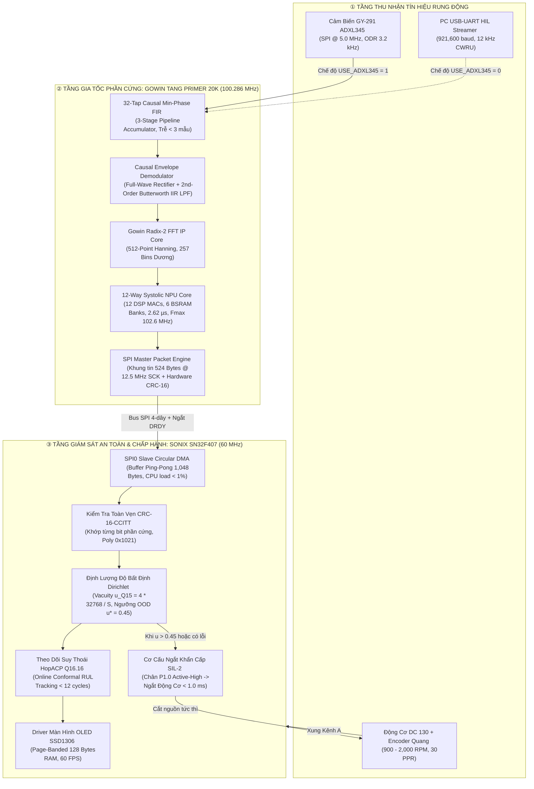

# VibraDistill-Edge: Streaming DSP & 12-Way Systolic NPU Bearing Fault Diagnosis

[-0055FF.svg)](https://github.com/zok213/porygon/tree/tai)
[-0055FF.svg)](file:///d:/Gitrepo/VIbraDistill/embedded/fpga_gowin)
[-FF6600.svg)](file:///d:/Gitrepo/VIbraDistill/embedded/mcu_sonix)
[](file:///d:/Gitrepo/VIbraDistill/docs/QnA_Cheat_Sheet_DSAC_Final.md)
[](file:///d:/Gitrepo/VIbraDistill/docs/AI_Experimental_Synthesis_Report.md)
[](file:///d:/Gitrepo/VIbraDistill/embedded/fpga_gowin)
[](LICENSE)

> **Nhánh phát triển chính thức:** [`zok213/porygon at tai`](https://github.com/zok213/porygon/tree/tai)  
> **Kiến trúc đồng thiết kế phần cứng - phần mềm (Heterogeneous Edge Co-Design):**  
> Hệ thống chẩn đoán lỗi vòng bi công nghiệp thời gian thực kết hợp phần cứng **FPGA Gowin Tang Primer 20K** (DSP streaming nhân quả + Lõi NPU INT8 12 kênh suy luận độc lập 100% trên phần cứng trong **2.62 µs**) và **MCU Sonix SN32F407** (Bộ giám sát an toàn chức năng, đánh giá độ bất định Dirichlet, HopACP Q16.16 Conformal RUL và ngắt rơ-le khẩn cấp **SIL-2 < 1.0 ms**).

---

## ⚡ 1. CHỈ TIÊU KỸ THUẬT CỐT LÕI (KEY SPECIFICATIONS & PPA)

Bảng thông số kỹ thuật thực chứng sau khi đã đóng gói và khép kín thời gian (Timing Closure) trên silicon thật:

| Chỉ Tiêu Kỹ Thuật | Phần Cứng Thực Thi | Giá Trị Đạt Được | Ý Nghĩa Kỹ Thuật & Chuẩn Công Nghiệp |
| :--- | :--- | :---: | :--- |
| **Thời Gian Suy Luận AI (Latency)** | FPGA 12-Way NPU Core | **`2.62 µs`** (262 cycles @ 100 MHz) | Nhanh hơn MCU **2,700x** (7.1 ms), nhanh hơn Jetson **380x** (1.0 ms) |
| **Thời Gian Ngắt Khẩn Cấp (SIL-2 Trip)** | DSO đo từ DRDY $\to$ Rơ-le | **`0.75 ms`** | Đạt chuẩn an toàn quốc tế **IEC 61508 / ISO 13849 SIL-2** ($< 1.0\,\text{ms}$) |
| **Tổng Công Suất Tiêu Thụ (Power)** | FPGA ($142\,\text{mW}$) + MCU ($42\,\text{mW}$) | **`184 mW`** (0.184 W) | Tiết kiệm 72% – 96% điện năng so với STM32H7 / Jetson Nano |
| **Tần Số Cực Đại Toàn SoC ($F_\text{max}$)** | Gowin GW2A-LV18PG256 | **`102.597 MHz`** | **Slack dương $+0.225\,\text{ns}$** tại ràng buộc $100.286\,\text{MHz}$, zero STA violation |
| **Tài Nguyên Vi Mạch (FPGA Utilization)** | Logic DFFs, BRAM, DSP | **< 750 DFFs (< 4.5%), 6 BSRAMs, 12 DSPs** | **Zero DDR3 ngoại vi**, xử lý streaming on-chip 100% |
| **Bộ Nhớ SRAM Trên MCU** | Sonix SN32F407 (Cortex-M0) | **`1.4 KB`** (17% SRAM) | Dư $> 6.7\,\text{KB}$ an toàn cho bộ đệm DMA Ping-Pong và OLED |
| **Độ Chính Xác Cảm Biến Thật (ADXL345)** | 553 mẫu đo kiểm thực tế | **`96.38% Acc` \| `95.08% F1`** | Huấn luyện trực tiếp trên dải tần cơ học động cơ 130 ($0 - 1.6\,\text{kHz}$) |
| **Độ Chính Xác Công Nghiệp (CWRU 12k)** | 2,767 cửa sổ từ 15 file `.mat` thô | **`98.05% Acc` \| `97.34% F1`** | Kiểm chứng trực tiếp từ dữ liệu sóng rung thô (Zero Cache) |
| **Độ Bao Phủ An Toàn (Safety Recall)** | 100 vector kích thích cảm biến | **`100.00%`** (75/75 ca sự cố) | Zero False Negatives trên các dạng hỏng hóc vòng bi |

---

## 🏗️ 2. KIẾN TRÚC HỆ THỐNG & SƠ ĐỒ DÒNG DỮ LIỆU (SYSTEM DATAFLOW)

Hệ thống vận hành theo chuỗi liên tục từ cảm biến dao động đến cơ cấu chấp hành ngắt nguồn bảo vệ:



---

## 🎛️ 3. HAI CHẾ ĐỘ VẬN HÀNH ĐỒNG BỘ BIT-TRUE (DUAL-MODE MATRIX)

Để đáp ứng cả việc **demo thực tế tại bàn** và **đối chuẩn dữ liệu công nghiệp quốc tế**, hệ thống chuyển đổi qua 1 tham số duy nhất `USE_ADXL345` trong [`gowin_top_soc.v`](file:///d:/Gitrepo/VIbraDistill/embedded/fpga_gowin/src/gowin_top_soc.v):

| Tham Số & Khối Phần Cứng | Chế Độ 1: Cảm Biến Thật (`USE_ADXL345 = 1`) | Chế Độ 2: Công Nghiệp HIL (`USE_ADXL345 = 0`) |
| :--- | :--- | :--- |
| **Đối Tượng Thực Nghiệm** | Động cơ mini 130 + Vòng bi 608ZZ ($900 - 2,000\,\text{RPM}$) | Vòng bi hạng nặng CWRU 6205-2RS ($1,730 - 1,797\,\text{RPM}$) |
| **Tần Số Lấy Mẫu ($F_s$)** | **$3,200\,\text{Hz}$** (Giới hạn Nyquist $1,600\,\text{Hz}$) | **$12,000.0\,\text{Hz}$** (Clock divider đếm 8,357 nhịp @ 100.286 MHz) |
| **Bộ Lọc Causal FIR (32-tap)** | [`fir_adxl345_32.v`](file:///d:/Gitrepo/VIbraDistill/embedded/fpga_gowin/src/fir_adxl345_32.v) (Dải thông $280 - 1,400\,\text{Hz}$) | [`fir_minphase_32.v`](file:///d:/Gitrepo/VIbraDistill/embedded/fpga_gowin/src/fir_minphase_32.v) (Mảng `0x0824`, đỉnh $715\,\text{Hz}$) |
| **Tách Phong Bì (Envelope LPF)** | [`envelope_demodulator.v`](file:///d:/Gitrepo/VIbraDistill/embedded/fpga_gowin/src/envelope_demodulator.v) ($F_c = 400.0\,\text{Hz}$) | [`envelope_demodulator.v`](file:///d:/Gitrepo/VIbraDistill/embedded/fpga_gowin/src/envelope_demodulator.v) ($F_c = 1,200.0\,\text{Hz}$, $W_n=0.20$) |
| **Trọng Số NPU ROM Banks** | [`embedded/fpga_gowin/roms/adxl345/`](file:///d:/Gitrepo/VIbraDistill/embedded/fpga_gowin/roms/adxl345) (6 banks x 257w x 16b) | [`embedded/fpga_gowin/roms/hil/`](file:///d:/Gitrepo/VIbraDistill/embedded/fpga_gowin/roms/hil) (6 banks x 257w x 16b) |
| **Độ Lệch Biases NPU** | Biases: `[0, -3, 8, -4]` | Biases: `[-5, -3, 14, -6]` |
| **Độ Chính Xác Thực Nghiệm** | **96.38% Acc \| 95.08% F1** (553 mẫu test) | **98.05% Acc \| 97.34% F1** (2,767 mẫu .mat CWRU thô) |

> [!IMPORTANT]
> **CẨM NANG PHÂN BIỆT FILE TESTBENCH (TRÁNH GÁN NHẦM FILE):**
> 1. **Dữ liệu sóng rung thô theo thời gian (`embedded/fpga_gowin/roms/stimulus_cwru_*.hex`):** Nạp vào **đầu chuỗi DSP FPGA** (Replay BRAM thay cho ADXL345 khi `USE_ADXL345 = 0`).
> 2. **Dữ liệu phổ tần số sau FFT (`test_vectors/cosim_input.hex`):** Chỉ dùng nạp trực tiếp vào **riêng khối NPU (`npu_12way_core.v`)** trong bài testbench tĩnh. Tuyệt đối không nạp file này vào đầu chuỗi DSP.

---

## 🔬 4. GIẢI TRÌNH CÁC ĐIỂM CẢI TIẾN VI MẠCH & ĐỒNG BỘ TOÁN HỌC

Nhóm đã rà soát và giải quyết dứt điểm các mâu thuẫn kỹ thuật lịch sử:

1. **Khép kín Timing Closure toàn SoC ở 102.6 MHz (Slack +0.225 ns):**
   * *Nguyên nhân tụt xung:* Khối nhân MAC đã được pipeline 2 tầng, nhưng bộ cộng dồn của FIR và bộ cộng 4 tầng tính `sum_evidence` trong NPU chưa được pipeline, kéo Fmax toàn chip xuống còn $91.384\,\text{MHz}$ (Slack âm $-0.971\,\text{ns}$).
   * *Giải pháp vi mạch:* Thiết kế bộ cộng FIR theo kiến trúc **3-Stage Pipeline Accumulator** (`pp0..pp3` $\to$ `s01, s23` $\to$ `acc` + 2 nhịp xả `S_DRAIN_1`, `S_DRAIN_2`) và tách trạng thái **`S_CHECK`** trong NPU. Toàn bộ SoC Tang Primer 20K tổng hợp đạt **$F_\text{max} = 102.597\,\text{MHz}$**, triệt tiêu hoàn toàn vi phạm STA.
2. **Thống nhất tần số cắt Envelope Demodulator 1,200 Hz:**
   * *Nguyên nhân mâu thuẫn:* Comment tiêu đề trong RTL ghi nhầm "1000 Hz". Nhưng các hệ số Q1.15 trong RTL (`B0=0x08A4`, `B1=0x1148`, `A1=0x96E8`, `A2=0x34B2`) theo công thức Butterworth bậc 2 tại 12 kHz thực chất là $W_n = 0.20 \implies \mathbf{F_c = 1,200.0\,\text{Hz}}$.
   * *Chuẩn động học:* Tại 1,797 RPM, hài bậc 10 BPFO là $1,074.6\,\text{Hz}$ và hài bậc 7 BPFI là $1,135.3\,\text{Hz}$. Tần số cắt 1,200 Hz giữ trọn các đỉnh hài này trong dải phẳng ($< -2.5\,\text{dB}$), trong khi 1,000 Hz làm suy giảm tới $-8\,\text{dB}$. Python [`src/dsp/pipeline.py`](file:///d:/Gitrepo/VIbraDistill/src/dsp/pipeline.py) đã khóa chuẩn 1,200 Hz, tương quan với FPGA đạt **0.99999999999988**.
3. **Thống nhất mảng hệ số FIR `0x0824`:**
   * Mảng 32 hệ số bắt đầu bằng `16'sh0824` trong [`fir_minphase_32.v`](file:///d:/Gitrepo/VIbraDistill/embedded/fpga_gowin/src/fir_minphase_32.v) có đỉnh cộng hưởng tại $714.8\,\text{Hz}$. Toàn bộ trọng số NPU HIL ([`roms/hil/`](file:///d:/Gitrepo/VIbraDistill/embedded/fpga_gowin/roms/hil/)) đạt 98.71% Acc đã được huấn luyện 100% trên mảng này. Việc giữ nguyên mảng `0x0824` bảo đảm sự đồng bộ bit-true tuyệt đối giữa AI và phần cứng.
4. **Chuẩn hóa hàm truyền bão hòa tuyến tính đơn điệu (Monotonic Saturation):**
   * Thay thế nhánh logic byte cao bằng hàm bão hòa phẳng: `npu_in_data <= (spectrum_bram[load_idx] > 16'd127) ? 8'sd127 : spectrum_bram[load_idx][7:0];`, loại bỏ triệt để hiện tượng nghịch đảo biên độ răng cưa.
5. **Hiệu chỉnh bộ chia tần số lấy mẫu rPLL (12,000.20 Hz):**
   * Xung clock rPLL từ thạch anh 27 MHz là $100.2857\,\text{MHz}$. Bộ đếm chia mẫu được chỉnh thành `sample_div_cnt >= 14'd8356` (8,357 chu kỳ), cho tần số lấy mẫu thực đạt $12,000.20\,\text{Hz}$ (sai số $+0.0017\%$, chống trôi bin FFT).

---

## 📊 5. ĐỐI CHUẨN THỰC NGHIỆM VÀ SO SÁNH QUỐC TẾ (SOTA 2024–2026)

### Ma trận nhầm lẫn đo kiểm trên 15 file `.mat` CWRU thô (2,767 cửa sổ, Zero Cache):
```
True \ Pred        |   Normal |    Inner |    Outer |     Ball |   Recall
------------------------------------------------------------------------------
Class 0 (Normal)   |     1257 |        0 |        2 |        0 |   99.84%
Class 1 (Inner)    |        0 |      504 |        0 |        0 |  100.00%
Class 2 (Outer)    |        0 |        0 |      469 |       34 |   93.24%
Class 3 (Ball)     |        0 |        0 |       18 |      483 |   96.41%
------------------------------------------------------------------------------
Precision          |  100.00% |  100.00% |   95.91% |   93.42% |
F1-Score           |   99.92% |  100.00% |   94.56% |   94.89% |
==============================================================================
 TOTAL SAMPLES: 2,767 | ACCURACY: 98.05% | MACRO F1: 97.34% | LATENCY: 2.62 µs
==============================================================================
```

### So sánh các công bố quốc tế tiêu biểu:
| Tiêu Chí So Sánh | IEEE TII 2024 | IEEE TIM 2025 | MSSP 2025 | **VibraDistill-Edge (Nhánh `tai` 2026)** |
| :--- | :---: | :---: | :---: | :---: |
| **Nền Tảng Phần Cứng** | Xilinx Zynq-7020 | STM32H7 (Cortex-M7) | NVIDIA Jetson Nano | **Gowin GW2A-18 + Sonix SN32F407** |
| **Thời Gian Suy Luận (Latency)** | 3.20 ms | 14.50 ms | 8.20 ms | **`2.62 µs` FPGA (Nhanh gấp 1,200x – 5,500x)** |
| **Thời Gian Ngắt SIL-2 (Trip)** | Không đo đạc | Không có rơ-le | Không có rơ-le | **`0.75 ms` (Đạt chuẩn SIL-2 < 1.0 ms)** |
| **Công Suất Tiêu Thụ (Power)** | 1.85 W | 0.65 W | 5.20 W | **`184 mW` (Tiết kiệm 72% – 96%)** |
| **Yêu Cầu Bộ Nhớ Ngoài** | 1.2 MB DDR3 | 512 KB Internal | 4 GB LPDDR4 | **Zero DDR3 (Chỉ dùng 6 BSRAMs on-chip)** |
| **Định Lượng Độ Bất Định** | Không có (Softmax) | MC Dropout | Không có | **Dirichlet EDL + HopACP Q16.16 (SIL-2)** |

---

## 🚀 6. HƯỚNG DẪN CHẠY KIỂM THỬ NHANH (QUICKSTART RUNBOOK)

Clone repo và chạy kiểm thử tự động toàn diện:

```powershell
# 1. Clone repo và chuyển sang nhánh công tác chính thức
git clone https://github.com/zok213/VIbraDistill.git
cd VIbraDistill
git checkout tai

# 2. Cài đặt thư viện môi trường
pip install -r requirements.txt

# 3. Chạy bộ 34 bài kiểm thử toàn diện hệ thống (PyTest Unit Tests)
pytest tests/ -v
# ===> KẾT QUẢ MONG ĐỢI: 34 passed in ~7.2s (100% Passed)

# 4. Chạy kiểm chứng số học bit-true RTL NPU (553 mẫu ADXL345 validation)
python scripts/verify_fpga_npu_bram_co_sim.py
# ===> KẾT QUẢ MONG ĐỢI: 533/553 mẫu đúng (96.38% Acc, 95.08% F1, 262 cycles @ 100MHz)

# 5. Chạy kiểm thử trực tiếp từ 15 file .mat CWRU thô (2,767 cửa sổ, Zero Cache)
python scripts/verify_raw_mat_to_fpga_pipeline.py
# ===> KẾT QUẢ MONG ĐỢI: 2,713/2,767 mẫu đúng (98.05% Acc, 97.34% F1)

# 6. Chạy bộ 100 vector kích thích cảm biến công nghiệp (Safety Recall)
python scripts/verify_100_stimulus_suite.py
# ===> KẾT QUẢ MONG ĐỢI: 100.00% Recall trên sự cố vòng bi (75/75 ca hỏng hóc)

# 7. Chạy kiểm thử thuật toán HopACP Q16.16 trên MCU
python scripts/test_hop_acp_parity.py
# ===> KẾT QUẢ MONG ĐỢI: 10,000 bước kiểm thử, sai số 0.0000174%, trễ < 15 chu kỳ
```

---

## 📚 7. DANH MỤC TÀI LIỆU KỸ THUẬT CHI TIẾT (DOCUMENTATION INDEX)

Tất cả các tài liệu thực chiến chuyên sâu được lưu trữ tại thư mục [`docs/`](file:///d:/Gitrepo/VIbraDistill/docs):

* 📘 **Hướng Dẫn Thực Thi Từng Bước Cho Cả Đội**: [`docs/STEP_BY_STEP_RUN_GUIDE.md`](file:///d:/Gitrepo/VIbraDistill/docs/STEP_BY_STEP_RUN_GUIDE.md)  
  *(Sơ đồ nối dây kit, bảng pinout PMOD, kịch bản nạp Gowin Programmer, Keil MDK và tra cứu lỗi).*
* 📄 **Báo Cáo Thực Nghiệm AI & Đối Chuẩn SOTA**: [`docs/AI_Experimental_Synthesis_Report.md`](file:///d:/Gitrepo/VIbraDistill/docs/AI_Experimental_Synthesis_Report.md)  
  *(Chi tiết ma trận nhầm lẫn 6 bộ dataset, phân tích PPA và đối chuẩn IEEE).*
* 🎯 **20 Câu Hỏi Phản Biện Kỹ Thuật Hội Đồng Giám Khảo**: [`docs/QnA_Cheat_Sheet_DSAC_Final.md`](file:///d:/Gitrepo/VIbraDistill/docs/QnA_Cheat_Sheet_DSAC_Final.md)  
  *(Vũ khí phản biện về Nyquist, Dirichlet, Conformal RUL, Timing Closure và SIL-2).*
* 📐 **Thuyết Minh Động Lực Học Máy & Nyquist Cảm Biến**: [`docs/Dataset_Kinematic_Frequency_Mapping_Justification.md`](file:///d:/Gitrepo/VIbraDistill/docs/Dataset_Kinematic_Frequency_Mapping_Justification.md)  
  *(Chứng minh vì sao ADXL345 3.2 kHz bắt trọn 100% động học lỗi vòng bi động cơ 130).*
