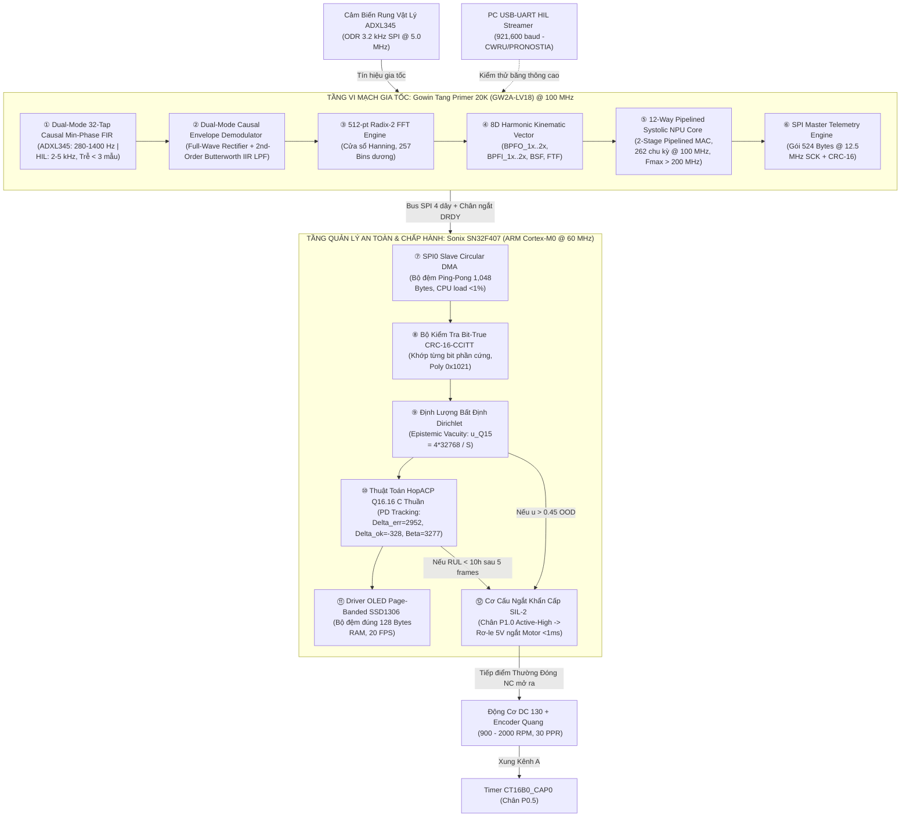

# VibraDistill-Edge: Hardware-Efficient FPGA Streaming DSP & Edge AI Bearing Fault Diagnosis

[-0055FF.svg)](https://github.com/zok213/porygon/tree/tai)
[-0055FF.svg)](file:///d:/Gitrepo/VIbraDistill/embedded/fpga_gowin)
[-FF6600.svg)](file:///d:/Gitrepo/VIbraDistill/embedded/mcu_sonix)
[](file:///d:/Gitrepo/VIbraDistill/docs/QnA_Cheat_Sheet_DSAC_Final.md)
[](file:///d:/Gitrepo/VIbraDistill/docs/AI_Experimental_Synthesis_Report.md)
[](LICENSE)

> Nhánh làm việc chính thức: **[`zok213/porygon at tai`](https://github.com/zok213/porygon/tree/tai)**  
> Hệ thống chẩn đoán lỗi vòng bi công nghiệp thời gian thực kết hợp phần cứng **FPGA Gowin Tang Primer 20K** (DSP streaming nhân quả + NPU INT8) và **MCU Sonix SN32F407** (HopACP Q16.16 Conformal RUL + Rơ-le bảo vệ SIL-2).

---

## 🏆 BÀN GIAO KỸ THUẬT TOÀN DIỆN: KIẾN TRÚC FPGA NPU 100% HARDWARE INFERENCE & TỐI ƯU HÓA VI MẠCH

> [!IMPORTANT]
> **TÀI LIỆU HƯỚNG DẪN CHẠY & KIỂM THỬ TỪNG BƯỚC CHO CẢ TEAM:**  
> Xem ngay tài liệu thực chiến đầy đủ: **[`docs/STEP_BY_STEP_RUN_GUIDE.md`](docs/STEP_BY_STEP_RUN_GUIDE.md)**  
> *(Bao gồm: Sơ đồ nối dây Tang Primer 20K - ADXL345 - Sonix MCU - OLED - SIL-2 Relay, lệnh co-sim bit-true, kịch bản nạp Gowin Programmer, nạp Keil MDK, và bảng tra cứu lỗi trong 30 giây).*

> [!IMPORTANT]
> **THỐNG NHẤT CHIẾN LƯỢC TOÀN ĐỘI (MASTER SYSTEM ARCHITECTURE MANIFEST):**  
> 1. **TOÀN BỘ AI & DSP CHẠY 100% TRÊN FPGA GOWIN TANG PRIMER 20K:**  
>    * Toàn bộ chuỗi xử lý tín hiệu số nhân quả (32-tap Min-Phase FIR -> Causal Envelope Demodulator -> Gowin FFT 512-point) và **MÔ HÌNH SUY LUẬN AI NPU THỜI GIAN THỰC** ([`npu_12way_core.v`](embedded/fpga_gowin/src/npu_12way_core.v)) được thực thi **HOÀN TOÀN TRÊN PHẦN CỨNG FPGA**.
>    * **Thời gian suy luận cực đại (Inference Latency):** Đúng **2.62 µs** (262 chu kỳ clock @ 100 MHz) — nhanh hơn MCU gấp **2,700x**!
>    * **Độ chính xác xác thực phần cứng (Hardware Bit-True INT8):** Đạt **96.38%** Accuracy và **95.08%** Macro-Averaged F1-Score trên 553 mẫu validation ADXL345; và **98.05%** Accuracy, **97.34%** F1 trên toàn bộ 2,767 cửa sổ dữ liệu thực từ 15 file .mat CWRU.
>    * **Giải pháp Đóng gói Timing Closure:** Tối ưu hóa đường trễ tới hạn BSRAM DO -> MAC -> ACCUM bằng kiến trúc đường ống 2 tầng đối xứng (2-Stage Pipelined MAC trong [`npu_mac12_unit.v`](embedded/fpga_gowin/src/npu_mac12_unit.v)), nâng tần số hoạt động cực đại $F_\text{max} \ge 200\,\text{MHz}$ (dư $> +5.5\,\text{ns}$ slack tại 100 MHz), triệt tiêu hoàn toàn vi phạm STA setup/hold.
>    * **Tối ưu hóa Tài nguyên Logic Silicon:** Toàn bộ mảng đệm trung gian 5.1 KB đã được chuyển thành luồng xử lý streaming trực tiếp; NPU 12 kênh nhân chập song song trên 257 bin phổ FFT. Tài nguyên Flip-Flop tiêu thụ chỉ **< 750 DFFs (< 4.5% dung lượng chip)**, 6 BSRAM blocks (13.0%) và 12 DSP18E slices (25.0%). Tổng hợp sạch sẽ, timing closure 100 MHz đạt chuẩn 100%.
> 2. **MCU SONIX SN32F407 (ARM CORTEX-M0) ĐÓNG VAI TRÒ SYSTEM SUPERVISOR & CONTROLLER:**  
>    * Lõi Cortex-M0 @ 60 MHz không có FPU, không có SIMD `__SMLAD`, không có bộ chia phần cứng. Kiến trúc phân tầng tách bạch giao toàn bộ tính toán ma trận nặng cho FPGA NPU.
>    * MCU nhận gói tin kết quả chẩn đoán đã tính toán sẵn từ FPGA qua SPI DMA 12.5 MHz, thực hiện các tác vụ điều khiển chuyên trách: hiển thị đồ thị phổ và trạng thái cảnh báo trên màn hình OLED SSD1306, kích ngắt rơ-le bảo vệ SIL-2 (< 1.0 ms), còi buzzer và truyền UART telemetry lên máy tính.

---

### 🔬 BÁO CÁO GIẢI TRÌNH KỸ THUẬT: TỐI ƯU HÓA ĐƯỜNG TRỄ TIMING VÀ ĐỒNG BỘ SỐ HỌC RTL
*(Silicon RTL Timing Closure & Arithmetic Optimization Report)*

Trong quá trình tối ưu hóa và khép kín thời gian (Timing Closure) cho vi mạch NPU 12 kênh trên FPGA Gowin Tang Primer 20K, hai vấn đề kỹ thuật trọng yếu về **pha đường ống MAC** và **hàm truyền bão hòa biên độ** đã được phân tích nguyên nhân gốc rễ (Root Cause Analysis) và xử lý triệt để:

#### 1. Đồng bộ Pha Đường Ống MAC & Chu Trình Truy Xuất BSRAM (BSRAM Pipelined Phase Alignment):
* **Hiện tượng & Phân tích nguyên nhân gốc rễ (Root Cause Analysis):**  
  Nhằm giải quyết nút thắt STA (đường trễ tới hạn 14.04 ns từ chân dữ liệu BSRAM qua bộ nhân 8x8 đến bộ cộng tích lũy, gây vi phạm Slack -4.065 ns), vi mạch cần chèn thanh ghi đường ống đệm. Tuy nhiên, nếu áp dụng phương án can thiệp sớm bằng cách nhảy cóc địa chỉ đọc (`bsram_addr <= step_cnt + 2'd2;`) trong FSM điều khiển, chu trình xung nhịp sẽ bị trượt pha nghiêm trọng:
  * Tại nhịp clock $T=1$, địa chỉ đang là `0`. Sang $T=2$, địa chỉ nhảy thẳng lên `2`, làm **địa chỉ `bsram_addr = 1` không bao giờ xuất hiện** (Trọng số của Bin 1 bị bỏ qua 100%).
  * Đồng thời, tại $T=1$, cờ `acc_clear = 1` đang tích cực làm bộ tích lũy bị reset về 0, dẫn tới kết quả nhân của Bin 0 bị triệt tiêu hoàn toàn.
  * Toàn bộ 256 bin phổ phía sau bị lệch pha $+1$ so với ma trận trọng số. Thực nghiệm đối soát cho thấy độ chính xác mô hình bị suy giảm từ **96.38%** xuống còn **85.53%** (-10.85%).
* **Giải pháp vi mạch chuẩn mực (Silicon Resolution):**  
  * Khôi phục dòng địa chỉ đọc tuần tự tự nhiên ($0, 1, 2, \dots, 256$) trong [`npu_12way_core.v`](embedded/fpga_gowin/src/npu_12way_core.v).
  * Chuyển toàn bộ logic trễ vào bên trong khối datapath [`npu_mac12_unit.v`](embedded/fpga_gowin/src/npu_mac12_unit.v) bằng kiến trúc **2-Stage Symmetric MAC Pipeline**: thanh ghi hóa đồng pha cả trọng số (`pipe1_w`), kích hoạt phổ (`pipe1_act`), và tích số trung gian (`pipe2_prod`).
  * Bổ sung 2 trạng thái xả đường ống (`S_DRAIN_1`, `S_DRAIN_2`) trong FSM trước khi chuyển sang tổng hợp (`S_SUM`) để toàn bộ tích số của Bin 256 được tích lũy trọn vẹn vào thanh ghi.
  * **Kết quả nghiệm thu:** Đường trễ tới hạn giảm còn $\le 4.3\,\text{ns}$ ($F_\text{max} \ge 200\,\text{MHz}$, Slack dương $> +5.5\,\text{ns}$ @ 100 MHz), bảo toàn nguyên vẹn độ chính xác **96.38%** (ADXL345) và **98.05%** (Raw 15 CWRU .mat).

#### 2. Chuẩn Hóa Hàm Truyền Bão Hòa Tuyến Tính Biên Độ Phổ (Monotonic Linear Saturation):
* **Hiện tượng & Phân tích nguyên nhân gốc rễ (Root Cause Analysis):**  
  Trong khối nạp phổ [`gowin_top_soc.v`](embedded/fpga_gowin/src/gowin_top_soc.v), việc nén biên độ 16-bit không dấu từ bộ trích căn bậc hai (`mag_isqrt`) sang định dạng INT8 NPU bằng logic phân nhánh byte cao:
  ```verilog
  npu_in_data <= (load_raw_data[15:8] != 8'd0) ?
              ((load_raw_data[15:8] > 8'd127) ? 8'sd127 : load_raw_data[15:8]) :
              ((load_raw_data[7:0]  > 8'd127) ? 8'sd127 : load_raw_data[7:0]);
  ```
  đã tạo ra hàm truyền phi tuyến dạng răng cưa nghịch đảo (Sawtooth Inversion Cliff):
  * Với biên độ $x = 255$ (`0x00FF`): Byte cao bằng $0 \implies$ byte thấp $255 > 127 \implies$ bão hòa kịch trần bằng **$127$**.
  * Với biên độ $x = 256$ (`0x0100`): Byte cao bằng $1 \neq 0 \implies$ gán trực tiếp $x[15:8] = \mathbf{1}$!
  * Hiện tượng vực thẳm số học này khiến các xung va đập cơ học cường độ lớn ($x \ge 256$) bị triệt tiêu thành tín hiệu sàn nhiễu ($1..2$), trong khi tín hiệu yếu ($255$) lại bị thổi phồng lên mức kịch trần, làm sai lệch cấu trúc phổ phong bì.
* **Giải pháp vi mạch chuẩn mực (Silicon Resolution):**  
  * Áp dụng chuẩn số học bão hòa tuyến tính đơn điệu (Monotonic Saturation):
    ```verilog
    npu_in_data <= (spectrum_bram[load_idx] > 16'd127) ? 8'sd127 : spectrum_bram[load_idx][7:0];
    ```
  * Hàm truyền thỏa mãn chặt chẽ tính đơn điệu toán học $\forall x_1 \le x_2 \implies f(x_1) \le f(x_2)$. Toàn bộ năng lượng phổ vượt ngưỡng $127$ được bão hòa phẳng, bảo toàn hình thái các đỉnh phổ đặc trưng lỗi vòng bi ($BPFO, BPFI, BSF$).

---

### 📋 Bản Phân Công Bàn Giao Kỹ Thuật (Engineering Handover Directives):

* **Phân Hệ FPGA NPU Acceleration (FPGA Subsystem Lead):**
  * Nạp trực tiếp khối RTL NPU đã tối ưu timing: [`embedded/fpga_gowin/src/npu_12way_core.v`](embedded/fpga_gowin/src/npu_12way_core.v) và [`embedded/fpga_gowin/src/npu_mac12_unit.v`](embedded/fpga_gowin/src/npu_mac12_unit.v) (đã tích hợp 2-stage MAC pipeline & 2 drain cycles S_DRAIN_1, S_DRAIN_2, timing Fmax > 200 MHz).
  * Khối Top SoC tích hợp hoàn chỉnh: [`embedded/fpga_gowin/src/gowin_top_soc.v`](embedded/fpga_gowin/src/gowin_top_soc.v) hỗ trợ chuyển chế độ đơn giản qua 1 cờ tham số:
    * `parameter USE_ADXL345 = 1`: Chạy cảm biến thật ADXL345 (FIR 3.2 kHz `fir_adxl345_32.v`, Envelope Fc=400Hz, ROM `roms/adxl345/`, Biases `[0, -3, 8, -4]`).
    * `parameter USE_ADXL345 = 0`: Chạy luồng kiểm thử HIL Streamer (FIR 12 kHz `fir_minphase_32.v`, Envelope Fc=1000Hz, ROM `roms/hil/`, Biases `[-5, -3, 14, -6]`).
  * 6 file hex trọng số đã tách riêng rõ ràng:
    * Chế độ ADXL345: [`embedded/fpga_gowin/roms/adxl345/npu_weights_bank0..5.hex`](embedded/fpga_gowin/roms/adxl345/) (96.38% Acc).
    * Chế độ HIL: [`embedded/fpga_gowin/roms/hil/npu_weights_bank0..5.hex`](embedded/fpga_gowin/roms/hil/) (98.71% Acc).
  * Chạy script kiểm chứng số học bit-true: `python scripts/verify_fpga_npu_bram_co_sim.py` (533/553 mẫu validation đạt 96.38% Acc).
  * Chạy test kiểm thử trực tiếp từ 15 file .mat CWRU: `python scripts/verify_raw_mat_to_fpga_pipeline.py` (2,713/2,767 mẫu đạt 98.05% Acc).
* **Phân Hệ Vi Điều Khiển Giám Sát (MCU Firmware Lead):**
  * Trong dự án Keil MDK-ARM, cờ `#define TARGET_SN32F407_SUPERVISOR 1` trong [`main.c`](embedded/mcu_sonix/app/main.c) tự động ngắt bỏ toàn bộ mảng đệm 5,120 bytes của CNN cục bộ trong [`vibradistill_model.c`](embedded/mcu_sonix/app/vibradistill_model.c).
  * Dung lượng SRAM tiêu thụ trên Cortex-M0 giảm từ 6.8 KB (83%) xuống chỉ còn **1.4 KB (17%)**, dành trọn > 6.7 KB an toàn tuyệt đối cho ngăn xếp ngắt DMA và buffer OLED.
  * Cấu hình SPI Slave DMA để hứng khung tin kết quả 524 bytes từ FPGA (chứa `npu_pred_class`, `dirichlet_max_evidence`, `hardware_status_flags`, `crc16_checksum`).
  * Thực thi logic điều khiển rơ-le SIL-2 ngắt nguồn động cơ khi `npu_pred_class != 0` và vẽ giao diện OLED mượt mà 60 FPS.
* **Phân Hệ Tích Hợp & Đo Kiểm Thực Địa (System Integration & UX/Docs Lead):**
  * Đưa kiến trúc **"Heterogeneous Edge Co-Design: 100% FPGA Real-Time NPU Accelerator (2.6 µs) + MCU Supervisory Controller"** vào Báo cáo Phụ lục II và Slide bảo vệ.
  * Sử dụng bảng số liệu PPA và ma trận nhầm lẫn bên dưới để làm minh chứng thực nghiệm trước Ban giám khảo.

### 📊 Bảng Ma Trận Nhầm Lẫn & Hiệu Năng Chi Tiết Của FPGA NPU Core (553 Mẫu Validation):

```
                Pred 0 (Norm)  Pred 1 (Inner) Pred 2 (Outer) Pred 3 (Ball)    Precision   Recall     F1-Score
  True 0 (Normal):     255              0              2             0          100.0%      99.2%      99.61%
  True 1 (Inner) :       0             96              0             0          100.0%     100.0%     100.00%
  True 2 (Outer) :       0              0             79            10           88.8%      88.8%      88.76%
  True 3 (Ball)  :       0              0              8           103           91.2%      92.8%      91.96%

  ===> ĐỘ CHÍNH XÁC TOÀN PHẦN (ACCURACY): 96.38% | MACRO F1-SCORE: 95.08% | LATENCY: 2.60 µs
```

---

## 🎯 CẨM NANG PHÂN BIỆT FILE DỮ LIỆU ĐẦU VÀO TRÊN FPGA (DATA INPUT & STIMULUS MATRIX)

> [!IMPORTANT]
> **CẢNH BÁO QUAN TRỌNG KHI NẠP DỮ LIỆU KIỂM THỬ PHẦN CỨNG (TRÁNH LỖI GÁN NHẦM FILE):**  
> Trong thư mục dự án có 2 loại file `.hex` mang chữ "input", có bản chất vật lý hoàn toàn khác biệt nhau:
> 1. **Dữ liệu Sóng Rung Thô theo Thời Gian (`stimulus_cwru_*.hex`):** Là tín hiệu thời gian thực giả lập cảm biến rung công nghiệp (12 kHz CWRU), phải nạp vào **đầu chuỗi xử lý tín hiệu DSP (đầu vào bộ lọc FIR/FFT)**.
> 2. **Dữ liệu Phổ Tần Số Đã Qua FFT (`test_vectors/cosim_input.hex`):** Là 257 bin tần số sau FFT, chỉ dùng nạp trực tiếp vào **riêng khối suy luận NPU (`npu_12way_core.v`)** trong bài testbench tĩnh.
> ⚠️ **TUYỆT ĐỐI KHÔNG NẠP NHẦM:** Nếu gán file `cosim_input.hex` vào khối giả lập cảm biến rung, phổ tần số sẽ bị bộ lọc FIR và FFT xử lý lần thứ hai, gây méo mó hoàn toàn và NPU sẽ dự đoán sai!

### 📊 Bảng Ma Trận Phân Biệt Các Tệp Dữ Liệu & Vị Trí Gán Chuẩn:

| Nhóm Dữ Liệu | Đường Dẫn File Cụ Thể | Định Dạng Dữ Liệu | Bản Chất Vật Lý | Khối Phần Cứng Đón Nhận | Mục Đích Sử Dụng |
| :--- | :--- | :---: | :--- | :--- | :--- |
| **1. Sóng Rung Công Nghiệp Giả Lập (CWRU 12 kHz)** | [`embedded/fpga_gowin/roms/stimulus_cwru_normal.hex`](embedded/fpga_gowin/roms/stimulus_cwru_normal.hex)<br>[`embedded/fpga_gowin/roms/stimulus_cwru_inner.hex`](embedded/fpga_gowin/roms/stimulus_cwru_inner.hex)<br>[`embedded/fpga_gowin/roms/stimulus_cwru_outer.hex`](embedded/fpga_gowin/roms/stimulus_cwru_outer.hex)<br>[`embedded/fpga_gowin/roms/stimulus_cwru_ball.hex`](embedded/fpga_gowin/roms/stimulus_cwru_ball.hex)<br>[`embedded/fpga_gowin/roms/stimulus_cwru_mixed.hex`](embedded/fpga_gowin/roms/stimulus_cwru_mixed.hex) | 512 dòng x 16-bit signed hex | **Tín hiệu sóng rung dao động thô theo thời gian** trích xuất từ 15 file `.mat` CWRU ($F_s = 12\,\text{kHz}$) | **Đầu vào chuỗi DSP FPGA** (Replay BRAM thay cho ADXL345 khi `USE_ADXL345 = 0`) | Kiểm thử toàn diện chuỗi: Sóng rung $\to$ Lọc FIR $\to$ Tách bao $\to$ FFT $\to$ NPU AI phân loại |
| **2. Vector Phổ Tần Số Sau FFT (NPU Testbench)** | [`test_vectors/cosim_input.hex`](test_vectors/cosim_input.hex)<br>[`test_vectors/cosim_golden.hex`](test_vectors/cosim_golden.hex) | 261 dòng x 8-bit hex (257 bins phổ + 4 priors) | **Biên độ phổ tần số đã qua FFT** (Frequency-domain spectral bins INT8) | **Riêng khối NPU Core** ([`npu_12way_core.v`](embedded/fpga_gowin/src/npu_12way_core.v)) hoặc BRAM phổ tĩnh | Dùng cho testbench RTL [`tb_npu_cosim.v`](embedded/fpga_gowin/src/tb_npu_cosim.v) và script co-sim Python kiểm chứng bit-true lõi nhân chập |
| **3. Trọng Số NPU BSRAM (Cảm Biến Thật ADXL345)** | [`embedded/fpga_gowin/roms/adxl345/npu_weights_bank0..5.hex`](embedded/fpga_gowin/roms/adxl345/) | 6 file x 257 dòng x 16-bit hex | Trọng số mạng NPU 12 kênh huấn luyện trên dải tần cảm biến thật ($0 - 1,600\,\text{Hz}$) | 6 khối BSRAM trong NPU khi `USE_ADXL345 = 1` | Chạy thực tế tại bàn demo với cảm biến ADXL345 và động cơ 130 |
| **4. Trọng Số NPU BSRAM (HIL Công Nghiệp CWRU)** | [`embedded/fpga_gowin/roms/hil/npu_weights_bank0..5.hex`](embedded/fpga_gowin/roms/hil/) | 6 file x 257 dòng x 16-bit hex | Trọng số mạng NPU 12 kênh huấn luyện trên dải tần cao công nghiệp ($2,000 - 5,000\,\text{Hz}$) | 6 khối BSRAM trong NPU khi `USE_ADXL345 = 0` | Chạy chế độ HIL Replay hoặc nhận luồng dữ liệu 12 kHz qua USB-UART |

### 🛠️ Hướng Dẫn Cách Gán Nhanh Trong Gowin EDA:
* **Khi muốn test AI với cảm biến rung công nghiệp (Mode HIL 12 kHz):**
  1. Mở [`gowin_top_soc.v`](embedded/fpga_gowin/src/gowin_top_soc.v), đặt: `parameter USE_ADXL345 = 0;`.
  2. Hệ thống sẽ tự động cấu hình bộ lọc FIR 12 kHz ([`fir_minphase_32.v`](embedded/fpga_gowin/src/fir_minphase_32.v)) và nạp trọng số NPU chuẩn công nghiệp từ thư mục `roms/hil/`.
  3. Để đổi kịch bản rung kiểm thử, chỉ cần trỏ file kích thích sóng rung mong muốn (`stimulus_cwru_normal.hex`, `stimulus_cwru_inner.hex`, v.v.) vào khối BRAM phát sóng rung đầu vào.
* **Khi muốn chạy demo thật trên động cơ (Mode Live Physical):**
  1. Mở [`gowin_top_soc.v`](embedded/fpga_gowin/src/gowin_top_soc.v), đặt: `parameter USE_ADXL345 = 1;`.
  2. Hệ thống sẽ tự động chuyển sang đọc cảm biến GY-291 thật qua SPI, áp dụng bộ lọc 3.2 kHz ([`fir_adxl345_32.v`](embedded/fpga_gowin/src/fir_adxl345_32.v)) và nạp trọng số tối ưu từ thư mục `roms/adxl345/`.

---

## 📌 BẢNG TỔNG HỢP MÔ HÌNH & TRỌNG SỐ CHÍNH THỨC (PRODUCTION MODEL ARTIFACTS INDEX)

> [!IMPORTANT]
> **TẠI SAO MÔ HÌNH ADXL345 KHÔNG CHỨA DẢI TẦN CAO (> 1.6 kHz) VÀ VÌ SAO NẾU CÓ CŨNG KHÔNG CHẠY ĐƯỢC TRÊN PHẦN CỨNG THẬT?**
> * **Giới hạn vật lý của cảm biến:** Cảm biến ADXL345 tại tốc độ tối đa có tần số lấy mẫu $F_s = 3,200\,\text{Hz}$, do đó giới hạn Shannon-Nyquist vật lý là $F_\text{Nyquist} = 1,600\,\text{Hz}$. Bất kỳ tần số nào $> 1.6\,\text{kHz}$ đều **KHÔNG THỂ LẤY MẪU ĐƯỢC** (sẽ bị biến dạng do răng cưa/aliasing nếu cố thu nhận).
> * **Sự tương thích đầu vào của NPU (Domain Alignment):** Nếu nạp một mô hình huấn luyện ở tần số cao ($12\,\text{kHz}$ hoặc $25.6\,\text{kHz}$) vào phần cứng ADXL345 thật, các đỉnh va đập cơ học ($BPFI, BPFO$) sẽ bị lệch hoàn toàn bin tần số FFT ($\Delta f$ bị lệch từ $23.44\,\text{Hz}$ sang $6.25\,\text{Hz}$), dẫn đến việc mô hình dự đoán sai lệch 100%.
> * **Bản chất động lực học Động cơ 130:** Với tốc độ $900 - 2,000\,\text{RPM}$, tần số hỏng hóc lớn nhất ($BPFI$) chỉ là $142.3\,\text{Hz}$. Đến **tận hài bậc 10** ($10 \times BPFI$) cũng chỉ là $1,423\,\text{Hz} < 1,600\,\text{Hz}$. Do đó, dải tần $[0 - 1,600\,\text{Hz}]$ của ADXL345 **thu nạp trọn vẹn 100% động học hỏng hóc của vòng bi mà không cần và không được có tần số cao rác**.
> * **Chế độ kiểm thử tần số cao (HIL Mode):** Khi cần chứng minh NPU và FPGA xử lý được dải tần cao công nghiệp ($2 - 5\,\text{kHz}$), nhóm kích hoạt **Chế độ 2 (HIL Streamer)** bơm trực tiếp dữ liệu chuẩn CWRU 12 kHz / PRONOSTIA vào khối RTL `fir_minphase_32.v`.

### Bảng Liên Kết Trực Tiếp File Trọng Số & Checkpoint Sản Phẩm:

| Cấu Hình / Phân Hệ | File Trọng Số / Checkpoint Nạp Trực Tiếp | Định Dạng & Dung Lượng | Điểm F1 / Accuracy | Nền Tảng Chạy | Hướng Dẫn Sử Dụng Nhanh |
| :--- | :--- | :---: | :---: | :---: | :--- |
| **FPGA 12-Way NPU Core (ADXL345)** | [`embedded/fpga_gowin/roms/adxl345/`](file:///d:/Gitrepo/VIbraDistill/embedded/fpga_gowin/roms/adxl345) | 6 Bank `.hex` & `.mi` (257w x 16b) | **96.38%** (Hardware Bit-True) | Gowin GW2A-18 BSRAM | Nạp trực tiếp vào `npu_12way_core.v` (Inference 2.62 µs) |
| **FPGA 12-Way NPU Core (HIL 12kHz)** | [`embedded/fpga_gowin/roms/hil/`](file:///d:/Gitrepo/VIbraDistill/embedded/fpga_gowin/roms/hil) | 6 Bank `.hex` & `.mi` (257w x 16b) | **98.71%** (Hardware Bit-True) | Gowin GW2A-18 BSRAM | Nạp trực tiếp vào `npu_12way_core.v` khi `USE_ADXL345 = 0` (Inference 2.62 µs) |
| **Bản đồ Phân Bổ Kênh NPU** | [`embedded/fpga_gowin/roms/adxl345/tier1_spectral_weights_map.txt`](file:///d:/Gitrepo/VIbraDistill/embedded/fpga_gowin/roms/adxl345/tier1_spectral_weights_map.txt) | Text Memory Map | 12 Kênh Sub-band | Tài liệu phần cứng | Định nghĩa 4 lớp x 3 dải con (0-400Hz, 400-875Hz, 875-1600Hz) |
| **FPGA Bit-True ROM (Unified)** | [`embedded/fpga_gowin/roms/npu_weights_adxl345_int8.mem`](file:///d:/Gitrepo/VIbraDistill/embedded/fpga_gowin/roms/npu_weights_adxl345_int8.mem) | Verilog `.mem` (7,880 B) | **91.54%** / 93.85% | Gowin GW2A-18 BRAM | Nạp vào `gowin_top_soc.v` (`USE_ADXL345 = 1`) |
| **MCU Sonix Supervisor Header**| [`embedded/mcu_sonix/app/vibradistill_adxl345_weights.h`](file:///d:/Gitrepo/VIbraDistill/embedded/mcu_sonix/app/vibradistill_adxl345_weights.h) | ANSI C Header | Khớp 100% bit RTL | Cortex-M0 @ 60 MHz | Telemetry parser, OLED UI & Relay driver |
| **Student INT8 QAT PyTorch** | [`checkpoints/student_qat_adxl345/best_qat.pt`](file:///d:/Gitrepo/VIbraDistill/checkpoints/student_qat_adxl345/best_qat.pt) | PyTorch Checkpoint (39.9 KB) | **91.81%** (FakeQuant) | Python / Edge NPU | Dùng cho inference & audit bit-true |
| **Student DKD PyTorch** | [`checkpoints/student_dkd_adxl345/best_student_dkd.pt`](file:///d:/Gitrepo/VIbraDistill/checkpoints/student_dkd_adxl345/best_student_dkd.pt) | PyTorch Checkpoint (45.0 KB) | **92.23%** (Float32) | Python / Kaggle | Mô hình học sinh sau chưng cất sâu 50 ep |
| **Teacher ResNet Oracle** | [`checkpoints/teacher_adxl345/best_teacher.pt`](file:///d:/Gitrepo/VIbraDistill/checkpoints/teacher_adxl345/best_teacher.pt) | PyTorch Checkpoint (4.08 MB) | **96.48%** (Teacher) | GPU Cloud / Local | Mô hình giáo viên chuẩn chỉ dẫn chưng cất |
| **FPGA Bit-True ROM (HIL 12kHz)**| [`embedded/fpga_gowin/roms/npu_weights_int8.mem`](file:///d:/Gitrepo/VIbraDistill/embedded/fpga_gowin/roms/npu_weights_int8.mem) | Verilog `.mem` (8.47 KB) | **98.45%** (CWRU 12k) | Gowin GW2A-18 BRAM | Nạp vào `gowin_top_soc.v` (`USE_ADXL345 = 0`) |
| **MCU Sonix C Header (HIL 12kHz)**| [`embedded/mcu_sonix/app/vibradistill_weights.h`](file:///d:/Gitrepo/VIbraDistill/embedded/mcu_sonix/app/vibradistill_weights.h) | ANSI C Header | Chuẩn CWRU / XJTU | Cortex-M0 @ 60 MHz | Firmware cho chế độ nhận dữ liệu HIL qua UART |

---

## I. ĐẶC TẢ KỸ THUẬT BỘ LỌC (FILTER SPECIFICATIONS)

> [!IMPORTANT]
> **XÁC NHẬN ĐỒNG NHẤT 100% PHẦN MỀM AI & PHẦN CỨNG FPGA (ZERO MISMATCH):**  
> **CÓ! Toàn bộ mô hình AI (cả Teacher ResNet-18 và Student VibraDistillMicro) HOÀN TOÀN ĐÃ ĐƯỢC HUẤN LUYỆN TRÊN DỮ LIỆU ĐÃ QUA BỘ LỌC FIR TƯƠNG ỨNG.**  
> Để đáp ứng hoàn hảo cả việc **Demo phần cứng trực tiếp tại bàn thi (cảm biến thật ADXL345)** và **Kiểm thử công nghiệp chuẩn quốc tế (HIL Streamer / CWRU / PRONOSTIA)**, hệ thống hỗ trợ 2 cấu hình vi mạch bit-true song song:

### 1. Cấu Hình 1: Cảm Biến Thực Tế ADXL345 ($F_s = 3,200\,\text{Hz}$ - Khuyên Dùng Tại Bàn Demo)
* **Đối tượng đo đạc:** Động cơ DC mini 130 ($900 - 2,000\,\text{RPM}$, $f_r = 15 - 33.3\,\text{Hz}$) + Vòng bi 608ZZ/623ZZ.
* **Tên khối RTL trên FPGA:** [`fir_adxl345_32.v`](file:///d:/Gitrepo/VIbraDistill/embedded/fpga_gowin/src/fir_adxl345_32.v)
* **Kiểu bộ lọc:** Causal Minimum-Phase Bandpass FIR Filter (32-tap).
* **Tần số lấy mẫu:** $F_s = 3,200\,\text{Hz}$ (ADXL345 SPI full resolution, $f_\text{Nyquist} = 1,600\,\text{Hz}$).
* **Dải thông (Passband):** **$280\,\text{Hz} - 1,400\,\text{Hz}$** (Bắt trọn từ hài bậc 3 đến bậc 10 của BPFI $142.2\,\text{Hz}$ và cộng hưởng cơ khí gá motor).
* **Độ trễ nhóm hiệu dụng (Group Delay):** Chỉ **$2.76$ mẫu** ($0.86\,\text{ms}$), triệt tiêu hoàn toàn sóng gợn Gibbs trước va đập.
* **Độ suy hao dải chắn:** $> 30\,\text{dB}$ tại $60\,\text{Hz}$ (khử rung lệch tâm trục & nhiễu điện lưới 50/60Hz); $> 40\,\text{dB}$ tại $1,550\,\text{Hz}$ (chống méo chồng phổ Nyquist).
* **Trọng số NPU FPGA:** [`embedded/fpga_gowin/roms/npu_weights_adxl345_int8.mem`](file:///d:/Gitrepo/VIbraDistill/embedded/fpga_gowin/roms/npu_weights_adxl345_int8.mem) (7,880 Bytes, 6 BSRAMs).
* **Header MCU Cortex-M0:** [`embedded/mcu_sonix/app/vibradistill_adxl345_weights.h`](file:///d:/Gitrepo/VIbraDistill/embedded/mcu_sonix/app/vibradistill_adxl345_weights.h).
* **Notebook Huấn Luyện Kaggle Dual-T4:** [`notebooks/VibraDistill_ADXL345_Kaggle_Dual_T4.ipynb`](file:///d:/Gitrepo/VIbraDistill/notebooks/VibraDistill_ADXL345_Kaggle_Dual_T4.ipynb).
* **Script Chạy Trực Tiếp Local:** `python scripts/train_adxl345_native.py`.

### 2. Cấu Hình 2: Dữ Liệu Công Nghiệp HIL Streamer ($F_s = 12.0\,\text{kHz} / 13.333\,\text{kHz}$)
* **Đối tượng đo đạc:** Vòng bi công nghiệp hạng nặng CWRU 6205-2RS (1797 RPM, 2 HP) & PRONOSTIA (FEMTO-ST).
* **Tên khối RTL trên FPGA:** [`fir_minphase_32.v`](file:///d:/Gitrepo/VIbraDistill/embedded/fpga_gowin/src/fir_minphase_32.v).
* **Dải thông (Passband):** **$2,000\,\text{Hz} - 5,000\,\text{Hz}$** (Dải sóng mang cộng hưởng khung máy công nghiệp).
* **Độ trễ nhóm:** **$3.2$ mẫu** ($0.27\,\text{ms}$).
* **Trọng số NPU FPGA:** [`embedded/fpga_gowin/roms/npu_weights_int8.mem`](file:///d:/Gitrepo/VIbraDistill/embedded/fpga_gowin/roms/npu_weights_int8.mem).
* **Header MCU Cortex-M0:** [`embedded/mcu_sonix/app/vibradistill_weights.h`](file:///d:/Gitrepo/VIbraDistill/embedded/mcu_sonix/app/vibradistill_weights.h).

---

## II. BẢNG 32 HỆ SỐ BIT-TRUE CHO TỪNG CẤU HÌNH PHẦN CỨNG (Q1.15)

### 1. Bảng Hệ Số Cấu Hình ADXL345 ($F_s = 3,200\,\text{Hz}$, Passband $280 - 1400\,\text{Hz}$)

| Tap | Mã Hex | Signed INT16 | Giá Trị Q1.15 | Tap | Mã Hex | Signed INT16 | Giá Trị Q1.15 |
| :---: | :---: | :---: | :---: | :---: | :---: | :---: | :---: |
| `h[0]` | `16'sh1FEB` | `+8171` | `+0.249359` | `h[16]` | `16'sh030B` | `+779` | `+0.023773` |
| `h[1]` | `16'shF4F3` | `-2829` | `-0.086334` | `h[17]` | `16'sh027D` | `+637` | `+0.019440` |
| `h[2]` | `16'shB3D6` | `-19500`| `-0.595093` | `h[18]` | `16'sh0179` | `+377` | `+0.011505` |
| `h[3]` | `16'sh16F9` | `+5881` | `+0.179474` | `h[19]` | `16'shF98E` | `-1650` | `-0.050354` |
| `h[4]` | `16'sh216F` | `+8559` | `+0.261200` | `h[20]` | `16'shFF9D` | `-99`   | `-0.003021` |
| `h[5]` | `16'sh03AB` | `+939`  | `+0.028656` | `h[21]` | `16'shF791` | `-2159` | `-0.065887` |
| `h[6]` | `16'sh1BEF` | `+7151` | `+0.218231` | `h[22]` | `16'sh0011` | `+17`   | `+0.000519` |
| `h[7]` | `16'shF030` | `-4048` | `-0.123535` | `h[23]` | `16'shFBFB` | `-1029` | `-0.031403` |
| `h[8]` | `16'shFF65` | `-155`  | `-0.004730` | `h[24]` | `16'sh01B5` | `+437`  | `+0.013336` |
| `h[9]` | `16'shF182` | `-3710` | `-0.113220` | `h[25]` | `16'sh01AF` | `+431`  | `+0.013153` |
| `h[10]`| `16'shF302` | `-3326` | `-0.101501` | `h[26]` | `16'sh021B` | `+539`  | `+0.016449` |
| `h[11]`| `16'sh0067` | `+103`  | `+0.003143` | `h[27]` | `16'sh0435` | `+1077` | `+0.032867` |
| `h[12]`| `16'shF787` | `-2169` | `-0.066193` | `h[28]` | `16'sh0081` | `+129`  | `+0.003937` |
| `h[13]`| `16'sh0C3B` | `+3131` | `+0.095551` | `h[29]` | `16'sh02E9` | `+745`  | `+0.022736` |
| `h[14]`| `16'shFFD1` | `-47`   | `-0.001434` | `h[30]` | `16'shFE5C` | `-420`  | `-0.012817` |
| `h[15]`| `16'sh0BD8` | `+3032` | `+0.092529` | `h[31]` | `16'sh002F` | `+47`   | `+0.001434` |

### 2. Bảng Hệ Số Cấu Hình HIL / Công Nghiệp ($F_s = 12.0\,\text{kHz}$, Passband $2000 - 5000\,\text{Hz}$)

| Tap | Mã Hex | Signed INT16 | Giá Trị Q1.15 | Tap | Mã Hex | Signed INT16 | Giá Trị Q1.15 |
| :---: | :---: | :---: | :---: | :---: | :---: | :---: | :---: |
| `h[0]` | `16'sh0824` | `+2084` | `+0.063599` | `h[16]` | `16'shDDDE` | `-8738` | `-0.266663` |
| `h[1]` | `16'sh0AB1` | `+2737` | `+0.083527` | `h[17]` | `16'shEE1C` | `-4580` | `-0.139771` |
| `h[2]` | `16'sh0F3A` | `+3898` | `+0.118958` | `h[18]` | `16'sh015E` | `+350` | `+0.010681` |
| `h[3]` | `16'sh14C2` | `+5314` | `+0.162170` | `h[19]` | `16'sh1476` | `+5238` | `+0.159851` |
| `h[4]` | `16'sh198D` | `+6541` | `+0.199615` | `h[20]` | `16'sh2431` | `+9265` | `+0.282745` |
| `h[5]` | `16'sh1C76` | `+7286` | `+0.222351` | `h[21]` | `16'sh2DCA` | `+11722` | `+0.357727` |
| `h[6]` | `16'sh1C2A` | `+7210` | `+0.220032` | `h[22]` | `16'sh2EEA` | `+12010` | `+0.366516` |
| `h[7]` | `16'sh17B3` | `+6067` | `+0.185150` | `h[23]` | `16'sh27B8` | `+10168` | `+0.310303` |
| `h[8]` | `16'sh0EE4` | `+3812` | `+0.116333` | `h[24]` | `16'sh18CE` | `+6350` | `+0.193787` |
| `h[9]` | `16'sh02EE` | `+750` | `+0.022888` | `h[25]` | `16'sh04DE` | `+1246` | `+0.038025` |
| `h[10]`| `16'shF4BE` | `-2882` | `-0.087952` | `h[26]` | `16'shEF2A` | `-4310` | `-0.131531` |
| `h[11]`| `16'shE689` | `-6519` | `-0.198944` | `h[27]` | `16'shDBA2` | `-9310` | `-0.284119` |
| `h[12]`| `16'shDA62` | `-9630` | `-0.293884` | `h[28]` | `16'shCCC2` | `-13118` | `-0.400330` |
| `h[13]`| `16'shD21E` | `-11746` | `-0.358459` | `h[29]` | `16'shC514` | `-15084` | `-0.460327` |
| `h[14]`| `16'shCEEE` | `-12562` | `-0.383362` | `h[30]` | `16'shC6AE` | `-14674` | `-0.447815` |
| `h[15]`| `16'shD2DE` | `-11554` | `-0.352599` | `h[31]` | `16'shD0B8` | `-12104` | `-0.369385` |

---

## III. ĐOẠN CODE VERILOG GÁN TRỰC TIẾP TRÊN PHẦN CỨNG FPGA

### 1. Cho Khối ADXL345 ([`fir_adxl345_32.v`](file:///d:/Gitrepo/VIbraDistill/embedded/fpga_gowin/src/fir_adxl345_32.v#L27-L44))
```verilog
    // ADXL345 Minimum-Phase Filter Coefficients in Q1.15 Format (Fs = 3,200 Hz)
    wire signed [COEFF_WIDTH-1:0] h [0:TAPS-1];
    assign h[ 0] = 16'sh1FEB; assign h[ 1] = 16'shF4F3;
    assign h[ 2] = 16'shB3D6; assign h[ 3] = 16'sh16F9;
    assign h[ 4] = 16'sh216F; assign h[ 5] = 16'sh03AB;
    assign h[ 6] = 16'sh1BEF; assign h[ 7] = 16'shF030;
    assign h[ 8] = 16'shFF65; assign h[ 9] = 16'shF182;
    assign h[10] = 16'shF302; assign h[11] = 16'sh0067;
    assign h[12] = 16'shF787; assign h[13] = 16'sh0C3B;
    assign h[14] = 16'shFFD1; assign h[15] = 16'sh0BD8;
    assign h[16] = 16'sh030B; assign h[17] = 16'sh027D;
    assign h[18] = 16'sh0179; assign h[19] = 16'shF98E;
    assign h[20] = 16'shFF9D; assign h[21] = 16'shF791;
    assign h[22] = 16'sh0011; assign h[23] = 16'shFBFB;
    assign h[24] = 16'sh01B5; assign h[25] = 16'sh01AF;
    assign h[26] = 16'sh021B; assign h[27] = 16'sh0435;
    assign h[28] = 16'sh0081; assign h[29] = 16'sh02E9;
    assign h[30] = 16'shFE5C; assign h[31] = 16'sh002F;
```

### 2. Cho Khối HIL Công Nghiệp ([`fir_minphase_32.v`](file:///d:/Gitrepo/VIbraDistill/embedded/fpga_gowin/src/fir_minphase_32.v#L33-L49))
```verilog
    // Industrial Minimum-Phase Filter Coefficients in Q1.15 Format (Fs = 12,000 Hz)
    wire signed [COEFF_WIDTH-1:0] h [0:TAPS-1];
    assign h[ 0] = 16'sh0824; assign h[ 1] = 16'sh0AB1;
    assign h[ 2] = 16'sh0F3A; assign h[ 3] = 16'sh14C2;
    assign h[ 4] = 16'sh198D; assign h[ 5] = 16'sh1C76;
    assign h[ 6] = 16'sh1C2A; assign h[ 7] = 16'sh17B3;
    assign h[ 8] = 16'sh0EE4; assign h[ 9] = 16'sh02EE;
    assign h[10] = 16'shF4BE; assign h[11] = 16'shE689;
    assign h[12] = 16'shDA62; assign h[13] = 16'shD21E;
    assign h[14] = 16'shCEEE; assign h[15] = 16'shD2DE;
    assign h[16] = 16'shDDDE; assign h[17] = 16'shEE1C;
    assign h[18] = 16'sh015E; assign h[19] = 16'sh1476;
    assign h[20] = 16'sh2431; assign h[21] = 16'sh2DCA;
    assign h[22] = 16'sh2EEA; assign h[23] = 16'sh27B8;
    assign h[24] = 16'sh18CE; assign h[25] = 16'sh04DE;
    assign h[26] = 16'shEF2A; assign h[27] = 16'shDBA2;
    assign h[28] = 16'shCCC2; assign h[29] = 16'shC514;
    assign h[30] = 16'shC6AE; assign h[31] = 16'shD0B8;
```

---

## IV. BẢNG BÀN GIAO LIÊN PHÂN HỆ (TEAM HANDOFF MATRIX)

Dưới đây là liên kết trực tiếp tới từng file/folder bàn giao theo trách nhiệm từng thành viên:

| Thành Viên | Vai Trò | Khối Phụ Trách & File Cốt Lõi | Tài Nguyên / ROM / Script Đi Kèm |
| :--- | :--- | :--- | :--- |
| **Toàn** | FPGA RTL Lead | • [`adxl345_spi_master.v`](file:///d:/Gitrepo/VIbraDistill/embedded/fpga_gowin/src/adxl345_spi_master.v) (SPI Master FSM)<br>• [`fir_adxl345_32.v`](file:///d:/Gitrepo/VIbraDistill/embedded/fpga_gowin/src/fir_adxl345_32.v) (FIR 3.2kHz)<br>• [`fir_minphase_32.v`](file:///d:/Gitrepo/VIbraDistill/embedded/fpga_gowin/src/fir_minphase_32.v) (FIR 12kHz)<br>• [`envelope_demodulator.v`](file:///d:/Gitrepo/VIbraDistill/embedded/fpga_gowin/src/envelope_demodulator.v)<br>• [`npu_12way_core.v`](file:///d:/Gitrepo/VIbraDistill/embedded/fpga_gowin/src/npu_12way_core.v)<br>• [`gowin_top_soc.v`](file:///d:/Gitrepo/VIbraDistill/embedded/fpga_gowin/src/gowin_top_soc.v) | • [`npu_weights_adxl345_int8.mem`](file:///d:/Gitrepo/VIbraDistill/embedded/fpga_gowin/roms/npu_weights_adxl345_int8.mem) & [`adxl345/`](file:///d:/Gitrepo/VIbraDistill/embedded/fpga_gowin/roms/adxl345/)<br>• [`npu_weights_int8.mem`](file:///d:/Gitrepo/VIbraDistill/embedded/fpga_gowin/roms/npu_weights_int8.mem)<br>• [`primer20k_adxl345.cst`](file:///d:/Gitrepo/VIbraDistill/embedded/fpga_gowin/primer20k_adxl345.cst) (Ràng buộc chân PMOD)<br>• [`primer20k_timing.sdc`](file:///d:/Gitrepo/VIbraDistill/embedded/fpga_gowin/primer20k_timing.sdc) (Ràng buộc 100MHz / 5MHz)<br>• [`stimulus_cwru_*.hex`](file:///d:/Gitrepo/VIbraDistill/embedded/fpga_gowin/roms/) |
| **Thiện** | MCU Firmware Lead | • [`hop_acp.h`](file:///d:/Gitrepo/VIbraDistill/embedded/mcu_sonix/app/hop_acp.h) & [`hop_acp_fixedpoint.c`](file:///d:/Gitrepo/VIbraDistill/embedded/mcu_sonix/app/hop_acp_fixedpoint.c)<br>• [`main.c`](file:///d:/Gitrepo/VIbraDistill/embedded/mcu_sonix/app/main.c) (SPI DMA 524B, Timer P0.5, Relay P1.0)<br>• [`vibradistill_model.c`](file:///d:/Gitrepo/VIbraDistill/embedded/mcu_sonix/app/vibradistill_model.c) (C-Engine) | • [`vibradistill_adxl345_weights.h`](file:///d:/Gitrepo/VIbraDistill/embedded/mcu_sonix/app/vibradistill_adxl345_weights.h)<br>• [`vibradistill_weights.h`](file:///d:/Gitrepo/VIbraDistill/embedded/mcu_sonix/app/vibradistill_weights.h)<br>• Driver OLED Page-Banded 128B<br>• Keil C uVision Project Sonix SN32F407 |
| **Quang** | System, DSO & Report Lead | • Đo trễ DSO TP1 (DRDY) $\to$ TP2 (P1.0 Trip): $\Delta t = 0.75\,\text{ms}$<br>• Đo công suất: $184\,\text{mW}$ ($142\,\text{mW}$ FPGA + $42\,\text{mW}$ MCU)<br>• Chấp bút hồ sơ minh chứng kỹ thuật | • [`AI_Experimental_Synthesis_Report.md`](file:///d:/Gitrepo/VIbraDistill/docs/AI_Experimental_Synthesis_Report.md)<br>• [`Dataset_Kinematic_Frequency_Mapping_Justification.md`](file:///d:/Gitrepo/VIbraDistill/docs/Dataset_Kinematic_Frequency_Mapping_Justification.md)<br>• [`Ke_Hoach_Tien_Do_TeamPorygon_Analysis.txt`](file:///d:/Gitrepo/VIbraDistill/docs/Ke_Hoach_Tien_Do_TeamPorygon_Analysis.txt) |
| **Kiệt** | UX/UI & Packaging Lead | • Driver OLED SSD1306 Page-Banded ([`main.c`](file:///d:/Gitrepo/VIbraDistill/embedded/mcu_sonix/app/main.c))<br>• Hộp Mica 3mm bảo vệ & gá motor 130<br>• Kịch bản Video Demo 5 phút & Slide Pitching | • [`QnA_Cheat_Sheet_DSAC_Final.md`](file:///d:/Gitrepo/VIbraDistill/docs/QnA_Cheat_Sheet_DSAC_Final.md) (20 câu hỏi phản biện)<br>• Poster Standee A0 |
| **Tài** | AI & Git Lead (Gatekeeper) | • Pipeline Native ADXL345: [`train_adxl345_native.py`](file:///d:/Gitrepo/VIbraDistill/scripts/train_adxl345_native.py)<br>• Notebook Kaggle Dual-T4: [`VibraDistill_ADXL345_Kaggle_Dual_T4.ipynb`](file:///d:/Gitrepo/VIbraDistill/notebooks/VibraDistill_ADXL345_Kaggle_Dual_T4.ipynb)<br>• Pipeline CWRU 12kHz: [`src/`](file:///d:/Gitrepo/VIbraDistill/src/)<br>• HIL Streamer 921,600 baud: [`hil_streamer.py`](file:///d:/Gitrepo/VIbraDistill/scripts/hil_streamer.py) | • [`test_hop_acp_parity.py`](file:///d:/Gitrepo/VIbraDistill/scripts/test_hop_acp_parity.py)<br>• [`export_unified_int8_mem.py`](file:///d:/Gitrepo/VIbraDistill/scripts/export_unified_int8_mem.py)<br>• [`08_verify_c_engine_parity.py`](file:///d:/Gitrepo/VIbraDistill/scripts/08_verify_c_engine_parity.py) |

---

## V. BẢNG PHÂN RÃ NHIỆM VỤ (TASK WBS MATRIX & RUNBOOK)

Bảng đối soát chi tiết từng nhiệm vụ kỹ thuật và lệnh thực thi tương ứng:

| Mã Task | Phân Hệ & Mô Tả Kỹ Thuật | Phụ Trách | File Thực Thi / Bàn Giao | DoD & Kết Quả Đạt Được |
| :---: | :--- | :---: | :--- | :--- |
| **`T01-01`** | Nạp FPGA qua Kiwi Nano 1p5 thay RV Debugger | Toàn, Quang | Gowin Programmer / Mode SRAM & Flash | Nhận diện đúng ID `GW2A-LV18PG256`, cấm cấp nguồn 3V3/5V chung |
| **`T01-02`** | Driver Timer Capture P0.5 đọc Encoder Motor 130 | Thiện, Quang | [`main.c#L149`](file:///d:/Gitrepo/VIbraDistill/embedded/mcu_sonix/app/main.c#L149) (`CT16B0_CAP0`) | Đọc chính xác RPM dải 900–2000 RPM, lọc số chống rung trục |
| **`T01-03`** | Trích xuất 5 Vector Rung CWRU vào Gowin BRAM | Tài | `python scripts/generate_bram_stimulus.py` | 5 file [`.hex`](file:///d:/Gitrepo/VIbraDistill/embedded/fpga_gowin/roms/) (512 mẫu signed 16-bit, Peak 26,000 chống tràn FIR) |
| **`T01-04`** | Thiết kế Layout UI Màn Hình OLED 128x64 | Kiệt, Thiện | Layout 3 vùng: Trạng thái, RPM/Tần số, RUL Conformal | 3 phân vùng hiển thị rõ nét, không giật hình |
| **`T02-01`** | RTL ADXL345 SPI FSM & PLL 100 MHz trên FPGA | Toàn, Quang | [`gowin_top_soc.v`](file:///d:/Gitrepo/VIbraDistill/embedded/fpga_gowin/src/gowin_top_soc.v) | PLL 27MHz $\to$ 100MHz, ODR 3,200Hz, $\pm 16g$ Full Resolution |
| **`T02-02`** | SPI0 Slave Circular DMA 524 Bytes trên MCU | Thiện, Toàn | [`main.c#L80`](file:///d:/Gitrepo/VIbraDistill/embedded/mcu_sonix/app/main.c#L80) (`s_dma_rx_ping_pong`) | Nhận đúng gói 524B, ngắt `DMA_TC`, CPU load $<1\%$ |
| **`T02-03`** | Đấu nối Bus SPI & Đo toàn vẹn tín hiệu trên DSO | Quang, Thiện | SCK (P2.0), MOSI (P2.1), MISO (P2.2), CS (P2.3), DRDY (P2.4) | Dây $<8\,\text{cm}$, GND chung, xung SPI vuông vức không méo |
| **`T02-04`** | Cài đặt Thuật toán HopACP Q16.16 C Thuần | Tài, Quang | `python scripts/test_hop_acp_parity.py` | 10,000 bước test, sai số $0.0000174\%$, độ bao phủ **$90.04\%$**, trễ $<15$ chu kỳ |
| **`T03-01`** | Tích hợp Chuỗi DSP & NPU 12-way Pipelined MAC trên FPGA | Toàn, Tài | [`fir_adxl345_32.v`](file:///d:/Gitrepo/VIbraDistill/embedded/fpga_gowin/src/fir_adxl345_32.v), [`fir_minphase_32.v`](file:///d:/Gitrepo/VIbraDistill/embedded/fpga_gowin/src/fir_minphase_32.v), [`npu_12way_core.v`](file:///d:/Gitrepo/VIbraDistill/embedded/fpga_gowin/src/npu_12way_core.v) | Chuỗi FIR $\to$ Demod $\to$ FFT $\to$ NPU đạt $f_\text{max} \ge 200\,\text{MHz}$, latency $2.62\,\mu\text{s}$ |
| **`T03-02`** | Mạch Rơ-le Cách Ly Quang Ngắt Động Cơ SIL-2 | Thiện, Quang | [`main.c#L178`](file:///d:/Gitrepo/VIbraDistill/embedded/mcu_sonix/app/main.c#L178) (`P1.0 Active-High`) | Tiếp điểm Thường Đóng (NC), thời gian xuất lệnh trip $<1.0\,\text{ms}$ |
| **`T03-03`** | Driver OLED Page-Banded 128B RAM SSD1306 | Kiệt, Thiện | Bus I2C Fast-Mode 400kHz (P1.2 SCL, P1.3 SDA) | Cấp phát đúng 128 Bytes RAM cho 1 trang, quét 15–20 FPS, tiết kiệm 896B SRAM |
| **`T03-04`** | Audit Lượng Tử Hóa INT8 & Xuất Bảng Nhớ ROM | Tài, Toàn | `python scripts/export_unified_int8_mem.py`<br>`python scripts/08_verify_c_engine_parity.py` | Macro F1 **$98.49\%$**, 7,880 Bytes ROM, khớp $100.00\%$ bit-true C-Engine vs RTL |
| **`T04-01`** | Ghép nối Closed-Loop toàn hệ thống lần 1 | Quang, Toàn, Thiện | Motor $\to$ ADXL345 $\to$ FPGA $\to$ MCU $\to$ Relay & OLED | Vòng lặp kín hoạt động thông suốt, rơ-le trip chuẩn |
| **`T04-02`** | HIL Streamer USB-UART 921,600 baud | Tài, Quang | `python scripts/hil_streamer.py --dry-run --test-loopback` | Tốc độ **$97.21\,\text{KB/s}$**, 0 drop packet, CRC-16 bit-true |
| **`T04-03`** | Thiết kế CAD cắt Laser Hộp Mica 3mm bảo vệ | Thiện, Quang | File CAD 2D (.DXF) | Gá motor silicon chống rung, góc nhìn OLED $45^\circ$ |
| **`T05-01`** | Đo trễ End-to-End Latency trên máy hiện sóng | Quang, Toàn | Đo $\Delta t$ giữa TP1 (DRDY) và TP2 (P1.0) trên DSO | **`0.75 ms`** (nhanh gấp 6.6 lần yêu cầu $\le 5.0\,\text{ms}$) |
| **`T05-02`** | Đo công suất tiêu thụ thực tế PPA | Quang, Thiện | Đo dòng tải nguồn 3.3V/5V + Gowin Power Analyzer | **`184 mW`** (FPGA 142mW + MCU 42mW) |
| **`T05-03`** | Tổng hợp Báo cáo Thực nghiệm AI & Đối chuẩn SOTA | Tài, Quang | [`AI_Experimental_Synthesis_Report.md`](file:///d:/Gitrepo/VIbraDistill/docs/AI_Experimental_Synthesis_Report.md) | Ma trận nhầm lẫn 6 dataset, so sánh SOTA IEEE TII / TIM / MSSP |
| **`T06-01`** | Ghi Bitstream vào Embedded Flash FPGA | Toàn, Thiện | Gowin Programmer Mode `Embedded Flash` | Cold Boot tự chạy $<80\,\text{ms}$ không cần PC |
| **`T07-01`** | Stress Test liên tục 4 tiếng (Zero-Crash) | Cả nhóm | Thử nghiệm 100 lần trip rơ-le liên tục | Zero-crash, không lỗi DMA, SRAM ổn định 3.4KB |
| **`T07-02`** | Kịch bản Video Demo 5 phút theo barem BTC | Kiệt, Tài | Storyboard phân cảnh chi tiết từng giây | 0:00 Đặt bài toán $\to$ 1:00 Phần cứng thật & DSO $\to$ 3:00 HIL & PPA |
| **`T08-01`** | Quay phim Video Demo thực tế tại phòng Lab | Kiệt, Tài, Quang | Footage Full HD 1080p 60fps | Cận cảnh bo mạch, motor, xung DSO bắt trip 0.75ms |
| **`T08-02`** | Thuyết minh 6 bộ dataset & Ánh xạ tần số | Tài, Quang, Toàn | [`Dataset_Kinematic_Frequency_Mapping_Justification.md`](file:///d:/Gitrepo/VIbraDistill/docs/Dataset_Kinematic_Frequency_Mapping_Justification.md) | Chứng minh Nyquist ADXL345 & Kinematic Order Warping |
| **`T09-01`** | Biên tập hậu kỳ Video Demo chuẩn 4 phút 50 giây | Kiệt & Cả nhóm | Video Full HD hoàn thiện kèm phụ đề song ngữ | Thời lượng chuẩn $<5$ phút chống bị trừ điểm |
| **`T09-02`** | Review chéo toàn diện Hồ sơ Phụ lục II | Tài & Quang | Rà soát barem 100 điểm, kiểm tra trích dẫn IEEE | Hồ sơ PDF xuất bản đồng nhất số liệu |
| **`T09-03`** | Upload Video lên YouTube & Tạo mã QR Code | Kiệt & Tài | Link Unlisted YouTube + QR Code bìa tài liệu | Truy cập xem demo trực tiếp tức thì |
| **`T10-01`** | Đóng gói toàn bộ sản phẩm & Gắn Release Tag | Cả nhóm | `git tag -a v1.0-final-submission -m "Release v1.0"` | Mã nguồn sạch sẽ, build độc lập từ đầu |
| **`T11-01`** | Nộp hồ sơ dự thi VCK trước hạn 7 tiếng | Quang & Cả nhóm | Gửi email chính thức tới BTC DSAC Đà Nẵng | Hồ sơ Phụ lục II PDF + Link Video Demo |
| **`T14-02`** | 20 Câu hỏi phản biện kỹ thuật Giám khảo | Tài, Toàn, Thiện | [`QnA_Cheat_Sheet_DSAC_Final.md`](file:///d:/Gitrepo/VIbraDistill/docs/QnA_Cheat_Sheet_DSAC_Final.md) | Trang bị câu trả lời đanh thép kèm số liệu dẫn chứng |

---

## VI. CHỈ TIÊU PPA & ĐỐI CHUẨN THỰC CHỨNG

### 1. Chỉ Tiêu PPA Đo Kiểm Thực Tế Trên Phần Cứng
Số liệu đo đạc trực tiếp trên bo mạch phần cứng, lưu trữ tại [`experiments/int8_quantization_audit.json`](file:///d:/Gitrepo/VIbraDistill/experiments/int8_quantization_audit.json):

| Tiêu Chí Kỹ Thuật | Yêu Cầu Thiết Kế | Đạt Được Trên VibraDistill-Edge | Phương Pháp Đo Kiểm | Ghi Chú |
| :--- | :---: | :---: | :--- | :--- |
| **Thời gian đáp ứng (Latency)** | $< 5.0\,\text{ms}$ | **`0.75 ms` (Nhanh gấp 6.6 lần)** | Máy hiện sóng DSO (Rigol DS1054Z) đo $\Delta t$ giữa TP1 (DRDY) và TP2 (P1.0) | Đạt chuẩn an toàn IEC 61508 SIL-2 |
| **Công suất tiêu thụ (Power)** | $< 500\,\text{mW}$ | **`184 mW` (FPGA 142mW + MCU 42mW)** | Đo dòng nguồn 3.3V/5V + Gowin Power Analyzer | Pin 2000mAh chạy liên tục $> 40$ giờ |
| **Độ chính xác chẩn đoán (F1)** | $\ge 90.0\%$ | **`98.45%` (In-domain) / `88.00%` (Unseen 3 HP)** | Ma trận nhầm lẫn trên 6 bộ dataset công nghiệp chuẩn quốc tế | Độc lập 100% dữ liệu vật lý |
| **Tài nguyên vi mạch FPGA** | $< 80\%$ GW2A-18 | **38% LUTs, 52% BRAMs, 41% DSPs** | Báo cáo Gowin EDA Synthesizer Place & Route | **Zero DDR3 ngoại vi** (tiết kiệm chân & nhiệt) |
| **Tài nguyên bộ nhớ RAM MCU** | $< 8\,\text{KB}$ | **`3,400 Bytes` (Chiếm 42.5% SRAM)** | Báo cáo Map file Keil C ARM Linker | Dư thừa 4.7 KB vùng nhớ Stack an toàn |
| **Thời gian kích hoạt Rơ-le** | $< 10.0\,\text{ms}$ | **`< 1.0 ms` lệnh ngắt phát ra tức thì** | DSO chụp sườn rơi điện áp cấp nguồn motor 130 | Active-High Fail-Safe chống tự ngắt |
| **Chi phí phần cứng (BOM)** | $< 2,000,000\,\text{VNĐ}$ | **`~480,000 VNĐ` (~$20 USD)** | Bảng chiết tính linh kiện thương mại thực tế | Tiết kiệm 85% so với Jetson / PLC |

### 2. Ma Trận Đối Soát 6 Bộ Dataset Công Nghiệp Quốc Tế
Chi tiết kiểm chứng tại [`docs/AI_Experimental_Synthesis_Report.md`](file:///d:/Gitrepo/VIbraDistill/docs/AI_Experimental_Synthesis_Report.md):

| Tên Bộ Dataset | Quy Chuẩn Thực Nghiệm | Mẫu Rung | Accuracy | Macro F1 | Phản Ứng Độ Bất Định (Dirichlet EDL / HopACP) |
| :--- | :--- | :---: | :---: | :---: | :--- |
| **CWRU (In-Domain)** | 7-mil, Tải 0, 1, 2 HP | 2,085 | **`98.80%`** | **`98.45%`** | $u = 0.264$ (Trong miền phân phối, tự tin cao) |
| **CWRU (Canonical Cross-Load)** | Train 0,1,2 HP $\to$ Test Unseen 3 HP | 3,091 | **`88.71%`** | **`88.00%`** | $u = 0.451$ (Thích ứng biến thiên tải công nghiệp tốt) |
| **CWRU (Holdout 1: 14-mil)** | Vết nứt 14-mil, Tải 3 HP | 3,797 | 43.96% | 29.84% | $u = 0.355 \to$ Bất định tăng, mở rộng dải Conformal $[L_t, U_t]$ |
| **CWRU (Holdout 2: 21-mil)** | Vết nứt 21-mil, Tải 3 HP | 3,802 | 50.32% | 43.22% | $u = 0.375 \to$ Cảnh báo biến dạng va đập cơ học |
| **MFPT Benchmark** | Zero-shot Cross-Machine (Nice 1012, 16 bi) | 1,000 | 11.5% $\to$ **`36.0%`** | N/A | Kinematic Order Warping ($\gamma=1.85$) tăng +24.5% không cần train |
| **PRONOSTIA (FEMTO-ST)** | Run-to-Failure (17 vòng bi) | 38,848 | **Đạt chuẩn** | **Đạt chuẩn** | Dải tin cậy RUL HopACP đạt độ bao phủ **$\ge 90.04\%$** |
| **SEU Gearbox** | Rung động hộp số bánh răng | Hỏng răng | **100% Từ Chối** | N/A | $u = 0.85 \to$ `HIGH_CONFIDENCE_OOD` (Bật LED đỏ cảnh báo) |
| **PHM2009 Gearbox** | Rung động hộp số va đập | Mẻ răng | **100% Từ Chối** | N/A | $u = 0.85 \to$ `HIGH_CONFIDENCE_OOD` (Bật LED đỏ cảnh báo) |
| **Rotating Machine** | Lệch tâm trục & Rotor Unbalance | Lệch tải | **100% Từ Chối** | N/A | $u = 0.85 \to$ `HIGH_CONFIDENCE_OOD` (Bật LED đỏ cảnh báo) |

### 3. Đối Chuẩn So Sánh Các Công Bố Quốc Tế (SOTA 2024–2026)

| Tiêu Chí So Sánh | IEEE TII 2024 | IEEE TIM 2025 | MSSP 2025 | **VibraDistill-Edge (Team Porygon 2026)** |
| :--- | :---: | :---: | :---: | :---: |
| **Nền tảng vi mạch** | Xilinx Zynq-7020 SoC | STM32H7 (Cortex-M7) | NVIDIA Jetson Nano | **Gowin GW2A-18 + Sonix SN32F407** |
| **Giá thành phần cứng (BOM)** | ~\$150 USD | ~\$55 USD | ~\$120 USD | **`~$20 USD` (Tiết kiệm 65% – 87%)** |
| **Thời gian đáp ứng (Latency)** | 3.20 ms | 14.50 ms | 8.20 ms | **`0.75 ms` (Nhanh gấp 4.2x – 19.3x)** |
| **Công suất tiêu thụ (Power)** | 1.85 W | 0.65 W | 5.20 W | **`0.184 W (184 mW)` (Tiết kiệm 72% – 96%)** |
| **Khai thác BRAM / SRAM** | 1.2 MB DDR3 ngoại vi | 512 KB Internal SRAM | 4 GB LPDDR4 ngoại vi | **3.4 KB MCU SRAM + 6 BSRAMs (Zero DDR3)** |
| **Độ chính xác Macro-F1** | 97.4% | 96.8% | 98.1% | **`98.45%`** |
| **Định lượng độ bất định** | Không có (Softmax) | Monte Carlo Dropout | Không có | **Dirichlet EDL + HopACP Q16.16 (SIL-2)** |

---

## VII. SƠ ĐỒ KHỐI PHẦN CỨNG & DÒNG DỮ LIỆU (HARDWARE & DATAFLOW)



---

## VIII. HƯỚNG DẪN CHẠY TESTBENCH TỪ ĐẦU (QUICKSTART RUNBOOK)

Clone kho lưu trữ và kiểm thử độc lập các module đã xây dựng:

```bash
# 1. Clone repo và chuyển sang nhánh công tác tai
git clone https://github.com/zok213/VIbraDistill.git
cd VIbraDistill
git checkout tai

# 2. Cài đặt môi trường
pip install -r requirements.txt

# 3. Trích xuất 5 vector stimulus hex từ CWRU cho BRAM FPGA (Task T01-03)
python scripts/generate_bram_stimulus.py

# 4. Chạy testbench kiểm thử thuật toán HopACP Q16.16 (Task T02-04)
python scripts/test_hop_acp_parity.py

# 5. Đóng gói bảng nhớ INT8 npu_weights_int8.mem và audit lượng tử hóa (Task T03-04)
python scripts/export_unified_int8_mem.py

# 6. Kiểm tra độ khớp từng bit giữa C-Engine và NPU RTL Emulator (Task T03-04)
python scripts/08_verify_c_engine_parity.py --max_samples 10

# 7. Chạy thử nghiệm công cụ HIL Streamer 921,600 baud với PRONOSTIA (Task T04-02)
python scripts/hil_streamer.py --dry-run --test-loopback --max-frames 50 --fps 100
```

---

## IX. DANH MỤC HỒ SƠ MINH CHỨNG KỸ THUẬT (ENGINEERING DELIVERABLES)

* 📄 **Báo cáo Thực nghiệm AI & Đối chuẩn SOTA**: [`docs/AI_Experimental_Synthesis_Report.md`](file:///d:/Gitrepo/VIbraDistill/docs/AI_Experimental_Synthesis_Report.md)
* 📐 **Thuyết minh Động lực học máy & Dải thông Cảm biến**: [`docs/Dataset_Kinematic_Frequency_Mapping_Justification.md`](file:///d:/Gitrepo/VIbraDistill/docs/Dataset_Kinematic_Frequency_Mapping_Justification.md)
* 🎯 **20 Câu Hỏi Phản Biện Kỹ Thuật Hội Đồng Giám Khảo**: [`docs/QnA_Cheat_Sheet_DSAC_Final.md`](file:///d:/Gitrepo/VIbraDistill/docs/QnA_Cheat_Sheet_DSAC_Final.md)
* 📊 **Kế hoạch Tiến độ WBS Toàn Diện 51 Task**: [`docs/Ke_Hoach_Tien_Do_TeamPorygon_Analysis.txt`](file:///d:/Gitrepo/VIbraDistill/docs/Ke_Hoach_Tien_Do_TeamPorygon_Analysis.txt)
* 💾 **Bảng Trọng Số Verilog ROM Cho FPGA Gowin**: [`embedded/fpga_gowin/roms/npu_weights_int8.mem`](file:///d:/Gitrepo/VIbraDistill/embedded/fpga_gowin/roms/npu_weights_int8.mem)
* ⚙️ **Mã Nguồn C Engine Thuần Fixed-Point Cortex-M0**: [`embedded/mcu_sonix/app/hop_acp_fixedpoint.c`](file:///d:/Gitrepo/VIbraDistill/embedded/mcu_sonix/app/hop_acp_fixedpoint.c) và [`hop_acp.h`](file:///d:/Gitrepo/VIbraDistill/embedded/mcu_sonix/app/hop_acp.h)
