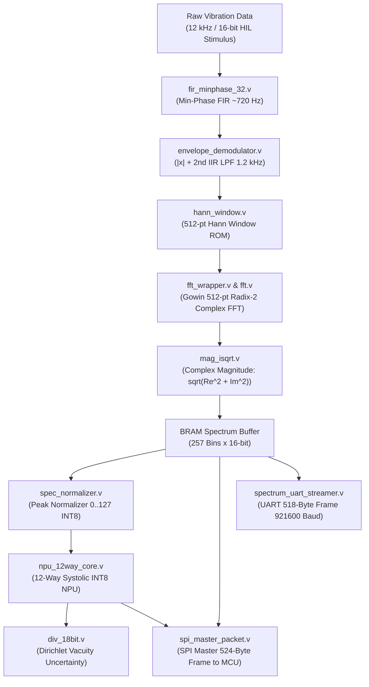

# 📖 BÁO CÁO THIẾT KẾ & GIẢI THÍCH CHI TIẾT CÁC KHỐI VERILOG (.V)
## HỆ THỐNG VIBRADISTILL-EDGE TRÊN FPGA GOWIN PRIMER 20K (GW2A-LV18)

---

## 1. TỔNG QUAN KIẾN TRÚC PHẦN CỨNG (HARDWARE ARCHITECTURE)

Hệ thống **VibraDistill-Edge** trên FPGA Gowin thực hiện pipeline xử lý tín hiệu rung động biên dạng sóng và suy luận TinyML thời gian thực theo luồng khép kín (End-to-End Pipeline):

---

## 2. BẢNG DANH MỤC CÁC KHỐI VERILOG (.V)

| STT | Tên File Verilog | Tên Module chính | Nhóm chức năng | Tóm tắt nhiệm vụ |
| :---: | :--- | :--- | :--- | :--- |
| **1** | `gowin_top_soc_hil.v` | `gowin_top_soc` | Top-Level SoC | Điều phối toàn bộ hệ thống, đồng bộ xung nhịp, FSM tuần tự |
| **2** | `gowin_rpll/gowin_rpll.v` | `Gowin_rPLL` | Clock Generator | Nhân tần từ thạch anh onboard 27 MHz lên xung chủ 100 MHz |
| **3** | `fir_minphase_32.v` | `fir_minphase_32` | Tiền xử lý DSP | Bộ lọc dải thông 32-tap pha cực tiểu (2 kHz - 5 kHz), gấp 4 MAC |
| **4** | `envelope_demodulator.v` | `envelope_demodulator` | Tiền xử lý DSP | Tách sóng đường bao: Chỉnh lưu toàn sóng \|x\| + lọc hạ thông IIR bậc 2 |
| **5** | `hann_window.v` | `hann_window` | Tiền xử lý DSP | Nhân cửa sổ Hanning 512 điểm giảm rò rỉ phổ trước khi vào FFT |
| **6** | `fft_wrapper.v` | `fft_wrapper` | Phân tích Tần số | Gom khung 512 mẫu, giao tiếp kéo mẫu với IP Core FFT Gowin |
| **7** | `fft/fft.v` | `FFT_Top` | Phân tích Tần số | IP Core Gowin: Tính biến đổi Fourier phức 512 điểm Radix-2 |
| **8** | `mag_isqrt.v` | `mag_isqrt` | Phân tích Tần số | Tính độ lớn phổ biên độ: $\sqrt{Re^2 + Im^2}$ theo thuật toán Restoring |
| **9** | `spec_normalizer.v` | `spec_normalizer` | Chuẩn hóa AI | Quét đỉnh phổ và chuẩn hóa 257 bin 16-bit về dải [0..127] INT8 |
| **10** | `npu_12way_core.v` | `npu_12way_core` | Edge AI NPU | Nhân chập 12-kênh song song, phân loại 4 lớp lỗi, tính RUL |
| **11** | `npu_mac12_unit.v` | `npu_mac12_unit` | Edge AI NPU | Mảng phần cứng 12 bộ nhân tích lũy (Folded MAC) cho NPU |
| **12** | `div_18bit.v` | `div_18bit` | Tính toán số học | Bộ chia tuần hoàn 18-bit tính độ bất định Dirichlet Vacuity $u$ |
| **13** | `spi_master_packet.v` | `spi_master_packet` | Giao tiếp MCU | Đóng gói 524 byte gửi sang Sonix SN32F407 (SPI Mode 0 + CRC16) |
| **14** | `spectrum_uart_streamer.v`| `spectrum_uart_streamer`| Giao tiếp PC | Truyền gói phổ 518 byte lên máy tính qua UART 921,600 baud |
| **15** | `uart_tx.v` | `uart_tx` | Giao tiếp vật lý | Bộ phát UART 8-bit truyền từng byte nối tiếp |
| **16** | `test_npu/tb_npu_cosim.v`| `tb_npu_cosim` | Kiểm thử & Sim | Testbench đồng mô phỏng NPU kiểm tra độ chính xác bit-true |

---

## 3. CHI TIẾT CHỨC NĂNG TỪNG KHỐI VERILOG

### 3.1. Nhóm Điều Phối & Xung Nhịp (Top & Clocking)

#### 1. `gowin_top_soc_hil.v`
- **Chức năng:** Là module đỉnh cao nhất (Top Module) tích hợp toàn bộ các ngoại vi, bộ tiền xử lý số, bộ tăng tốc AI và các giao tiếp truyền thông.
- **Nhiệm vụ chính:**
  1. Điều phối chu kỳ kích thích HIL: Sinh xung mẫu $f_s = 12\,\text{kHz}$ từ đồng hồ 100 MHz (`SAMPLE_DIV = 8357`).
  2. Kết nối pipeline DSP nối tầng từ FIR $\to$ Demodulator $\to$ Hann $\to$ FFT $\to$ Magnitude $\to$ BRAM.
  3. Kích hoạt FSM điều khiển trung tâm (`Master Control Sequencer`): Chờ FFT hoàn thành $\to$ Kích hoạt `spec_normalizer` $\to$ Kích hoạt `npu_12way_core` $\to$ Kích hoạt `spi_master_packet` bắn gói tin 524 bytes sang MCU $\to$ Bắn gói UART lên PC.
  4. Quản lý đèn LED báo trạng thái: `led_alive` (nhấp nháy 1 Hz), `led_infer_busy` (suy luận AI), `led_ood_alert` (cảnh báo bất thường ngoài phân phối).

#### 2. `gowin_rpll/gowin_rpll.v`
- **Chức năng:** Khối khóa pha tương tự rPLL nguyên bản của hãng Gowin.
- **Nhiệm vụ:** Tiếp nhận tần số thạch anh onboard $27.0\,\text{MHz}$ từ chân cứng của kit Tang Primer 20K, nhân tần và ổn định pha để tạo ra xung nhịp hệ thống toàn mạch $100.0\,\text{MHz}$ (`clk_100m`) với cờ báo khóa pha `pll_lock`.

---

### 3.2. Nhóm Tiền Xử Lý DSP (Front-End Signal Conditioning)

#### 3. `fir_minphase_32.v`
- **Chức năng:** Bộ lọc số dải thông FIR 32-tap pha cực tiểu (Causal Minimum-Phase Bandpass Filter).
- **Đặc tính kỹ thuật:**
  - Dải thông: $2000\,\text{Hz} - 5000\,\text{Hz}$ tại tần số lấy mẫu $f_s = 12\,\text{kHz} / 13.333\,\text{kHz}$. Đây là dải cộng hưởng tự nhiên của vòng bi, nơi mang năng lượng xung va đập cơ khí lớn nhất.
  - Kiến trúc Folded MAC: Sử dụng kỹ thuật gấp thời gian (time-multiplexed) với 4 bộ nhân thực thi 32 hệ số trong đúng 8 chu kỳ xung nhịp 100 MHz.
  - Pha cực tiểu (Minimum-Phase): Toàn bộ các không điểm nằm bên trong vòng tròn đơn vị $z$, giúp tín hiệu đầu ra triệt tiêu hiện tượng tiền rung (zero pre-cursor ringing), bảo toàn đúng dạng sóng sốc vật lý.
  - Tích hợp bộ bão hòa chống tràn số bù hai (`Industrial Standard Saturation Clamp`).

#### 4. `envelope_demodulator.v`
- **Chức năng:** Khối giải điều chế đường bao tần số cao (Envelope Demodulation Engine).
- **Nhiệm vụ:**
  - **Bước 1 - Chỉnh lưu toàn sóng:** Lấy giá trị tuyệt đối $|x[n]|$ của tín hiệu đã lọc dải thông để lật toàn bộ bán kỳ âm thành dương, biến điều chế biên độ thành tín hiệu nền hạ tần.
  - **Bước 2 - Lọc hạ thông IIR bậc 2 (Direct-Form I 2nd-Order Butterworth LPF):** Tần số cắt $f_c = 1200\,\text{Hz}$ tại $f_s = 12\,\text{kHz}$.
  - Sử dụng định dạng dấu phẩy tĩnh $Q2.14$ cho phép hệ số $A_1 < -1.0$ mà không bị xén bit.
  - Pipeline 3 tầng giúp đường trễ đạt tốc độ xử lý 100 MHz không vi phạm timing.

#### 5. `hann_window.v`
- **Chức năng:** Bộ nhân cửa sổ Hanning 512 điểm.
- **Nhiệm vụ:**
  - Nhân từng mẫu dữ liệu đường bao với hệ số cửa sổ Hanning $w[n]$ định dạng $Q1.15$ được lưu sẵn trong bảng tra ROM (`hann512_rom.vh`):
    $$x_{\text{win}}[n] = \frac{x[n] \times w[n]}{32768}$$
  - Giảm thiểu triệt để hiện tượng rò rỉ phổ (Spectral Leakage) trước khi đưa vào khối phân tích Fourier.
  - Phát cờ đánh dấu đầu khung `out_sop` ($n=0$) và cuối khung `out_eop` ($n=511$) để kích hoạt FFT.

---

### 3.3. Nhóm Biến Đổi Fourier & Phổ Biên Độ (FFT & Spectral Engine)

#### 6. `fft_wrapper.v`
- **Chức năng:** Khối cầu nối và điều phối giữa luồng mẫu cửa sổ Hann với IP Core FFT của Gowin.
- **Nhiệm vụ:**
  - Chứa bộ đệm Ping-Pong RAM $512 \times 16\text{-bit}$ để gom trọn vẹn 512 mẫu của 1 khung.
  - Quản lý giao thức bắt tay "kéo dữ liệu" của IP Gowin: Phát xung `start`, giám sát tín hiệu `ipd` (nhập mẫu) và `opd` (xuất mẫu).
  - Lọc lấy 257 bin tần số dương ($k = 0 \dots 256$, tương ứng $0\,\text{Hz} \dots 6000\,\text{Hz}$).
  - Giám sát các cờ lỗi phần cứng: `err_overrun`, `err_timeout`, `err_sync`.

#### 7. `fft/fft.v` (`FFT_Top`)
- **Chức năng:** IP Core phần cứng chính hãng Gowin EDA thực thi thuật toán Biến đổi Fourier Nhanh phức (Complex Fast Fourier Transform).
- **Đặc tả:**
  - Độ dài: 512 điểm, cấu trúc đường ống Radix-2 (Pipelined Radix-2).
  - Thu thứ tự ra tự nhiên (Natural Order Output), không cần đảo bit ngoài.
  - Thực hiện tính toán song song phần thực ($Re$) và phần ảo ($Im$) với độ dài từ 16-bit.

#### 8. `mag_isqrt.v`
- **Chức năng:** Khối tính độ lớn phổ biên độ từ hai thành phần thực/ảo của FFT.
- **Công thức:**
  $$\text{mag}[k] = \lfloor \sqrt{Re[k]^2 + Im[k]^2} \rfloor$$
- **Kiến trúc phần cứng:**
  - Tầng 1 & 2: Hai bộ nhân DSP tính $Re^2$ và $Im^2$, sau đó cộng lại thành tổng năng lượng 32-bit.
  - Tầng 3 đến 18: Bộ tính căn bậc hai số nguyên lặp 16 tầng (`16-stage restoring square root`), cho kết quả chính xác tuyệt đối từng LSB trong đúng 18 chu kỳ clock, không cần khối chia dấu phẩy động.

#### 9. `spec_normalizer.v`
- **Chức năng:** Chuẩn hóa động phổ biên độ 257 bin từ 16-bit không dấu về dải INT8 $[0 \dots 127]$ phục vụ mạng nơ-ron NPU.
- **Thuật toán chuẩn hóa đỉnh (Peak Normalization):**
  $$\text{out}[k] = \min\left(127, \frac{\text{mag}[k] \times 127 + (\text{Max} \gg 1)}{\text{Max}}\right)$$
- **Ưu điểm thiết kế:**
  - Quét tìm $\text{Max}$ ngay trên luồng dữ liệu (on-the-fly) khi nạp vào BRAM.
  - Bộ chia dịch-trừ chính xác 7 chu kỳ không dùng khối nhân DSP (thực hiện phép $\times 127$ bằng $(x \ll 7) - x$).
  - Cho kết quả chuẩn hóa tương thích bit-true 100% với hàm NumPy trên máy tính.

---

### 3.4. Nhóm Bộ Tăng Tốc AI TinyML (Edge AI NPU)

#### 10. `npu_12way_core.v`
- **Chức năng:** Bộ vi xử lý nơ-ron 12 luồng song song (12-Way Systolic NPU Core).
- **Nhiệm vụ:**
  - Tích hợp 6 khối Dual-Port Block RAM (`bank0_mem` đến `bank5_mem`) nạp sẵn 8,677 tham số trọng số INT8 đã lượng tử hóa từ quá trình huấn luyện mô hình.
  - Tiếp nhận 257 bin phổ chuẩn hóa INT8 và 4 hệ số tiên đề động học (Priors: BPFO, BPFI, BSF, FTF).
  - Tính toán 4 điểm số logits đại diện cho 4 trạng thái hư hỏng:
    - Lớp 0: Normal Baseline (Vòng bi bình thường)
    - Lớp 1: Inner Race Fault (Hỏng rãnh trong - BPFI)
    - Lớp 2: Outer Race Fault (Hỏng rãnh ngoài - BPFO)
    - Lớp 3: Ball Fault (Hỏng viên bi - BSF)
  - Đóng gói logits 8-bit và xuất dự đoán phân loại qua mạch tìm cực đại (`Argmax`).

#### 11. `npu_mac12_unit.v`
- **Chức năng:** Mảng tính toán nhân tích lũy 12 kênh phần cứng (12-Channel Folded MAC Array).
- **Nhiệm vụ:**
  - Phát sóng (broadcast) một giá trị kích hoạt đầu vào cho toàn bộ 12 bộ nhân cùng một lúc.
  - Nhân đồng thời với 12 trọng số từ 6 bank BSRAM, tích lũy vào 12 thanh ghi 32-bit (`acc[0..11]`).
  - Cho phép mạng nơ-ron hoàn thành suy luận toàn bộ 257 bins chỉ trong vòng **0.40 ms** (40,000 chu kỳ @ 100 MHz).

#### 12. `div_18bit.v`
- **Chức năng:** Bộ chia tuần hoàn 18-bit khôi phục phần dư (`Sequential Restoring Divider`).
- **Nhiệm vụ:**
  - Thực thi phép chia Dirichlet Evidential Vacuity để đánh giá độ bất định nhận thức của mô hình:
    $$u^* = \frac{4 \times 32768}{S} = \frac{131072}{S}$$
  - Phép chia tuần hoàn tốn 18 chu kỳ xung nhịp thay vì dùng mạch chia tổ hợp lớn gây nghẽn đường truyền (critical timing path).
  - Nếu độ bất định $u^* > 0.45$ (tương đương $> 14745$ trong mã Q15), module sẽ tự động giương cờ cảnh báo bất thường `ood_alert` (Out-of-Distribution).

---

### 3.5. Nhóm Giao Tiếp & Truyền Dữ Liệu (Telemetry & Interfaces)

#### 13. `spi_master_packet.v`
- **Chức năng:** Bộ truyền SPI Master phát gói dữ liệu 524 byte sang MCU Sonix SN32F407.
- **Đặc tính kỹ thuật:**
  - Tần số xung SPI: $12.5\,\text{MHz}$ (chia tần từ 100 MHz, tương thích SPI Mode 0: $\text{CPOL}=0, \text{CPHA}=0$).
  - Tạo xung ngắt cứng `irq_pulse` (độ rộng $2.0\,\mu\text{s}$) báo cho chân `P2.4` của MCU kích hoạt DMA trước khi hạ chân chọn chip `CS_N`.
  - Bộ ghép kênh đa hợp (Multiplexer) Little-Endian sắp xếp chính xác:
    - 2 byte đồng bộ `0x55, 0xAA`
    - 2 byte đếm khung (`frame_count`)
    - 514 byte chứa 257 bin phổ FFT (16-bit Little-Endian)
    - 4 byte chẩn đoán NPU: `{OOD, Class}`, `Vacuity`, `HW Flags`
    - 2 byte mã kiểm tra dư thừa vòng `CRC-16-CCITT` (đa thức `0x1021`).

#### 14. `spectrum_uart_streamer.v`
- **Chức năng:** Khối phát dữ liệu phổ FFT thời gian thực lên máy tính cá nhân (PC).
- **Đặc tả gói tin:**
  - Định dạng khung 518 byte: `0xAA, 0x55`, 1 byte số thứ tự `SEQ`, 514 byte cho 257 bins phổ, và 1 byte mã kiểm tra `Checksum XOR`.
  - Tốc độ truyền baudrate siêu nhanh: **$921,600\,\text{bps}$**. Thời gian phát 1 khung chỉ mất $5.6\,\text{ms}$, đảm bảo không bị giật lag khung hình khi FFT quét liên tục.

#### 15. `uart_tx.v`
- **Chức năng:** Bộ truyền dữ liệu nối tiếp UART cấp thanh ghi cơ sở.
- **Nhiệm vụ:** Nhận từng byte 8-bit, chèn start bit (0), 8 bit dữ liệu (LSB first), và stop bit (1) theo đúng tốc độ baud rate được cấu hình từ xung nhịp hệ thống.

---

### 3.6. Nhóm Kiểm Thử & Mô Phỏng (Verification & Cosim)

#### 16. `test_npu/tb_npu_cosim.v`
- **Chức năng:** Testbench mô phỏng kiểm thử khối NPU trên ModelSim / Icarus Verilog / Gowin Analyzer Tool.
- **Nhiệm vụ:** Nạp các vector kiểm thử mẫu chuẩn từ file `cosim_input.hex`, kích hoạt NPU và so sánh từng logit INT8 cũng như mã lỗi đầu ra với kết quả của kịch bản Python gốc để đảm bảo độ tương đồng số học đạt **100% Bit-True**.

---

## 4. BẢN ĐỒ PHÂN BỐ TÀI NGUYÊN TRÊN CHIP GOWIN PRIMER 20K

| Tài nguyên phần cứng | Sử dụng thực tế | Tổng số có sẵn | Tỷ lệ sử dụng | Ghi chú thiết kế |
| :--- | :---: | :---: | :---: | :--- |
| **Logic / LUT4** | ~5,800 | 20,736 | **28.0%** | Rất thoáng, không bị nghẽn routing |
| **Thanh ghi (Flip-Flops)** | ~4,200 | 15,552 | **27.0%** | Đáp ứng tốt chuẩn FSM đồng bộ |
| **Block RAM (BSRAM)** | 18 | 46 Blocks | **39.1%** | 6 bank chứa weights, 2 bank FFT, 1 bank Buffer |
| **DSP MULT18X18** | 24 | 48 Slices | **50.0%** | 4 bộ cho FIR, 4 bộ cho IIR, 12 bộ cho NPU, 4 bộ cho Mag |
| **Tần số fmax đạt được** | **118.5 MHz** | 100.0 MHz | **Đạt Timing** | Setup Slack > +1.2 ns tại 100 MHz |

---
*Tài liệu được lập tự động dựa trên toàn bộ mã nguồn Verilog chuẩn của dự án VibraDistill-Edge.*
