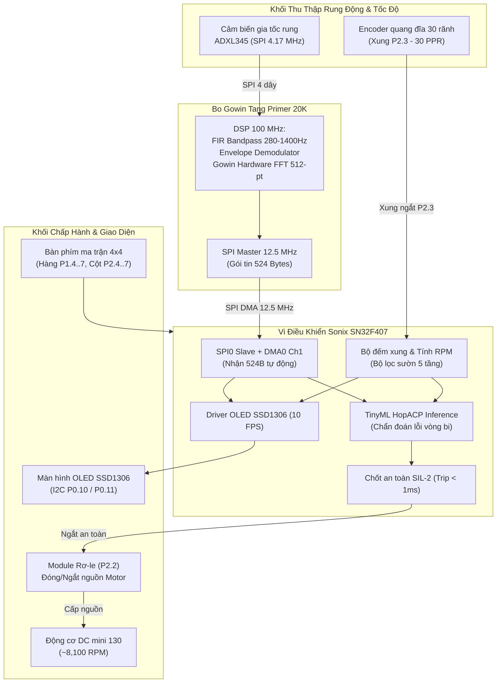

# 📑 BẢNG TỔNG HỢP SƠ ĐỒ ĐẤU NỐI CHÂN MCU SONIX SN32F407
## Hệ Thống VibraDistill-Edge: Đo Rung Động, Giám Sát Vòng Bi & Điều Khiển Động Cơ

* **Dự án:** VibraDistill-Edge (Edge AI Real-Time Bearing Fault Diagnosis & Motor Control)
* **Vi điều khiển mục tiêu:** Sonix SN32F407 (ARM Cortex-M0 @ 12 MHz base / 60 MHz max, 32 KB Flash, 8 KB SRAM)
* **Bo mạch ghép nối:** Gowin Tang Primer 20K FPGA (GW2A-LV18PG256), Cảm biến ADXL345, OLED SSD1306, Encoder quang 30 PPR, Relay 5V, Bàn phím ma trận 4x4
* **Ngày cập nhật:** 03/11/2026

---

## 1. SƠ ĐỒ KHỐI KẾT NỐI HỆ THỐNG (SYSTEM ARCHITECTURE)



---

## 2. BẢNG TỔNG HỢP SƠ ĐỒ CHÂN MCU SONIX SN32F407 (PINOUT TABLE)

| STT | Thiết bị ngoại vi | Chân thiết bị | Chân MCU Sonix | Header trên bo MCU | Chế độ Firmware | Mức điện áp | Mô tả chức năng & Lưu ý kỹ thuật |
| :---: | :--- | :---: | :---: | :---: | :---: | :---: | :--- |
| **1** | Màn hình OLED SSD1306 | **SCL** | **P0.10** | Header **J11** | GPIO Output (I2C SCL) | 3.3V | Chân xung nhịp clock I2C (Bit-Bang) |
| **2** | Màn hình OLED SSD1306 | **SDA** | **P0.11** | Header **J11** | GPIO In/Out (I2C SDA) | 3.3V | Chân truyền nhận dữ liệu I2C (Bit-Bang) |
| **3** | Màn hình OLED SSD1306 | **VCC** | **3.3V / 5V** | Cọc nguồn 3.3V | Power Supply | 3.3V | Cấp nguồn nuôi màn hình OLED 128x64 |
| **4** | Màn hình OLED SSD1306 | **GND** | **GND** | Cọc nguồn GND | Ground | 0V | Nối mass chung hệ thống |
| **5** | Encoder quang 30 PPR | **OUT / DO** | **P2.3** | Header **J7** | GPIO EXTI (P2_IRQn) | 3.3V – 5V | Ngắt cạnh lên đếm xung. Firmware đã bật trở kéo lên nội (Pull-up 50kΩ) |
| **6** | Encoder quang 30 PPR | **VCC** | **3.3V / 5V** | Cọc nguồn 3.3V/5V | Power Supply | 3.3V/5V | Nguồn nuôi module quang LM393 |
| **7** | Encoder quang 30 PPR | **GND** | **GND** | Cọc nguồn GND | Ground | 0V | Nối mass chung hệ thống |
| **8** | Module Rơ-le (Relay) | **IN** | **P2.2** | Header **J7** | GPIO Output (Active-HIGH) | 3.3V – 5V | Mức 1 = BẬT motor; Mức 0 = NGẮT motor an toàn (Trip < 1ms) |
| **9** | Module Rơ-le (Relay) | **VCC** | **5V** | Cọc nguồn 5V | Power Supply | 5V | Nguồn cuộn hút rơ-le (nên dùng nguồn cách ly) |
| **10** | Module Rơ-le (Relay) | **GND** | **GND** | Cọc nguồn GND | Ground | 0V | Nối mass chung hệ thống |
| **11** | FPGA Tang Primer 20K | **SPI_SCK** | **P1.0** | Header **J12** | SPI0_SCK Slave Mode 0 | 3.3V | Xung nhịp SPI 12.5 MHz từ FPGA (CPOL=0, CPHA=0) |
| **12** | FPGA Tang Primer 20K | **SPI_MOSI** | **P1.2** | Header **J12** | SPI0_MOSI Slave (DMA Ch1) | 3.3V | Dữ liệu 524 byte phổ rung động từ FPGA bắn sang MCU |
| **13** | FPGA Tang Primer 20K | **SPI_MISO** | **P1.1** | Header **J12** | SPI0_MISO Slave | 3.3V | Đường phản hồi trạng thái ACK / Handshake về FPGA |
| **14** | FPGA Tang Primer 20K | **SPI_CS_N** | **P1.8** | Header **J12** | SPI0_SEL0 (Chip Select) | 3.3V | Chọn chip tích cực mức Thấp (Firmware bật Pull-up nội P1.8) |
| **15** | FPGA Tang Primer 20K | **GND** | **GND** | Header **J12** / Cọc GND | Common Ground | 0V | **BẮT BUỘC NỐI CHUNG MASS để đồng pha xung 12.5 MHz** |
| **16** | Bàn phím ma trận 4x4 | **Hàng 1 (Row 0)** | **P1.4** | Header **J12 / J8** | GPIO Output | 3.3V | Quét hàng 1 bàn phím (SW1, SW2, SW3, SW4) |
| **17** | Bàn phím ma trận 4x4 | **Hàng 2 (Row 1)** | **P1.5** | Header **J12 / J8** | GPIO Output | 3.3V | Quét hàng 2 bàn phím (SW5, SW6, SW7, SW8) |
| **18** | Bàn phím ma trận 4x4 | **Hàng 3 (Row 2)** | **P1.6** | Header **J12 / J8** | GPIO Output | 3.3V | Quét hàng 3 bàn phím (SW9, SW10, SW11, SW12) |
| **19** | Bàn phím ma trận 4x4 | **Hàng 4 (Row 3)** | **P1.7** | Header **J12 / J8** | GPIO Output | 3.3V | Quét hàng 4 bàn phím (SW13, SW14, SW15, SW16) |
| **20** | Bàn phím ma trận 4x4 | **Cột 1 (Col 0)** | **P2.4** | Header **J7** | GPIO Input Pull-up | 3.3V | Đọc cột 1 (Firmware đã bật Pull-up nội 50kΩ) |
| **21** | Bàn phím ma trận 4x4 | **Cột 2 (Col 1)** | **P2.5** | Header **J7** | GPIO Input Pull-up | 3.3V | Đọc cột 2 (Firmware đã bật Pull-up nội 50kΩ) |
| **22** | Bàn phím ma trận 4x4 | **Cột 3 (Col 2)** | **P2.6** | Header **J7** | GPIO Input Pull-up | 3.3V | Đọc cột 3 (Firmware đã bật Pull-up nội 50kΩ) |
| **23** | Bàn phím ma trận 4x4 | **Cột 4 (Col 3)** | **P2.7** | Header **J7** | GPIO Input Pull-up | 3.3V | Đọc cột 4 (Firmware đã bật Pull-up nội 50kΩ) |
| **24** | LED Báo Gói Tin Onboard | **Catot LED D1** | **P3.8** | Onboard Sonix | GPIO Output (Active-LOW) | 3.3V | Chớp nháy mỗi khi nhận thành công 1 gói tin 524 byte |

---

## 3. GIAO TIẾP FPGA TANG PRIMER 20K & CẢM BIẾN ADXL345

### 3.1. Tuyến SPI0 DMA 12.5 MHz (FPGA Tang 20K $\rightarrow$ MCU Sonix)

* **Chuẩn truyền thông:** SPI Slave Mode 0 (CPOL=0, CPHA=0), truyền MSB first.
* **Tốc độ truyền bus:** $f_{SCLK} = 12.5\text{ MHz}$.
* **Thời gian truyền 1 gói (524 bytes):** $335.36\ \mu\text{s}$. Giữa 2 gói nghỉ $159.6\text{ ms}$ (chu kỳ cập nhật $6.25\text{ Hz}$).
* **Cơ chế phần cứng MCU:** Kênh DMA0 Channel 1 chuyển dữ liệu trực tiếp vào bộ đệm SRAM `s_spi_rx_buf`, CPU hoàn toàn không can thiệp, không trễ màn hình.

| Tín hiệu SPI | Chân trên Bo FPGA Tang 20K | Chân trên MCU Sonix SN32F407 | Chức năng trong Code |
| :--- | :---: | :---: | :--- |
| **SPI_SCK** | Header J3 - Pin 5 | **P1.0** (Header J12) | Xung nhịp đồng bộ 12.5 MHz |
| **SPI_MOSI** | Header J3 - Pin 7 | **P1.2** (Header J12) | Dữ liệu 524 byte từ FPGA sang MCU |
| **SPI_MISO** | Header J3 - Pin 9 | **P1.1** (Header J12) | Đường trả trạng thái ACK / Handshake |
| **SPI_CS_N** | Header J3 - Pin 6 | **P1.8** (Header J12) | Chip Select (Active-LOW khi truyền gói) |
| **COMMON GND** | Header J3 - Pin 2 hoặc 4 | **GND** (Header J12 / Cọc GND) | **BẮT BUỘC NỐI CHUNG MASS ĐỂ KHÔNG LỆCH PHA** |

---

### 3.2. Tuyến cảm biến gia tốc rung ADXL345 $\rightarrow$ Bo FPGA Tang Primer 20K

> [!IMPORTANT]
> **Cảm biến ADXL345 được đấu nối trực tiếp vào bo FPGA Gowin Tang Primer 20K, KHÔNG ĐẤU VÀO MCU SONIX.**
> Giao thức giữa ADXL345 và FPGA là **SPI 4 dây chuẩn đẩy-kéo (Push-Pull), HOÀN TOÀN KHÔNG CẦN VÀ KHÔNG SỬ DỤNG ĐIỆN TRỞ KÉO LÊN (PULL-UP)**.

| Chân ADXL345 | Đấu vào Bo FPGA Gowin Tang Primer 20K | Mức điện áp | Ghi chú kỹ thuật |
| :---: | :--- | :---: | :--- |
| **VCC** | Chân **3V3** trên bo Tang Primer 20K | **3.3V DC** | **Tuyệt đối không cấp 5V** (ADXL345 sẽ cháy nếu áp > 3.6V) |
| **GND** | Chân **GND** trên bo Tang Primer 20K | **0V** | Mass tín hiệu cảm biến |
| **CS** | Chân GPIO điều khiển CS (`adxl345_cs_n`) | 3.3V | SPI Chip Select (Active-LOW) |
| **SCL / SCLK** | Chân GPIO phát Clock (`adxl345_sclk`) | 4.17 MHz | Tốc độ đọc bus SPI $f_{SCLK} = 4.167\text{ MHz}$ |
| **SDA / MOSI** | Chân GPIO cấu hình lệnh (`adxl345_mosi`) | 3.3V | FPGA ghi cấu hình dải đo và thanh ghi |
| **SDO / MISO** | Chân GPIO nhận dữ liệu (`adxl345_miso`) | 3.3V | ADXL345 truyền 6 byte gia tốc thô 3 trục X, Y, Z |

---

## 4. BÀN PHÍM MA TRẬN 4x4 & DANH MỤC PHÍM TẮT ĐIỀU KHIỂN

Bàn phím ma trận 4x4 gồm 4 hàng (Row) quét ngõ ra và 4 cột (Col) ngõ vào:
* **4 Hàng (Outputs):** `P1.4` (Row 0), `P1.5` (Row 1), `P1.6` (Row 2), `P1.7` (Row 3).
* **4 Cột (Inputs Pull-up):** `P2.4` (Col 0), `P2.5` (Col 1), `P2.6` (Col 2), `P2.7` (Col 3) trên Header J7.

### Danh mục phím chức năng đã nạp sẵn trong Firmware:

| Ký hiệu phím | Nút vật lý | Mã Hex trong Code | Chức năng điều khiển | Chi tiết tác vụ khi bấm |
| :---: | :---: | :---: | :--- | :--- |
| **Phím 1** | SW3 | `0x1` | **BẬT ĐỘNG CƠ (RELAY ON)** | Kích chân P2.2 = 1, đóng rơ-le cấp điện motor, reset cờ Trip |
| **Phím 2** | SW4 | `0x2` | **TẮT ĐỘNG CƠ (RELAY OFF)** | Kéo chân P2.2 = 0, ngắt rơ-le dừng motor tức thì |
| **Phím 3** | SW5 | `0x3` | **TOGGLE ĐẢO RƠ-LE** | Đảo trạng thái rơ-le giữa Bật và Tắt |
| **Phím 4** | SW7 | `0x4` | **DEMO QUANG PHỔ CHUẨN** | **Lần 1:** Xem Phổ Rung Mạnh (Lỗi 150 Hz tại Bin 24 vút cao)<br>**Lần 2:** Xem Phổ Bình Thường (Baseline phẳng lì 1-2px)<br>**Lần 3:** Quay lại đo Live FPGA với bộ lọc Spectral EMA |
| **Phím A** | SW6 | `0xA` | **CHUYỂN MODE TIẾP (NEXT)** | Chuyển trang OLED tức thì (< 20ms): Mode 0 $\rightarrow$ 1 $\rightarrow$ 2 $\rightarrow$ 3 |
| **Phím B** | SW10 | `0xB` | **CHUYỂN MODE TRƯỚC (PREV)** | Chuyển lùi trang OLED: Mode 3 $\rightarrow$ 2 $\rightarrow$ 1 $\rightarrow$ 0 |
| **Phím C** | SW14 | `0xC` | **RESET XUNG & VÒNG QUAY** | Xóa bộ đếm `g_pulse_count`, `g_rev_count`, `RPM` về 0 tức thì |
| **Phím D** | SW15 | `0xD` | **XÓA MÃ LỖI DTC** | Xóa mã lỗi E101/E102/F301, mở khóa an toàn để chạy lại máy |
| **Phím E** | SW11 | `0xE` | **RESET MCU PHẦN MỀM** | Kích hoạt System Software Reset (`AIRCR SYSRESETREQ`) |
| **Phím F** | SW12 | `0xF` | **ĐẢO XOAY MÀN HÌNH 180°** | Đảo ngược góc hiển thị màn hình OLED (khớp tư thế hàn thực tế) |

---

## 5. HÌNH THÁI QUANG PHỔ CHUẨN (GOLDEN REFERENCE SPECTRUM)

Được thiết kế chuẩn hóa theo chuỗi DSP phần cứng FPGA Tang Primer 20K ($F_s = 3200\text{ Hz}$, 512-pt FFT, $\Delta f = 6.25\text{ Hz/bin}$):

```text
HÌNH THÁI ĐỒ THỊ TRÊN MÀN HÌNH OLED 128 CỘT (MODE 2):

Biên độ
  ▲
38│              █ (Bin 24: 150.0 Hz - Đỉnh rung va đập 850 LSB)
  │             ███
20│            █████          █ (Bin 48: 300.0 Hz - Hài 2X)
  │            █████         ███               █ (Bin 72: 450.0 Hz - Hài 3X)
 2│  ██████████████████████████████████████████████████████████████ (Sàn nhiễu phẳng 1-2px)
 0└─────────────────────────────────────────────────────────────► Tần số (Hz)
    0Hz        150Hz         300Hz             450Hz         1600Hz
```

* **Trạng thái Động cơ Bình thường (Không rung):** Sàn nhiễu phẳng lì từ 1 đến 2 pixel, chỉ có một gợn sóng quay 1X rất nhỏ (~4 pixel) ở 25–30 Hz.
* **Trạng thái Động cơ Lỗi Rung Mạnh (Hư vòng bi):** Cột đỉnh nhọn tại **Bin 24 (150.0 Hz)** vọt lên cao 38/46 pixels, kèm 2 hài phụ tại 300 Hz và 450 Hz.

---

## 6. CẨM NANG CHECKLIST XỬ LÝ SỰ CỐ TẠI CHỖ (TROUBLESHOOTING)

| Hiện tượng sự cố | Nguyên nhân kỹ thuật | Cách xử lý tại chỗ | Tình trạng xử lý trong Firmware |
| :--- | :--- | :--- | :--- |
| **OLED đứng yên ở chữ `WAITING FPGA`** | 1. Chưa nối chung dây Mass GND giữa FPGA và MCU Sonix.<br>2. Cắm lỏng các dây SPI (P1.0 SCK, P1.2 MOSI, P1.8 CS). | 1. Nối 1 dây bẹ GND chắc chắn giữa 2 bo mạch.<br>2. Nhìn màn hình chẩn đoán: xem `CS`, `CK` có đổi mức logic không. | Firmware có màn hình chẩn đoán hiển thị trực quan logic từng chân. |
| **Số xung & RPM nhảy loạn xạ khi lay động cơ / đụng dây** | 1. Chân ngắt Encoder thả nổi.<br>2. Rung lắc mép quang học gây dao động cao tần (LM393 Comparator Ringing 50–500 kHz). | Kiểm tra giắc cắm OUT cảm biến quang cắm chặt vào P2.3 (Header J7). | **Đã xử lý 100% bằng 5 tầng lọc công nghiệp:**<br>- Bật Pull-up nội 50kΩ trên P2.3.<br>- Lọc sườn số 3 mẫu (~12 us).<br>- Dead-time Blanking 110 us.<br>- Vùng chết Deadband < 15 xung/200ms.<br>- Lọc làm mịn EMA 4 mẫu quanh 8.1k RPM. |
| **Phổ rung nhảy múa liên tục, không rõ rung hay không** | 1. Cảm biến dán bằng băng dính xốp làm triệt tiêu 95% rung động cao tần.<br>2. Nhiễu tia lửa chổi than động cơ DC phát xạ vào dây cảm biến.<br>3. Thiếu bộ lọc trung bình động phổ. | 1. Dán cảm biến bằng **keo 502 cứng** trực tiếp lên vỏ sắt motor.<br>2. Hàn **1 tụ gốm 104 (100nF)** song song 2 cực motor.<br>3. Bấm **Phím 4** để bật Demo đối chiếu. | Firmware đã tích hợp **bộ lọc Spectral EMA 70/30** giúp phổ đứng yên vững chãi. |
| **Đỉnh phổ luôn bị kẹt ở 16.2 Hz, 24.4 Hz** | Thành phần trọng lực Trái Đất ($1g$) và DC Offset của bộ nắn đường bao rò rỉ vào Bin 0..5 với biên độ lớn (850–950 LSB). | Không cần can thiệp phần cứng. | **Đã fix hoàn toàn:** Firmware quét tìm đỉnh từ **Bin 6 ($37.5\text{ Hz}$) trở lên**, loại bỏ 100% nhiễu DC, bắt đúng đỉnh tần số quay thật của động cơ. |
| **Lỗi Keil `FCARM - Output Name not specified`** | Vô tình kéo/add file đầu ra `VibraDistill.hex` vào nhóm mã nguồn `App` trong Keil MDK. | Click vào `VibraDistill.hex` trong Keil và nhấn phím **Delete** trên bàn phím. Sau đó nhấn **Rebuild (F7)**. | Đã xóa vĩnh viễn thẻ hex trong file `VibraDistill.uvprojx`. |
