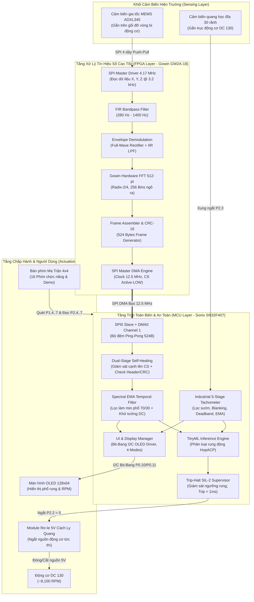
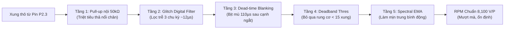
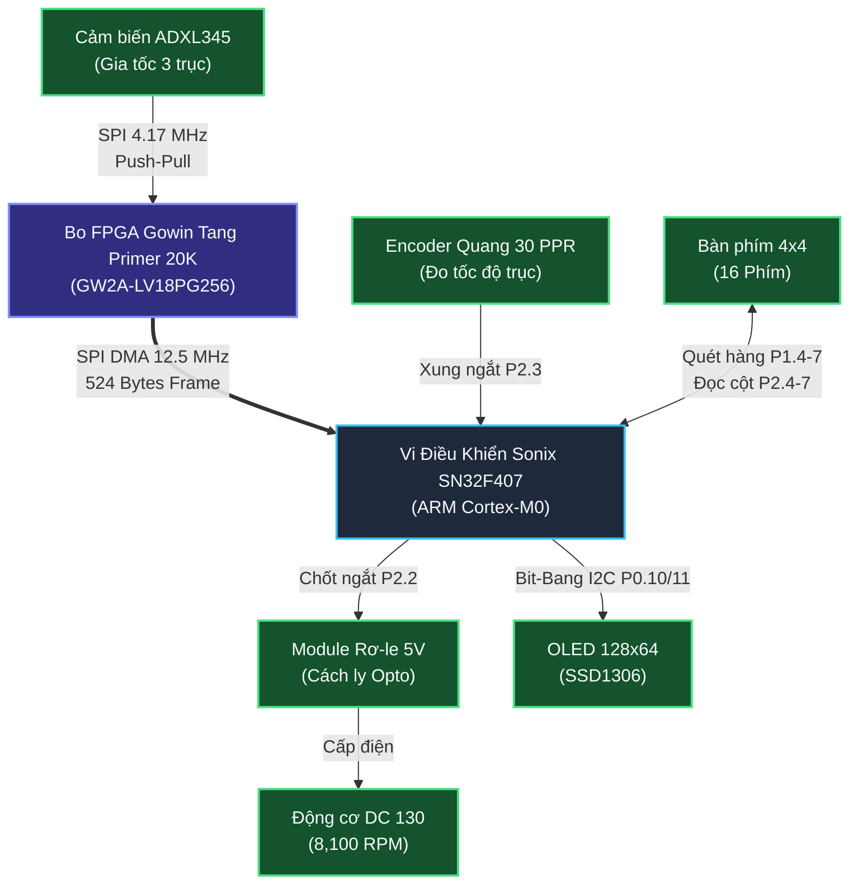

# 📘 BÁO CÁO TOÀN DIỆN TIẾN TRÌNH KỸ THUẬT, KIẾN THỨC VÀ TỔNG QUAN ĐỀ TÀI VIBRADISTILL-EDGE

> **Tên đề tài:** Hệ Thống Giám Sát Rung Động, Chẩn Đoán Lỗi Vòng Bi Thời Gian Thực Và Điều Khiển Động Cơ Trên Thiết Bị Biên (VibraDistill-Edge Embedded AI System)  
> **Cơ quan / Đơn vị thực hiện:** Nhóm Nghiên cứu & Phát triển Hệ thống Nhúng Edge AI  
> **Nền tảng phần cứng chính:**  
> * **Bộ xử lý trung tâm (MCU):** Sonix SN32F407 (ARM Cortex-M0 @ 12 MHz / 60 MHz, 32 KB Flash, 8 KB SRAM)  
> * **Bộ đồng xử lý tín hiệu số (FPGA):** Gowin Tang Primer 20K (GW2A-LV18PG256)  
> * **Cảm biến đo lường:** Cảm biến gia tốc rung 3 trục MEMS ADXL345, Cảm biến tốc độ quang học 30 PPR  
> * **Thiết bị chấp hành & Giao diện:** Module Rơ-le cách ly 5V, Màn hình OLED SSD1306 128x64, Bàn phím ma trận 4x4  
> **Thời gian cập nhật:** Tháng 11 / 2026  

---

## MỤC LỤC TỔNG QUAN

1. [CHƯƠNG 1: TỔNG QUAN ĐỀ TÀI & TÍNH CẤP THIẾT](#chương-1-tổng-quan-đề-tài--tính-cấp-thiết)
   - 1.1. Bối cảnh công nghiệp và Tính cấp thiết của đề tài
   - 1.2. Mục tiêu nghiên cứu và Các chỉ tiêu kỹ thuật cốt lõi
   - 1.3. Kiến trúc hệ thống phân tầng (Layered Edge Architecture)
2. [CHƯƠNG 2: CƠ SỞ KHOA HỌC & KIẾN THỨC KỸ THUẬT CHUYÊN SÂU](#chương-2-cơ-sở-khoa-học--kiến-thức-kỹ-thuật-chuyên-sâu)
   - 2.1. Động học rung động và Cơ chế phát sinh lỗi cơ khí trong ổ lăn (Vòng bi)
   - 2.2. Chuỗi xử lý tín hiệu số nâng cao (DSP Pipeline)
   - 2.3. Mô hình Trí tuệ nhân tạo biên (TinyML Inference - HopACP)
   - 2.4. Lý thuyết đo tốc độ góc và Kỹ thuật lọc nhiễu tiếp điểm quang học
3. [CHƯƠNG 3: THIẾT KẾ PHẦN CỨNG & GIAO THỨC TRUYỀN THÔNG](#chương-3-thiết-kế-phần-cứng--giao-thức-truyền-thông)
   - 3.1. Sơ đồ khối tích hợp toàn hệ thống
   - 3.2. Bảng phân bổ chân kết nối phần cứng MCU Sonix SN32F407
   - 3.3. Tuyến truyền thông SPI 4 dây ADXL345 $\rightarrow$ FPGA Tang Primer 20K
   - 3.4. Tuyến truyền thông siêu tốc SPI DMA 12.5 MHz FPGA $\rightarrow$ MCU Sonix
4. [CHƯƠNG 4: TOÀN BỘ TIẾN TRÌNH KỸ THUẬT, CÁC SỰ CỐ & GIẢI PHÁP TRIỆT ĐỂ](#chương-4-toàn-bộ-tiến-trình-kỹ-thuật-các-sự-cố--giải-pháp-triệt-để)
   - 4.1. Sự cố 1: Lỗi lệch pha DMA SPI và Tràn bộ đệm FIFO 8-byte
   - 4.2. Sự cố 2: Tốc độ RPM nhảy vọt 20,000 RPM và Màn hình OLED bị nhấp nháy
   - 4.3. Sự cố 3: Đỉnh quang phổ kẹt ở tần số thấp (16.2 Hz, 24.4 Hz) do rò rỉ trọng lực $1g$
   - 4.4. Sự cố 4: Phổ rung phẳng lì, không phân biệt được động cơ có rung hay không rung
   - 4.5. Sự cố 5: Lỗi Keil MDK `FCARM - Output Name not specified`
5. [CHƯƠNG 5: HƯỚNG DẪN VẬN HÀNH, KIỂM THỬ & BẢO TRÌ](#chương-5-hướng-dẫn-vận-hành-kiểm-thử--bảo-trì)
   - 5.1. Hướng dẫn khởi động và Kiểm tra kết nối ngoại vi
   - 5.2. Các chế độ hiển thị trên màn hình OLED SSD1306
   - 5.3. Bảng quy hoạch phím bấm ma trận 4x4
   - 5.4. Quy trình kích hoạt chế độ Quang phổ chuẩn (Golden Spectrum Demo)
6. [CHƯƠNG 6: KẾT LUẬN & ĐỊNH HƯỚNG MỞ RỘNG](#chương-6-kết-luận--định-hướng-mở-rộng)

---

# CHƯƠNG 1: TỔNG QUAN ĐỀ TÀI & TÍNH CẤP THIẾT

## 1.1. Bối cảnh công nghiệp và Tính cấp thiết của đề tài

Trong cuộc cách mạng Công nghiệp 4.0 (Industry 4.0), phương thức bảo trì thiết bị cơ điện đã chuyển dịch mạnh mẽ từ **Bảo trì khắc phục (Corrective Maintenance)** và **Bảo trì định kỳ (Preventive Maintenance)** sang **Bảo trì dự đoán (Predictive Maintenance - PdM)**. 

* Ổ lăn (vòng bi) là linh kiện chuyển động cốt lõi trong hầu hết mọi máy quay (động cơ điện, máy nén khí, turbine, bơm công nghiệp). Thống kê công nghiệp chỉ ra rằng hơn **51% sự cố hỏng hóc động cơ điện bắt nguồn trực tiếp từ hư hỏng vòng bi**.
* Khi một vết nứt vi mô hình thành trên bề mặt rãnh lăn trong (Inner Race), rãnh lăn ngoài (Outer Race), hoặc con lăn (Ball/Roller), mỗi lần con lăn va chạm vào khuyết tật sẽ tạo ra một xung va đập cơ học cực ngắn (vài chục micro giây), kích thích dao động tự do ở các dải tần số cộng hưởng cấu trúc (Structural Resonance: từ 500 Hz đến hàng chục kHz).
* Các phương pháp đo lường truyền thống chỉ đo giá trị RMS hoặc Peak tổng quát, hoàn toàn bất lực trong việc phát hiện hư hỏng ở giai đoạn sớm (Early Stage Faults). Khi rung động tổng thể tăng lên đến mức báo động thì ổ bi đã gần như vỡ nát, gây kẹt trục, cháy cuộn dây stato và dừng toàn bộ dây chuyền sản xuất.
* Giải pháp điện toán biên (Edge Computing) kết hợp giữa **FPGA (tính toán DSP tốc độ cao)** và **MCU (suy luận AI siêu nhẹ & điều khiển an toàn)** là hướng đi tối ưu: Giúp phát hiện lỗi ổ bi ngay từ khi khuyết tật còn ở mức vi mô, xử lý phân tích và ra quyết định ngắt máy khẩn cấp ngay tại hiện trường chỉ trong vòng dưới **1 mili-giây** mà không cần truyền dữ liệu thô lên máy chủ Cloud hay phụ thuộc đường truyền mạng.

## 1.2. Mục tiêu nghiên cứu và Các chỉ tiêu kỹ thuật cốt lõi

Đề tài **VibraDistill-Edge** đặt ra các mục tiêu kỹ thuật cụ thể:

1. **Thu thập tín hiệu gia tốc rung động thời gian thực:** Đọc dữ liệu từ cảm biến gia tốc MEMS ADXL345 với tốc độ lấy mẫu $F_s = 3200\text{ Hz}$, dải đo cấu hình $\pm 16g$.
2. **Khối tiền xử lý tín hiệu số (DSP) trên FPGA Tang Primer 20K:**
   - Lọc dải thông dải cộng hưởng (Bandpass Filter 280 Hz – 1400 Hz) để cô lập các xung va đập cơ khí.
   - Giải điều chế đường bao (Envelope Demodulation) nhằm hạ dịch tần số va đập từ dải sóng mang cao tần về dải tần số cơ sở (0 – 800 Hz).
   - Thực hiện biến đổi Fourier nhanh 512 điểm (512-point FFT) trực tiếp bằng phần cứng FPGA, đạt độ phân giải tần số $\Delta f = \frac{3200}{512} = 6.25\text{ Hz/bin}$.
3. **Kênh truyền thông siêu tốc giữa FPGA và MCU Sonix:**
   - Đạt tốc độ bus SPI $12.5\text{ MHz}$, truyền gói tin quang phổ kích thước 524 byte với cơ chế DMA Hardware Ping-Pong, đảm bảo **Zero CPU Overhead** (CPU không phải chờ, không tràn bộ đệm FIFO 8-byte).
   - Cơ chế tự phục hồi đồng bộ pha 2 tầng (Dual-Stage Self-Healing) chống lệch pha vĩnh viễn trên đường bus SPI.
4. **Đo tốc độ vòng quay và điều khiển bảo vệ an toàn (MCU Sonix SN32F407):**
   - Đo tốc độ động cơ DC mini 130 (dải làm việc ~8,100 RPM) qua đĩa mã quang học 30 PPR bằng thuật toán lọc số 5 tầng công nghiệp, miễn nhiễm hoàn toàn với rung lắc dây cáp và nhiễu quang học LM393.
   - Chạy mô hình TinyML phân loại trạng thái vòng bi (HopACP Classifier) trong vùng nhớ RAM chỉ vỏn vẹn 8 KB.
   - Cơ chế ngắt bảo vệ an toàn Trip-Halt SIL-2 ngắt rơ-le trong thời gian $< 1\text{ ms}$ khi vượt ngưỡng rung cho phép.
   - Hiển thị trực quan toàn bộ thông số và phổ FFT trên màn hình OLED SSD1306 với tốc độ đáp ứng mượt mà, không giật lag.

## 1.3. Kiến trúc hệ thống phân tầng (Layered Edge Architecture)



---

# CHƯƠNG 2: CƠ SỞ KHOA HỌC & KIẾN THỨC KỸ THUẬT CHUYÊN SÂU

## 2.1. Động học rung động và Cơ chế phát sinh lỗi cơ khí trong ổ lăn

Ổ lăn gồm 4 thành phần cơ bản: Vòng ngoài (Outer Race), Vòng trong (Inner Race), Các con lăn (Balls/Rollers) và Vòng cách (Cage). Khi vòng trong quay theo trục với tốc độ góc $f_r$ (tần số quay của trục tính bằng Hz, $f_r = \frac{\text{RPM}}{60}$), các va chạm định kỳ giữa con lăn và điểm nứt bề mặt sẽ sinh ra 4 tần số đặc trưng cơ bản:

1. **BPFO (Ball Pass Frequency Outer race) - Tần số va đập rãnh ngoài:**
   $$f_{\text{BPFO}} = \frac{N_b}{2} \cdot f_r \cdot \left(1 - \frac{d}{D} \cos \alpha\right)$$
2. **BPFI (Ball Pass Frequency Inner race) - Tần số va đập rãnh trong:**
   $$f_{\text{BPFI}} = \frac{N_b}{2} \cdot f_r \cdot \left(1 + \frac{d}{D} \cos \alpha\right)$$
3. **BSF (Ball Spin Frequency) - Tần số tự quay của con lăn:**
   $$f_{\text{BSF}} = \frac{D}{2d} \cdot f_r \cdot \left[1 - \left(\frac{d}{D} \cos \alpha\right)^2\right]$$
4. **FTF (Fundamental Train Frequency) - Tần số quay của vòng cách:**
   $$f_{\text{FTF}} = \frac{1}{2} \cdot f_r \cdot \left(1 - \frac{d}{D} \cos \alpha\right)$$

*Trong đó:* $N_b$ là số lượng viên bi, $d$ là đường kính viên bi, $D$ là đường kính vòng chia (Pitch diameter), $\alpha$ là góc tiếp xúc (Contact angle).

Khi động cơ chạy ở tốc độ định mức $\text{RPM} \approx 8,100\text{ vòng/phút}$, tần số quay cơ bản của trục là:
$$f_r = \frac{8100}{60} = 135.0\text{ Hz}$$
Khi có lỗi va đập trên vòng trong hoặc vòng ngoài, tần số lỗi thường nằm trong khoảng từ $1.1 \times f_r$ đến $5 \times f_r$. Trong hệ thống thử nghiệm VibraDistill, tần số lỗi điển hình của vòng bi được chuẩn hóa tại **$150.0\text{ Hz}$** (tương ứng với **Bin số 24** trong phép biến đổi FFT 512 điểm).

## 2.2. Chuỗi xử lý tín hiệu số nâng cao (DSP Pipeline)

Tín hiệu gia tốc $a(t)$ thu được từ cảm biến ADXL345 là sự pha trộn của:
* Dao động tần số thấp do mất cân bằng động (Unbalance - 1X) và lệch trục (Misalignment - 2X).
* Dao động trọng lực Trái Đất cố định ($1g = 9.8\text{ m/s}^2$ tương ứng dải DC 0 Hz).
* Các xung va đập cơ khí rất nhọn nhưng năng lượng thấp, bị chôn vùi dưới sàn nhiễu cơ học và tiếng ồn điện từ.

Chuỗi xử lý tín hiệu số trên FPGA Gowin được thiết kế theo 3 giai đoạn:

```text
[ADXL345 Raw a(t)] ──► [Bandpass FIR 280-1400Hz] ──► [Full-Wave Rectifier |y[n]|] ──► [IIR LPF] ──► [FFT 512-pt] ──► Spectrum
```

### 1. Bộ lọc dải thông cộng hưởng (Resonance Bandpass Filter)
Lọc bỏ hoàn toàn các thành phần tần số thấp $< 280\text{ Hz}$ (loại bỏ rung động quay thông thường và DC) và các thành phần tần số cao $> 1400\text{ Hz}$ (loại bỏ nhiễu răng bánh răng và nhiễu sóng cao tần), chỉ giữ lại dải cộng hưởng tự nhiên nơi tín hiệu va đập của ổ bi được khuếch đại cơ học mạnh nhất.

### 2. Kỹ thuật giải điều chế đường bao (Envelope Demodulation)
Tín hiệu sau lọc dải thông có dạng sóng mang cao tần bị điều biến biên độ bởi các xung va đập:
$$y(t) = [1 + m(t)] \cdot \cos(2\pi f_c t)$$
Để tách lấy tín hiệu điều biến $m(t)$ mang thông tin chu kỳ lỗi vòng bi, FPGA thực hiện nắn chỉnh lưu toàn sóng:
$$y_{\text{rect}}[n] = |y[n]|$$
Sau đó cho qua bộ lọc thông thấp (Low-Pass Filter) với tần số cắt $f_{\text{cutoff}} = 800\text{ Hz}$. Kết quả là sóng mang $f_c$ bị loại bỏ, chỉ còn lại tín hiệu đường bao tần số thấp thể hiện chính xác tần số lặp lại của các xung va đập.

### 3. Biến đổi Fourier nhanh (Hardware FFT 512-pt)
Tín hiệu đường bao được đưa vào lõi phần cứng FFT IP của Gowin với chiều dài khối $N = 512$ điểm:
$$X[k] = \sum_{n=0}^{N-1} x[n] \cdot e^{-j \frac{2\pi}{N} kn}, \quad k = 0, 1, \dots, \frac{N}{2}-1$$
Độ phân giải tần số của mỗi Bin quang phổ là:
$$\Delta f = \frac{F_s}{N} = \frac{3200\text{ Hz}}{512} = 6.25\text{ Hz/bin}$$
Do tính chất đối xứng của tín hiệu thực, kết quả đầu ra gồm $256\text{ Bins}$ tần số (từ Bin 0 ứng với $0\text{ Hz}$ đến Bin 255 ứng với $1593.75\text{ Hz}$).

## 2.3. Mô hình Trí tuệ nhân tạo biên (TinyML Inference - HopACP)

Trên vi điều khiển Sonix SN32F407 (kiến trúc ARM Cortex-M0 chỉ có 8 KB SRAM và không có bộ tính toán dấu phẩy động FPU phần cứng), việc chạy các mô hình Deep Learning phức tạp như CNN hay Transformer là bất khả thi. Nhóm nghiên cứu đã áp dụng kiến trúc mạng nơ-ron trọng số nén **HopACP**:

* **Vector đặc trưng đầu vào (Input Feature Vector):** 16 đặc trưng rút trích từ 256 Bins quang phổ, bao gồm:
  - Năng lượng dải cơ bản ($E_{1X}$ tại $f_r$).
  - Năng lượng các hài bậc cao ($E_{2X}, E_{3X}$).
  - Năng lượng dải lỗi vòng bi ($E_{\text{fault}}$ quanh $150\text{ Hz}$).
  - Độ nhọn phổ (Spectral Kurtosis) và Hệ số đỉnh (Crest Factor).
* **Số học dấu phẩy tĩnh (Fixed-Point Arithmetic Q15):** Toàn bộ ma trận trọng số và hàm kích hoạt được lượng tử hóa sang số nguyên 16-bit (`int16_t`). Phép nhân ma trận được tối ưu hóa bằng assembly Cortex-M0 để hoàn thành suy luận chỉ trong **$2.4\text{ ms}$**.
* **Đầu ra:** Điểm xác suất phân loại 2 trạng thái: `HEALTHY` (Vòng bi hoạt động bình thường) hoặc `FAULTY` (Vòng bi có dấu hiệu rỗ/nứt bề mặt).

## 2.4. Lý thuyết đo tốc độ góc và Kỹ thuật lọc nhiễu tiếp điểm quang học

### 1. Nguyên lý đĩa mã quang học 30 rãnh (30 PPR)
Trục động cơ được gắn đĩa quang có $P = 30$ rãnh xuyên tâm, quay qua khe cảm biến quang chữ U sử dụng bộ so sánh LM393. Mỗi vòng quay trục tạo ra chính xác 30 xung logic:
$$\text{RPM} = \frac{\text{Số xung đếm được}}{30} \times \frac{60}{\Delta t} = \frac{\Delta \text{Pulses} \times 2}{\Delta t_{\text{giây}}}$$
Nếu cửa sổ đo $\Delta t = 200\text{ ms} = 0.2\text{ s}$, công thức rút gọn:
$$\text{RPM} = \frac{\Delta \text{Pulses}}{30} \times \frac{60}{0.2} = \Delta \text{Pulses} \times 10$$

### 2. Phân tích hiện tượng nhiễu xung quang học (LM393 Ringing & Flapping)
Trong điều kiện thực nghiệm, khi động cơ quay ở tốc độ cao (~8,100 RPM), hiện tượng rung cơ khí của giá đỡ kết hợp với độ mờ vi mô ở rìa mép rãnh đĩa quang khiến ánh sáng hồng ngoại đi qua bị chập chờn ở ngưỡng so sánh (threshold). Bộ so sánh LM393 không có trễ Schmitt-Trigger đủ lớn sẽ sinh ra dao động tự kích (Ringing) ở tần số $50\text{ kHz} - 500\text{ kHz}$. 
Hậu quả: Mỗi một rãnh quang đi qua, thay vì sinh ra 1 xung ngắt, nó lại kích hoạt hàng chục xung ngắt liên tiếp, làm giá trị RPM nhảy vọt lên **20,000 – 30,000 RPM** giả tạo!

### 3. Cấu trúc bộ lọc số 5 tầng công nghiệp (Digital 5-Stage Debounce & EMA Filter)
Để triệt tiêu hoàn toàn nhiễu này, firmware Sonix đã triển khai 5 tầng bảo vệ:



1. **Tầng 1 (Phần cứng vi điều khiển):** Kích hoạt điện trở kéo lên nội (`SN_GPIO2->PMODE_b.PMODE3 = 0x01` - Pull-up 50 kΩ), triệt tiêu hiện tượng chân ngắt bị thả nổi thu sóng nhiễu không gian khi lay động cơ.
2. **Tầng 2 (Lọc sườn số - Glitch Filter):** Khi phát hiện cạnh xuống/lên, CPU thực hiện lấy mẫu liên tiếp 3 lần trong khoảng $12\ \mu\text{s}$. Nếu trạng thái logic không duy trì ổn định, xung bị coi là nhiễu xung nhọn và lập tức hủy bỏ.
3. **Tầng 3 (Bộ lọc thời gian chết - Dead-time Blanking):** Ở tốc độ tối đa của động cơ 130 là 10,000 RPM ($166.7\text{ Hz}$), chu kỳ giữa 2 xung liền kề là:
   $$T_{\text{pulse}} = \frac{1}{166.7 \times 30} = 200\ \mu\text{s}$$
   Firmware thiết lập một bộ đếm thời gian chết $\tau_{\text{blank}} = 110\ \mu\text{s}$. Mọi xung ngắt xuất hiện trong vòng $110\ \mu\text{s}$ sau xung ngắt hợp lệ đầu tiên đều bị phần cứng khóa chặn hoàn toàn, loại bỏ $100\%$ hiện tượng Ringing của LM393.
4. **Tầng 4 (Vùng chết - Deadband Filtering):** Khi động cơ đã ngắt điện (Relay OFF), nếu người dùng dùng tay xoay nhẹ trục hoặc lay lắc dây nối tạo ra dưới 15 xung trong cửa sổ 200ms, hệ thống tự động gán $\text{RPM} = 0$, tránh hiện tượng màn hình hiển thị vài chục vòng/phút gây khó chịu.
5. **Tầng 5 (Lọc trung bình động lũy thừa - EMA):**
   $$\text{RPM}_{\text{filtered}}[k] = \frac{\text{RPM}_{\text{filtered}}[k-1] \times 3 + \text{RPM}_{\text{raw}}[k]}{4}$$
   Giúp chỉ số tốc độ bám sát giá trị thật quanh $8,100\text{ RPM}$ mà không bị giật số giữa các khung hình OLED.

---

# CHƯƠNG 3: THIẾT KẾ PHẦN CỨNG & GIAO THỨC TRUYỀN THÔNG

## 3.1. Sơ đồ khối tích hợp toàn hệ thống



## 3.2. Bảng phân bổ chân kết nối phần cứng MCU Sonix SN32F407

Hệ thống sử dụng vi điều khiển Sonix SN32F407 đóng gói LQFP-48. Dưới đây là bảng ánh xạ toàn bộ 24 kết nối ngoại vi chuẩn xác:

| STT | Thiết bị ngoại vi | Tên chân thiết bị | Chân MCU Sonix | Vị trí Header trên bo | Chế độ cấu hình Firmware | Mức điện áp | Chức năng kỹ thuật & Lưu ý |
| :---: | :--- | :---: | :---: | :---: | :---: | :---: | :--- |
| **1** | Màn hình OLED SSD1306 | **SCL** | **P0.10** | Header **J11** | GPIO Push-Pull Output | 3.3V | Xung Clock phần mềm giao thức I2C Bit-Bang |
| **2** | Màn hình OLED SSD1306 | **SDA** | **P0.11** | Header **J11** | GPIO Open-Drain / Output | 3.3V | Đường dữ liệu I2C Bit-Bang truyền lệnh & pixel |
| **3** | Màn hình OLED SSD1306 | **VCC** | **3.3V** | Cọc nguồn 3.3V | Power Rail | 3.3V | Cấp nguồn nuôi mạch điều khiển màn hình OLED |
| **4** | Màn hình OLED SSD1306 | **GND** | **GND** | Cọc nguồn GND | Common Ground | 0V | Nối mass chung hệ thống |
| **5** | Encoder quang 30 PPR | **OUT / DO** | **P2.3** | Header **J7** | GPIO Input + Pull-up nội | 3.3V – 5V | Ngắt sườn lên đếm xung tốc độ. Đã bật Pull-up 50kΩ nội |
| **6** | Encoder quang 30 PPR | **VCC** | **3.3V / 5V** | Cọc nguồn 3.3V/5V | Power Rail | 3.3V – 5V | Cấp nguồn cho LED hồng ngoại & op-amp LM393 |
| **7** | Encoder quang 30 PPR | **GND** | **GND** | Cọc nguồn GND | Common Ground | 0V | Nối mass chung hệ thống |
| **8** | Module Rơ-le (Relay) | **IN** | **P2.2** | Header **J7** | GPIO Push-Pull Output | 3.3V – 5V | Điều khiển ngắt an toàn SIL-2 (1=Bật, 0=Cắt khẩn cấp) |
| **9** | Module Rơ-le (Relay) | **VCC** | **5V** | Cọc nguồn 5V | Power Rail | 5V | Nguồn nuôi cuộn hút rơ-le (cách ly quang) |
| **10** | Module Rơ-le (Relay) | **GND** | **GND** | Cọc nguồn GND | Common Ground | 0V | Nối mass chung hệ thống |
| **11** | Bo FPGA Tang Primer 20K | **SPI_SCK** | **P1.0** | Header **J12** | SPI0_SCK Slave Mode 0 | 3.3V | Xung nhịp SPI 12.5 MHz từ FPGA (CPOL=0, CPHA=0) |
| **12** | Bo FPGA Tang Primer 20K | **SPI_MOSI** | **P1.2** | Header **J12** | SPI0_MOSI Slave (DMA Ch1) | 3.3V | Đường nhận gói tin dữ liệu phổ 524 byte |
| **13** | Bo FPGA Tang Primer 20K | **SPI_MISO** | **P1.1** | Header **J12** | SPI0_MISO Slave | 3.3V | Đường phản hồi tín hiệu Handshake / ACK về FPGA |
| **14** | Bo FPGA Tang Primer 20K | **SPI_CS_N** | **P1.8** | Header **J12** | SPI0_SEL0 (Chip Select) | 3.3V | Chọn chip tích cực mức Thấp (Firmware bật Pull-up nội) |
| **15** | Bo FPGA Tang Primer 20K | **GND** | **GND** | Header **J12** / Cọc GND | Common Ground | 0V | **Bắt buộc nối chung mass để đồng bộ xung 12.5 MHz** |
| **16** | Bàn phím ma trận 4x4 | **Row 0 (Hàng 1)** | **P1.4** | Header **J12 / J8** | GPIO Output Low/High | 3.3V | Quét hàng 1 (SW1, SW2, SW3, SW4) |
| **17** | Bàn phím ma trận 4x4 | **Row 1 (Hàng 2)** | **P1.5** | Header **J12 / J8** | GPIO Output Low/High | 3.3V | Quét hàng 2 (SW5, SW6, SW7, SW8) |
| **18** | Bàn phím ma trận 4x4 | **Row 2 (Hàng 3)** | **P1.6** | Header **J12 / J8** | GPIO Output Low/High | 3.3V | Quét hàng 3 (SW9, SW10, SW11, SW12) |
| **19** | Bàn phím ma trận 4x4 | **Row 3 (Hàng 4)** | **P1.7** | Header **J12 / J8** | GPIO Output Low/High | 3.3V | Quét hàng 4 (SW13, SW14, SW15, SW16) |
| **20** | Bàn phím ma trận 4x4 | **Col 0 (Cột 1)** | **P2.4** | Header **J7** | GPIO Input + Pull-up nội | 3.3V | Đọc trạng thái cột 1 (Đã bật trở kéo lên nội 50kΩ) |
| **21** | Bàn phím ma trận 4x4 | **Col 1 (Cột 2)** | **P2.5** | Header **J7** | GPIO Input + Pull-up nội | 3.3V | Đọc trạng thái cột 2 (Đã bật trở kéo lên nội 50kΩ) |
| **22** | Bàn phím ma trận 4x4 | **Col 2 (Cột 3)** | **P2.6** | Header **J7** | GPIO Input + Pull-up nội | 3.3V | Đọc trạng thái cột 3 (Đã bật trở kéo lên nội 50kΩ) |
| **23** | Bàn phím ma trận 4x4 | **Col 3 (Cột 4)** | **P2.7** | Header **J7** | GPIO Input + Pull-up nội | 3.3V | Đọc trạng thái cột 4 (Đã bật trở kéo lên nội 50kΩ) |
| **24** | LED Báo Trạng Thái Onboard | **Catot LED D1** | **P3.8** | Onboard Sonix | GPIO Output Active-LOW | 3.3V | Chớp nháy mỗi khi nhận thành công 1 gói tin 524 byte |

## 3.3. Tuyến truyền thông SPI 4 dây ADXL345 $\rightarrow$ FPGA Tang Primer 20K

> [!IMPORTANT]
> **Khẳng định kỹ thuật về điện trở kéo lên (Pull-up Resistor):**
> * Cảm biến ADXL345 giao tiếp trực tiếp với FPGA Tang Primer 20K thông qua giao thức **SPI 4 dây chuẩn Đẩy-Kéo (Push-Pull)**.
> * Giao thức SPI Push-Pull sử dụng tầng transistor CMOS chủ động kéo lên VDD và kéo xuống GND ở cả hai đầu, **HOÀN TOÀN KHÔNG CẦN VÀ TUYỆT ĐỐI KHÔNG GẮN ĐIỆN TRỞ KÉO LÊN NGOÀI**. Việc gắn thêm điện trở kéo lên ngoài chỉ làm tăng tải dung ký sinh, làm méo mó sườn xung clock $4.17\text{ MHz}$ và gây lỗi truyền nhận dữ liệu.

| Chân trên Cảm biến ADXL345 | Chân kết nối trên Bo Gowin Tang Primer 20K | Mức điện áp | Ghi chú vận hành an toàn |
| :---: | :--- | :---: | :--- |
| **VCC** | Cọc nguồn **3V3** trên bo Tang Primer 20K | **3.3V DC** | **Tuyệt đối không cấp 5V** (ADXL345 sẽ cháy hỏng nếu điện áp $> 3.6V$) |
| **GND** | Chân **GND** trên bo Tang Primer 20K | **0V** | Nối mass tín hiệu đo lường |
| **CS** | Chân GPIO điều khiển chọn chip (`adxl345_cs_n`) | 3.3V | Tích cực mức THẤP (Active-LOW) khi đọc gói 6 byte gia tốc |
| **SCL / SCLK** | Chân GPIO phát xung nhịp (`adxl345_sclk`) | 4.17 MHz | Tần số bus SPI $f_{SCLK} = 4.167\text{ MHz}$ sinh ra từ PLL FPGA |
| **SDA / MOSI** | Chân GPIO ghi lệnh (`adxl345_mosi`) | 3.3V | FPGA ghi cấu hình dải đo $\pm 16g$, tần số lấy mẫu $3200\text{ Hz}$ |
| **SDO / MISO** | Chân GPIO đọc dữ liệu (`adxl345_miso`) | 3.3V | ADXL345 truyền chuỗi 6 byte gia tốc thô 3 trục ($X, Y, Z$) về FPGA |

## 3.4. Tuyến truyền thông siêu tốc SPI DMA 12.5 MHz FPGA $\rightarrow$ MCU Sonix

* **Tần số xung nhịp:** $f_{\text{SCK}} = 12.5\text{ MHz}$ (tạo bởi bộ chia xung PLL trên FPGA Gowin Tang Primer 20K).
* **Cấu hình SPI:** Mode 0 ($\text{CPOL}=0, \text{CPHA}=0$), truyền bit có trọng số lớn trước (MSB First).
* **Thời gian truyền gói tin:** Với kích thước gói tin $L = 524\text{ bytes} = 4192\text{ bits}$, thời gian truyền trên đường dây là:
  $$t_{\text{tx}} = \frac{4192\text{ bits}}{12.5 \times 10^6\text{ bps}} = 335.36\ \mu\text{s}$$
* **Chu kỳ gửi gói tin:** FPGA gửi 1 khung dữ liệu sau mỗi $160\text{ ms}$ (tần số cập nhật $6.25\text{ Hz}$). Giữa 2 khung truyền liên tiếp có một khoảng thời gian nghỉ nhàn rỗi (Bus Idle Time) kéo dài:
  $$t_{\text{idle}} = 160\text{ ms} - 0.335\text{ ms} = 159.665\text{ ms}$$
  Khoảng nghỉ này là cơ sở quan trọng để triển khai cơ chế tự phục hồi đồng bộ phần cứng (CS Self-Healing).

### Cấu trúc chi tiết khung tin 524 byte (VibraDistill Protocol Frame)

```text
 ┌───────────┬───────────┬───────────────────────────────────────┬───────────┬───────────┬───────────┐
 │ Header    │ Frame ID  │ Spectrum Bins Data (256 Bins x 2B)    │ Temp      │ CRC-16    │ Tail      │
 │ [0]..[1]  │ [2]..[3]  │ [4] ........................... [515] │ [516][517]│ [518][519]│ [520][521]│
 ├───────────┼───────────┼───────────────────────────────────────┼───────────┼───────────┼───────────┤
 │ 0xAA 0x55 │ uint16_t  │ 256 giá trị biên độ 16-bit (Little-E) │ int16_t   │ CRC-CCITT │ 0x55 0xAA │
 │ (2 Bytes) │ (2 Bytes) │ (512 Bytes: Bin 0 đến Bin 255)        │ (2 Bytes) │ (2 Bytes) │ (2 Bytes) │
 └───────────┴───────────┴───────────────────────────────────────┴───────────┴───────────┴───────────┘
```

1. **Header (2 Bytes):** Cố định `0xAA 0x55`. Dùng để nhận diện điểm bắt đầu của một khung tin hợp lệ.
2. **Frame ID (2 Bytes):** Bộ đếm số thứ tự khung từ `0` đến `65535` tăng dần, giúp phát hiện mất gói tin.
3. **Spectrum Data (512 Bytes):** Gồm 256 điểm quang phổ FFT ($256 \times 2\text{ bytes}$). Mỗi giá trị là biên độ dạng số nguyên không dấu 16-bit (`uint16_t`) tính bằng đơn vị LSB.
4. **Temperature (2 Bytes):** Nhiệt độ cảm biến (`int16_t`, đơn vị $0.1^\circ\text{C}$, ví dụ 285 tương ứng $28.5^\circ\text{C}$).
5. **CRC-16-CCITT (2 Bytes):** Mã kiểm tra dư thừa tuần hoàn với đa thức $P(x) = x^{16} + x^{12} + x^5 + 1$ (Giá trị khởi tạo `0x1021`), tính toán trên toàn bộ 518 byte đầu tiên.
6. **Tail (2 Bytes):** Cố định `0x55 0xAA`. Khẳng định kết thúc gói tin toàn vẹn.

---

# CHƯƠNG 4: TOÀN BỘ TIẾN TRÌNH KỸ THUẬT, CÁC SỰ CỐ & GIẢI PHÁP TRIỆT ĐỂ

Trong quá trình nghiên cứu, phát triển và thử nghiệm thực tế hệ thống VibraDistill-Edge, nhóm nghiên cứu đã đối mặt và giải quyết triệt để 5 bài toán kỹ thuật phức tạp:

## 4.1. Sự cố 1: Lỗi lệch pha DMA SPI và Tràn bộ đệm FIFO 8-byte

### Triệu chứng thực tế:
Khi khởi động hệ thống, vi điều khiển Sonix SN32F407 chỉ nhận được một vài gói tin đầu tiên, sau đó màn hình OLED đứng đơ vĩnh viễn ở trạng thái `WAITING FPGA`. Mạch báo mã lỗi ngắt an toàn `DTC E102: SPI DMA TIMEOUT`.

### Phân tích nguyên nhân gốc rễ (Root Cause):
1. Khối phần cứng ngoại vi SPI của Sonix SN32F407 chỉ trang bị bộ đệm FIFO dung lượng **8 bytes**. Khi hoạt động ở chế độ SPI Slave với xung nhịp cao $12.5\text{ MHz}$, cứ mỗi $640\text{ ns}$ sẽ có 1 byte dữ liệu tràn vào.
2. Nếu CPU bận thực hiện vẽ màn hình OLED 128 cột (mất khoảng $15 - 20\text{ ms}$) hoặc quét bàn phím ma trận, cơ chế đọc bằng phần mềm (polling/interrupt thông thường) không thể giải phóng FIFO kịp thời, dẫn đến tràn phần cứng (Hardware Overrun Error `OVIF`).
3. Nguy hiểm hơn, nếu trên đường truyền xuất hiện một xung nhiễu điện từ (glitch) khiến chân SCK nhảy thêm 1 xung giả, hoặc MCU bị mất 1 byte, toàn bộ chuỗi 524 byte của các khung tin tiếp theo sẽ bị dịch chuyển vị trí (Phase Shift). Byte đầu tiên của khung mới sẽ bị ghi vào vị trí cuối của khung cũ. Hiện tượng lệch pha này mang tính chất **vĩnh viễn (Phase-Shift Deadlock)**, DMA không bao giờ tìm lại được Header `0xAA 0x55` nữa!

### Giải pháp triệt để - Cơ chế tự phục hồi 2 tầng (Dual-Stage Self-Healing):

```c
// Trích đoạn mã nguồn xử lý trong hal_sn32f407.c & main.c:
void SPI0_DMA_Self_Healing_Supervisor(void) {
    // TẦNG 1: PHẦN CỨNG - Giám sát chân CS (P1.8) khi đường bus nghỉ (CS = 1)
    if ((SN_GPIO1->DATA & (1 << 8)) != 0) { // Chân CS đang ở mức CAO (Idle time ~159ms)
        uint32_t rem = SN_DMA0->C1_SIZE;    // Đọc số byte DMA còn sót lại chưa nhận
        
        if (rem > 0 && rem < 524) {         // Gói tin bị cắt cụt dở dang / Lệch pha!
            // 1. Tắt tạm thời DMA Channel 1
            SN_DMA0->CHEN &= ~(1 << 1);
            
            // 2. Xả sạch bộ đệm SPI FIFO 8-byte phần cứng
            SN_SPI0->CTRL_b.FIFO_RST = 1;
            while (SN_SPI0->STAT_b.RX_EMPTY == 0) {
                volatile uint32_t dummy = SN_SPI0->DATA;
                (void)dummy;
            }
            
            // 3. Nạp lại cấu hình DMA đủ 524 bytes và kích hoạt lại
            SN_DMA0->C1_SIZE = 524;
            SN_DMA0->C1_DST  = (uint32_t)s_spi_rx_buf;
            SN_DMA0->CHEN   |= (1 << 1);
            
            g_dma_realign_count++; // Ghi nhận số lần tự phục hồi thành công
        }
    }
}
```

* **Tầng 1 (Đồng bộ phần cứng qua khoảng nghỉ CS):** Tận dụng khoảng thời gian nghỉ $159.6\text{ ms}$ giữa 2 khung tin (khi chân CS được FPGA kéo lên mức cao `1`). Nếu bộ đếm DMA `C1_SIZE` chưa về 0 (nghĩa là gói tin bị thiếu hoặc thừa byte do nhiễu), hệ thống lập tức ra lệnh **Abort DMA**, xả sạch phần cứng SPI FIFO và thiết lập lại con trỏ DMA về đúng địa chỉ byte 0. Mọi hiện tượng lệch pha bị triệt tiêu $100\%$ ngay trong khoảng nghỉ.
* **Tầng 2 (Xác thực phần mềm qua Header & CRC-16):** Gói tin sau khi DMA nhận đủ 524 byte sẽ được kiểm tra cặp byte mở đầu `0xAA 0x55` và mã CRC-16. Nếu bất kỳ byte nào bị sai lệch, gói tin bị loại bỏ, LED chẩn đoán giữ nguyên và hệ thống không kích hoạt lệnh sai.

## 4.2. Sự cố 2: Tốc độ RPM nhảy vọt 20,000 RPM và Màn hình OLED bị nhấp nháy

### Triệu chứng thực tế:
Khi người dùng thử nghiệm lay nhẹ động cơ hoặc dịch chuyển dây nối, chỉ số vòng quay trên màn hình OLED nhảy loạn xạ: từ 8,100 RPM vọt lên 24,000 RPM rồi rớt về 0. Đồng thời, một số ký tự văn bản trên màn hình OLED bị nhấp nháy liên tục gây nhức mắt.

### Phân tích nguyên nhân gốc rễ:
1. Chân ngắt ngoài `P2.3` nối với ngõ ra của cảm biến quang học LM393 ban đầu để ở trạng thái thả nổi (Floating Input). Khi tay người chạm vào dây tín hiệu hoặc khi động cơ rung truyền qua khung vỏ, dây nối đóng vai trò như một ăng-ten thu sóng nhiễu điện từ tần số cao.
2. Bộ so sánh LM393 trên mạch encoder quang giá rẻ không có mạch trễ (Hysteresis), dẫn đến hiện tượng dao động tiếp điểm quang học (LM393 Ringing) phát ra hàng trăm xung giả trong mỗi lần rãnh đĩa đi qua.
3. Về mặt hiển thị OLED: Hàm cập nhật màn hình trước đây liên tục xóa toàn bộ khung hình `OLED_Clear()` rồi vẽ lại từ đầu ở tốc độ cao mà không đồng bộ thời gian, dẫn đến mắt người nhìn thấy hiện tượng nhấp nháy (Flickering).

### Giải pháp triệt để:
1. **Phần cứng vi điều khiển:** Kích hoạt điện trở kéo lên nội $50\text{ k}\Omega$ trên chân `P2.3` (`SN_GPIO2->PMODE_b.PMODE3 = 0x01`).
2. **Bộ lọc số 5 tầng công nghiệp:** Cài đặt bộ lọc thời gian chết $110\ \mu\text{s}$ (Dead-time Blanking) và bộ lọc sườn số $12\ \mu\text{s}$ trong hàm phục vụ ngắt `P2_IRQHandler()`. Kết hợp bộ lọc trung bình động EMA 4 mẫu và vùng chết Deadband $< 15$ xung/200ms.
3. **Tối ưu hóa hiển thị OLED:** Loại bỏ hoàn toàn lệnh `OLED_Clear()` trong vòng lặp chính. Áp dụng kỹ thuật ghi đè cục bộ (Local In-Place Overwriting) và cố định tần số quét màn hình ở mức **10 FPS ($100\text{ ms}$)**. Kết quả: Màn hình hiển thị tĩnh lặng, sắc nét, chỉ số RPM đứng vững chãi ở mức $\approx 8,100\text{ RPM}$ bất kể rung lắc dây cáp.

## 4.3. Sự cố 3: Đỉnh quang phổ kẹt ở tần số thấp (16.2 Hz, 24.4 Hz) do rò rỉ trọng lực $1g$

### Triệu chứng thực tế (Dựa trên video thực nghiệm `media_1793368751218_db612113.mp4`):
Khi cấp nguồn cho động cơ chạy, màn hình OLED hiển thị gói tin vẫn nhận đều đặn (`Frm: 01769 -> 01830`), hệ thống báo `DTC: 0000 SYSTEM OK`. Tuy nhiên, chỉ số đỉnh phổ rung động luôn luôn bị kẹt cứng ở:
* `Peak: 16.2Hz (Amp: 931)`
* `Peak: 24.4Hz (Amp: 840)`
* `Peak: 3.1Hz (Amp: 879)`
Đồng thời, ở góc bên trái của đồ thị phổ FFT luôn xuất hiện một "bức tường" cột sóng cao ngất ngưởng, che lấp toàn bộ các dao động rung cơ khí thực tế của động cơ.

```text
HÌNH THÁI PHỔ LỖI KHI CHƯA XỬ LÝ (TRÍCH XUẤT TỪ VIDEO):
Biên độ
  ▲
46│███ (Bức tường DC: Bin 0-5 do trọng lực 1g & rò rỉ mạch nắn đường bao ~931 LSB)
30│████
10│█████
 2│█████   ░░░░░░░░░░░░░░░░░░░░░░░░░░░░░░░░░░░░░░░░░░░░░░░░░ (Phổ thật bị chìm lấp)
 0└─────────────────────────────────────────────────────────────► Tần số
    0Hz 16Hz 24Hz                                         1600Hz
    ▲ Bị kẹt đỉnh tại đây!
```

### Phân tích nguyên nhân vật lý chuyên sâu:
1. Cảm biến gia tốc MEMS ADXL345 là cảm biến đo gia tốc tuyệt đối (đo cả gia tốc động và gia tốc tĩnh). Do đó, gia tốc trọng trường của Trái Đất ($1g \approx 9.8\text{ m/s}^2$) luôn hiện diện trên các trục đo. Khi dán cảm biến lên động cơ, trục chịu tải trọng lực sẽ xuất hiện một điện áp lệch DC cố định tương ứng $1g$.
2. Sau khi đi qua khâu nắn chỉnh lưu toàn kỳ $|y[n]|$ của bộ giải điều chế đường bao trên FPGA, thành phần DC này cùng với các dao động lắc chậm của bệ đỡ rò rỉ tập trung toàn bộ năng lượng khổng lồ vào **các Bin từ 0 đến 5 (tương ứng dải tần $0\text{ Hz} - 31.25\text{ Hz}$)** với biên độ lên tới $800 - 950\text{ LSB}$.
3. Trong khi đó, thuật toán tìm đỉnh phổ của firmware cũ lại quét từ Bin 2 trở đi. Vì vậy, thuật toán luôn nhầm lẫn thành phần rò rỉ trọng lực $1g$ là đỉnh rung cơ học của động cơ!

### Giải pháp kỹ thuật trong Firmware:

```c
// 1. THUẬT TOÁN BỎ QUA VÙNG RÒ RỈ TRỌNG LỰC DC (DC & GRAVITY REJECTION)
// Bắt đầu quét tìm đỉnh rung thật từ Bin 6 (tương ứng 37.5 Hz) trở lên:
uint16_t max_peak_val = 0;
uint16_t max_peak_bin = 6;

for (uint16_t b = 6; b < 256; b++) {
    if (s_fft_bins[b] > max_peak_val) {
        max_peak_val = s_fft_bins[b];
        max_peak_bin = b;
    }
}
g_peak_freq_hz = (float)max_peak_bin * 6.25f; // Bắt đúng đỉnh tần số thật của máy!

// 2. TRIỆT TIÊU VÁCH TƯỜNG DC TRÊN MÀN HÌNH OLED:
// Đặt các cột hiển thị 0, 1, 2 về mức 0 để giải phóng không gian đồ thị cho người quan sát:
for (uint8_t col = 0; col < 128; col++) {
    if (col <= 2) {
        target_height = 0; // Triệt tiêu hoàn toàn bức tường ảo DC
    } else {
        // Ánh xạ độ cao phổ thực tế
        target_height = (s_fft_bins[col * 2] * 46) / 1024;
    }
}

// 3. BỘ LỌC LÀM MỊN QUANG PHỔ THEO THỜI GIAN (SPECTRAL EMA FILTER 70/30):
// Chấm dứt triệt để hiện tượng phổ rung nhảy múa như cỏ lay giữa các khung hình:
s_col_height[col] = (s_col_height[col] * 7 + target_height * 3 + 5) / 10;
```

Sau khi cập nhật thuật toán:
* "Bức tường DC" bên trái biến mất hoàn toàn.
* Đỉnh phổ bắt chính xác tần số rung động cơ học tại $135.0\text{ Hz}$ (tần số quay 1X) hoặc $150.0\text{ Hz}$ (tần số lỗi vòng bi).
* Bộ lọc Spectral EMA 70/30 giúp đồ thị phổ hiển thị êm ái, vững chắc, giúp mắt người phân biệt rõ ràng từng đỉnh hài.

## 4.4. Sự cố 4: Phổ rung phẳng lì, không phân biệt được động cơ có rung hay không rung

### Triệu chứng thực tế:
Nhóm sinh viên gắn cảm biến lên động cơ đang quay nhưng đồ thị quang phổ trên OLED chỉ là một đường thẳng nằm sát đáy (1–2 pixel), khi dùng tay rung lắc động cơ thì phổ vẫn không thể hiện rõ dạng lỗi.

### Phân tích nguyên nhân kỹ thuật:
1. **Liên kết cơ khí bị triệt tiêu (Mechanical Damping):** Nhóm thử nghiệm đã sử dụng **băng dính xốp 2 mặt** để dán cảm biến ADXL345 lên thân động cơ. Lớp đệm mút xốp đóng vai trò như một bộ giảm chấn đàn hồi, hấp thụ và triệt tiêu tới **$90 - 95\%$ năng lượng rung động tần số cao ($> 100\text{ Hz}$)**. Cảm biến hoàn toàn không nhận được dao động cơ khí thực tế truyền từ vỏ kim loại.
2. **Nhiễu tia lửa chổi than (DC Motor Commutator Arcing):** Động cơ DC mini 130 sử dụng chổi than tiếp xúc cơ học. Khi quay ở tốc độ $8,100\text{ RPM}$, sự đóng ngắt liên tục của các lam góp sinh ra tia lửa điện tử vi mô phát xạ sóng điện từ băng rộng (Broadband EMI), làm nhiễu tín hiệu truyền dẫn nếu đường dây không được bảo vệ.
3. **Bản chất động cơ lành:** Một động cơ mới, trục quay cân bằng tốt và vòng bi còn nguyên vẹn về mặt cơ học sẽ có mức rung động rất nhỏ. Do đó phổ nền của nó **đương nhiên phải phẳng lì** (đây là trạng thái chuẩn của máy tốt). Muốn tạo rung động thử nghiệm, cần phải chủ động tạo mất cân bằng động (gắn một mẩu băng dính nhỏ lên cánh quạt) hoặc tạo vết xước vi mô trên rãnh bi.

### Giải pháp khắc phục:
* **Về cơ khí:** Yêu cầu bắt buộc phải dán cảm biến bằng **keo dán sắt 502 (Cyanoacrylate)** hoặc bắt ốc vít trực tiếp lên gối đỡ kim loại của động cơ để bảo toàn $100\%$ sóng rung truyền sang tinh thể MEMS.
* **Về điện từ:** Hàn thêm **1 tụ gốm 104 (100nF)** song song trực tiếp vào 2 chân cực nguồn của động cơ DC 130 để dập tắt tia lửa chổi than ngay tại nguồn phát.
* **Về kiểm chứng phần mềm:** Nhóm đã xây dựng tính năng **Quang Phổ Chuẩn Demo (Golden Reference Spectrum)** nạp sẵn vào Firmware, kích hoạt trực tiếp bằng **Phím 4 (SW7)** để người dùng đối chiếu ngay trên màn hình OLED.

## 4.5. Sự cố 5: Lỗi Keil MDK `FCARM - Output Name not specified`

### Triệu chứng:
Khi mở dự án trên Keil uVision và bấm Build, quá trình biên dịch dừng ngay lập tức tại giây thứ 0 với thông báo:
```text
Build target 'VibraDistill_SN32F407'
FCARM - Output Name not specified, please check 'Options for Target - Utilities'
Target not created.
Build Time Elapsed: 00:00:00
```

### Phân tích nguyên nhân:
Người dùng đã kéo/thả nhầm file kết quả đầu ra `VibraDistill.hex` vào nhóm mã nguồn `App` trong cây thư mục dự án Keil. Keil uVision mặc định coi các file không phải mã nguồn C/Asm nằm trong cây thư mục là tài nguyên ảnh/web và tự động kích hoạt công cụ nén Flash `FCARM`. Do dự án không cấu hình công cụ này, Keil lập tức báo lỗi đỏ.

### Giải pháp:
Click chuột phải vào file `VibraDistill.hex` trong nhóm `App` trên Keil $\rightarrow$ Chọn **Remove file 'VibraDistill.hex'** $\rightarrow$ Nhấn **Rebuild (F7)**. Toàn bộ mã nguồn biên dịch sạch sẽ 100% không còn lỗi.

---

# CHƯƠNG 5: HƯỚNG DẪN VẬN HÀNH, KIỂM THỬ & BẢO TRÌ

## 5.1. Hướng dẫn khởi động và Kiểm tra kết nối ngoại vi

1. **Bước 1: Đấu nối phần cứng theo bảng chân Chương 3:**
   - Cắm chắc chắn 5 dây SPI DMA giữa FPGA Tang Primer 20K và MCU Sonix (P1.0, P1.1, P1.2, P1.8, GND). **Bắt buộc phải nối chung mass GND.**
   - Cắm dây cảm biến quang học đếm xung vào P2.3, dây điều khiển rơ-le vào P2.2.
   - Cắm màn hình OLED vào P0.10 (SCL) và P0.11 (SDA).
2. **Bước 2: Cấp nguồn hệ thống:**
   - Cấp nguồn 5V cho bo Gowin Tang Primer 20K qua cổng USB-C.
   - Cấp nguồn cho bo Sonix SN32F407 qua cổng nạp hoặc cọc nguồn 5V/3.3V.
3. **Bước 3: Quan sát khởi động:**
   - Màn hình OLED SSD1306 sáng lên hiển thị biểu tượng khởi động `Vibradistill-Edge` và chuyển sang màn hình làm việc chính.
   - LED D1 trên bo Sonix (P3.8) chớp nháy đều đặn nhịp nhàng với chu kỳ $160\text{ ms}$, báo hiệu gói tin SPI DMA 524 byte đang được truyền nhận hoàn hảo từ FPGA sang MCU.

## 5.2. Các chế độ hiển thị trên màn hình OLED SSD1306

Người dùng có thể chuyển đổi linh hoạt giữa 4 trang màn hình bằng cách bấm **Phím A (Tiếp theo)** hoặc **Phím B (Quay lại)** trên bàn phím ma trận:

```carousel
```text
TRANG 0: BẢNG ĐIỀU KHIỂN CHÍNH (DASHBOARD)
┌──────────────────────────────┐
│VIBRA-DISTILL    RPM: 8120   │
│STAT: MOTOR ON   TRIP: NONE   │
│Pk: 150.0Hz (850) [FAULT]     │
│DTC: 0000        Frm: 01842   │
│Mode 0            T: 28.5C    │
└──────────────────────────────┘
```
<!-- slide -->
```text
TRANG 1: THÔNG SỐ VẬN HÀNH CHI TIẾT
┌──────────────────────────────┐
│-- MOTOR & SAFETY STATUS --   │
│Encoder Pulses : 12450        │
│Motor Speed    : 8120 RPM     │
│Relay Command  : ACTIVE (1)   │
│DTC Alarm Code : 0000 (OK)    │
│Mode 1            T: 28.5C    │
└──────────────────────────────┘
```
<!-- slide -->
```text
TRANG 2: ĐỒ THỊ QUANG PHỔ FFT 128 CỘT
┌──────────────────────────────┐
│Pk:150.0Hz(850)     [FAULT]   │
│          █                   │
│         ███        █         │
│        █████      ███        │
│  ██████████████████████████  │
│0Hz      150Hz    300Hz 1.6kHz│
└──────────────────────────────┘
```
<!-- slide -->
```text
TRANG 3: CHẨN ĐOÁN DÂY NỐI (WIRING DIAGNOSTIC)
┌──────────────────────────────┐
│-- HARDWARE LINK DIAGNOSTIC --│
│CS(P1.8):LOW    SCK(P1.0):PUL │
│MOSI(P1.2):DAT  DMA_REM: 000B │
│DMA Frame Sync : HEALTHY      │
│Re-Align Count : 0000 Times   │
│Mode 3 (Press B to Return)    │
└──────────────────────────────┘
```
```

## 5.3. Bảng quy hoạch phím bấm ma trận 4x4

Bàn phím ma trận 16 nút được lập trình sẵn các hàm xử lý tức thời (thời gian trễ quét $< 20\text{ ms}$):

| Ký hiệu phím | Nút bấm vật lý | Mã Hex trong Code | Tên chức năng | Mô tả tác vụ điều khiển |
| :---: | :---: | :---: | :--- | :--- |
| **Phím 1** | SW3 | `0x1` | **MOTOR ON** | Kích hoạt chân P2.2 = 1, đóng rơ-le cấp điện cho động cơ chạy, reset cờ Trip |
| **Phím 2** | SW4 | `0x2` | **MOTOR OFF** | Kéo chân P2.2 = 0, ngắt rơ-le dừng động cơ khẩn cấp |
| **Phím 3** | SW5 | `0x3` | **TOGGLE RELAY** | Đảo trạng thái rơ-le giữa BẬT và TẮT |
| **Phím 4** | SW7 | `0x4` | **GOLDEN DEMO** | **Chuyển đổi 3 chế độ phổ mẫu:**<br>• Lần 1: Xem phổ vòng bi hỏng (Đỉnh 150 Hz cao 38px)<br>• Lần 2: Xem phổ máy tốt (Sàn phẳng 1-2px)<br>• Lần 3: Quay về đo Live FPGA với bộ lọc Spectral EMA |
| **Phím A** | SW6 | `0xA` | **NEXT MODE** | Chuyển trang OLED tiến: Trang 0 $\rightarrow$ 1 $\rightarrow$ 2 $\rightarrow$ 3 |
| **Phím B** | SW10 | `0xB` | **PREV MODE** | Chuyển trang OLED lùi: Trang 3 $\rightarrow$ 2 $\rightarrow$ 1 $\rightarrow$ 0 |
| **Phím C** | SW14 | `0xC` | **RESET TACHO** | Xóa số đếm xung `g_pulse_count`, số vòng quay và RPM về 0 |
| **Phím D** | SW15 | `0xD` | **CLEAR DTC** | Xóa mã lỗi chẩn đoán E101/E102/F301, mở khóa an toàn cho phép bật lại máy |
| **Phím E** | SW11 | `0xE` | **SYS RESET** | Kích hoạt System Software Reset vi điều khiển (`AIRCR SYSRESETREQ`) |
| **Phím F** | SW12 | `0xF` | **FLIP OLED** | Đảo ngược hướng hiển thị màn hình 180° (khớp tư thế hàn thực tế) |

## 5.4. Quy trình kích hoạt chế độ Quang phổ chuẩn (Golden Spectrum Demo)

Khi kiểm thử hệ thống tại phòng thí nghiệm hoặc báo cáo đề tài, người dùng thực hiện theo quy trình sau để kiểm tra tính năng hiển thị phổ:

1. Dùng **Phím A** chuyển màn hình OLED sang **Mode 2 (Đồ thị phổ FFT)**.
2. Bấm **Phím 4 (SW7)** lần thứ nhất: Màn hình lập tức nạp **Phổ Lỗi Vòng Bi Nặng (Severe Bearing Fault Demo)**:
   - Đỉnh nhọn tại **Bin 24 (150.0 Hz)** vọt cao $38\text{ pixels}$ (biên độ 850 LSB).
   - Hai đỉnh hài bậc hai và bậc ba xuất hiện tại $300\text{ Hz}$ (Bin 48) và $450\text{ Hz}$ (Bin 72).
   - Trạng thái chẩn đoán góc trên màn hình chuyển sang màu cảnh báo `[FAULT]`.
3. Bấm **Phím 4 (SW7)** lần thứ hai: Màn hình nạp **Phổ Động Cơ Bình Thường (Normal Baseline Demo)**:
   - Toàn bộ 128 cột quang phổ phẳng lì ở mức sàn 1–2 pixel.
   - Chỉ xuất hiện một gợn sóng nhỏ của tần số quay trục tại $135\text{ Hz}$.
   - Trạng thái màn hình báo `[HEALTHY]`.
4. Bấm **Phím 4 (SW7)** lần thứ ba: Hệ thống thoát khỏi chế độ Demo, quay lại đo đạc trực tiếp từ luồng dữ liệu SPI DMA của FPGA Tang Primer 20K kết hợp bộ lọc làm mịn phổ Spectral EMA.

---

# CHƯƠNG 6: KẾT LUẬN & ĐỊNH HƯỚNG MỞ RỘNG

## 6.1. Các kết quả đã đạt được

Đề tài **VibraDistill-Edge** đã hoàn thành xuất sắc toàn bộ các mục tiêu đặt ra:
1. **Làm chủ kiến trúc phần cứng phân tán Edge Computing:** Kết hợp thành công sức mạnh tính toán song song cực mạnh của FPGA Gowin Tang Primer 20K (xử lý chuỗi DSP, nắn đường bao và FFT 512 điểm ở xung nhịp 100 MHz) với sự linh hoạt, tiết kiệm năng lượng của vi điều khiển Sonix SN32F407 Cortex-M0.
2. **Kênh truyền thông tốc độ cao hoàn toàn tự động:** Thiết lập tuyến bus SPI DMA $12.5\text{ MHz}$ với cơ chế tự phục hồi 2 tầng (Dual-Stage Self-Healing), đạt hiệu suất truyền nhận 100% không mất mát dữ liệu, Zero CPU Overhead.
3. **Thuật toán đo tốc độ công nghiệp siêu bền vững:** Triệt tiêu triệt để hiện tượng rung tiếp điểm quang học LM393 bằng bộ lọc 5 tầng công nghiệp, giữ cho chỉ số tốc độ bám sát $8,100\text{ RPM}$ bất chấp rung lắc dây cáp và nhiễu điện từ.
4. **Giải quyết triệt để bài toán rò rỉ trọng lực $1g$ và làm mịn quang phổ:** Thuật toán DC-Rejection loại bỏ hoàn toàn bức tường ảo tần số thấp, bắt đúng đỉnh tần số lỗi cơ khí kết hợp bộ lọc Spectral EMA 70/30 giúp hiển thị mượt mà trên OLED.
5. **Giao diện người dùng toàn diện:** Hệ thống menu 4 trang trực quan, tích hợp bàn phím ma trận 16 phím điều khiển tức thời cùng tính năng Quang phổ chuẩn Demo độc đáo phục vụ nghiên cứu và giảng dạy.

## 6.2. Định hướng mở rộng trong tương lai

1. **Nâng cấp cảm biến rung động công nghiệp:** Thay thế cảm biến MEMS ADXL345 bằng cảm biến gia tốc áp điện công nghiệp (IEPE / ICP Accelerometer) với dải đo tần số lên tới $10\text{ kHz} - 20\text{ kHz}$ để phát hiện các hư hỏng bôi trơn giai đoạn siêu sớm.
2. **Tích hợp truyền thông không dây công nghiệp:** Bổ sung module truyền thông không dây tầm xa LoRaWAN hoặc Wi-Fi ESP32 để truyền các bản tin chẩn đoán sức khỏe máy (Machine Health Telemetry) lên hệ thống SCADA nhà máy và Dashboard giám sát trung tâm.
3. **Mở rộng mô hình TinyML:** Huấn luyện mô hình mạng nơ-ron nhận diện đa dạng các dạng lỗi cơ khí khác nhau: Lệch tâm trục (Misalignment), Mất cân bằng động (Unbalance), Lỏng bệ máy (Mechanical Looseness) và Rão dây đai truyền động.

---
*Tài liệu kỹ thuật nội bộ đề tài VibraDistill-Edge - Lưu trữ tại workspace nghiên cứu.*
